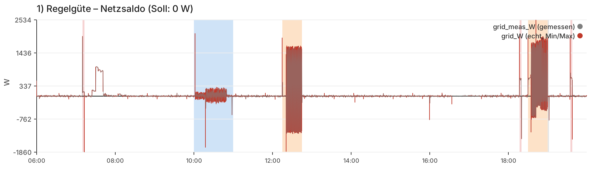
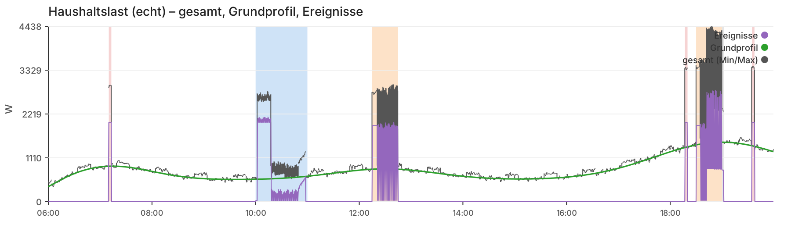
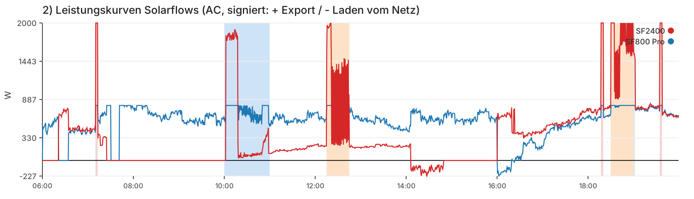
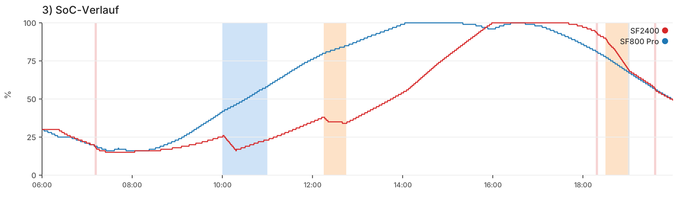

# Testumgebung Multi-Device-Controller (zdmc)

Stand: 18.10.2026 · Controller-Version im Test: 5.2.0

Diese Testumgebung lässt das echte Controller-Skript (`zdmc_test.js`) gegen einen simulierten Stromzähler und zwei simulierte Zendure-Geräte laufen. Die Simulation reagiert auf das, was der Controller schreibt (geschlossener Regelkreis). Ein Testtag von 14 Stunden läuft in etwa 6–12 Minuten durch.

---

## Fazit: Regelung 5.2.0 im Simulator (Entwurf)

Grundlage:
- Damping-Matrix 2: 15 Läufe, 3 s Geräteverzögerung
- Damping-Matrix 3: 12 Läufe (dampingFactor 0.4–0.8), zusätzlich Anlauf aus Standby (`START_DELAY_S=4`) und Kaffeevollautomat, ausgewertet mit `SAT_TOL_W=13`
- Beispiel-Report (Abschnitt 8.2)
- zwei echte Tageslogs (11.10. mit 5.1.7, 15.10.)

### Regelgüte (qualitativ)
- **Stabil:** In keinem der 15 Läufe hat sich die Regelung aufgeschaukelt, bei keinem Damping-Wert von 0.4 bis 0.8. Der Controller rechnet vom Ist-Wert der Geräte aus, nicht vom alten Sollwert.
- **Ruhige Phasen:** Der Netzwert liegt meist eng um 0 W, Abweichungen über 50 W sind selten (Matrix 3: 0,8–1,1 % der Zyklen, an allen Testtagen gleich). Das gilt trotz eines bewusst unruhigen Haushalts.
- **Damping verschiebt, statt zu verschlechtern:** Höheres Damping regelt schneller nach, verschiebt die Abweichung aber von Bezug zu Export und braucht mehr Schreibvorgänge. Bezug + Export bleiben fast gleich.
- **Reihenfolge der Damping-Werte stabil:** In Matrix 3 steigt der Anteil im Band von 0.4 bis 0.8 an jedem Testtag, über den ganzen Tag und in ruhigen Phasen (Median: 57,7 → 61,7 → 64,6 → 67,3 %).
- **Sättigung (Matrix 3: 6–7 %)** entsteht an Kapazitätsgrenzen: morgens minSoc, abends maximale Abgabe, oder ein Gerät steht weniger als die Hysterese unter seinem Maximum, während das andere leer ist. Das ist kein Regelfehler.

### Zeitverhalten
- **Reaktion der Geräte realistisch nachgebildet:** 4-s-Takt, Schreiblaufzeit 1 s, Rampe 3 s und Anlauf aus dem Standby (+1 Takt). Beides ist an echten Logs überprüft.
- **Schnelle Flanke wirkt:** Bei großem Lastabfall reagiert der Controller sofort mit Faktor 0.9. Der Export danach ist kurz und bei allen Damping-Werten gleich.
- **Anlauf aus Standby und Kaffeevollautomat (Matrix 3 gegen Matrix 2):** Netzbezug +0,13 bis +0,20 kWh (der Kaffeevollautomat allein bringt 0,15 kWh Last am Tag), Export gleich, Schreibvorgänge leicht weniger (−65 bis −138).
- **Robust:** Matrix 2: 0 Fehler in 15 Läufen. Matrix 3: alle 12 Läufe vollständig (Exit 0). Übersprungene Takte kommen vom beschleunigten Test, nicht vom Regler.

### Ausreißer: Wo die Regelung an Grenzen kommt

| Situation | Verhalten | Ursache |
|---|---|---|
| Taktende Induktion | Saldo springt um ±1–1,5 kW, unter 10 % im Band | Die Last wechselt alle 8–12 s, ähnlich schnell wie Messen (4 s) plus Reaktion. Kein Damping-Wert hilft. |
| Waschmaschine, Motorphase | Saldo schwankt um etwa ±200 W | schnell wechselnde Trommellast |
| Wasserkocher, Kaffeevollautomat | 1–2 Takte Spitze am Anfang (Bezug) und am Ende (Export) | Sprung wird erst im nächsten Takt gesehen |
| Lasten über der maximalen Abgabe | dauerhafter Bezug | Kapazitätsgrenze |
| Akkus leer (minSoc) | Bezug in Höhe der Hauslast | Entladesperre, gewollt |

### Was noch
- **Lastverteilung und Ausgleich funktionieren.** Ein Gerät deckt kleine Lasten allein, bei großen Lasten liefern beide. Die SoC-Werte gleichen sich über den Tag an.
- **Volle Akkus:** Ist ein Gerät voll, nimmt das andere den PV-Überschuss über AC auf. Das Netz bleibt bei 0 W.

### Empfehlung und Spielen für `dampingFactor`

| Situation | Empfohlener Wert |
| --- | --- |
| Standard (`gridSource: "local"`, `interval` 4000 ms) | **0,6–0,7**, Default `0.65` |
| `gridSource: "remote"` oder `"http_json"`, oder 3 und mehr Geräte | **0,5–0,6** |
| `interval` 3000 ms | **0,6** |

**Über 0,7 lohnt sich selten.** In der Simulation verbessert 0,8 gegenüber
0,65 die Regelgüte nur wenig (+2,7 Prozentpunkte im Band ±13 W). Die
Energiebilanz (Bezug + Export) wird nicht besser, die Zahl der
Schreibvorgänge steigt um rund 14 %. Bei schnell taktenden Lasten
(Induktion) hilft ein höherer Wert gar nicht. Schnelle Reaktion auf
Lastabwurf liefert seit 5.1.8 ohnehin die schnelle Flanke (`JUMP_FACTOR`),
nicht ein hoher `dampingFactor`.

Grundlage ist eine Simulation mit 4 s Takt, 1 s Schreiblaufzeit, 3 s Rampe
und zusätzlicher Anlaufzeit, wenn ein Gerät aus dem Standby startet (siehe
[Changelog](CHANGELOG.md) 5.1.8 und 5.2.0 sowie
[Damping/Simulation](Damping_Kompromiss.md)). Bei `remote` und `http_json`
kommt der Messwert mit zusätzlicher Verzögerung an, bei mehreren Geräten
dauert ein Zyklus länger. In beiden Fällen ist der Regelkreis träger, und
eine stärkere Dämpfung verhindert Überschwingen.

🧮 **Selbst ausprobieren:** Im [Damping-Kompromiss](damping_kompromiss.html)
stellst du ein, was dir wichtig ist: gute Regelung, wenig Export, wenig
Netzbezug oder wenige Schreibvorgänge. Die Seite zeigt, welcher Wert in der
Simulation am besten dazu passt. Sie rechnet mit einem simulierten, bewusst
unruhigen Haushalt (2 Geräte, `http_json`, 4 s Takt) und zeigt, wie sich die
Werte untereinander verhalten. Die Tabelle oben bleibt der Ausgangspunkt für
die eigene Anlage.

---

## 1. Überblick

```
matrix_damping.cmd ──► matrix.js ──┬─► run_test.js (Lauf 1) ──► mock_server.js  (Zähler + 2 Geräte)
   (optional)                      ├─► run_test.js (Lauf 2)      shelly_shim.js  (Shelly-Nachbildung)
                                   └─► ...                       zdmc_test.js    (Controller)
                                                                      │
14hlauf0600*.cmd ──► run_test.js ─────────────────────────────────────┤
                                                                      ▼
                                                    closed_loop_result.csv + Log
                                                                      │
                                                     generate_charts.js ──► report.html
                                                     matrix.js         ──► matrix_ergebnis.md
```

- **Einzellauf:** ein Testtag mit festen Einstellungen. Start über `14hlauf0600.cmd` (ohne Rauschen) oder `14hlauf0600_rauschen.cmd` (mit Rauschen).
- **Matrix:** mehrere Testtage mit verschiedenen `dampingFactor`-Werten und Seeds. Start über `matrix_damping.cmd`. Ergebnis ist eine Vergleichstabelle.

---

## 2. Benötigte Dateien

Alle Dateien liegen im selben Ordner.

| Datei | Zweck | Muss man anpassen? |
|---|---|---|
| `zdmc_test.js` | Das Controller-Skript, das getestet wird: echtes Skript mit dem CONFIG-Block aus `testconfig.js` | ja, bei jeder neuen Version (siehe Abschnitt 4.1) |
| `testconfig.js` | Der CONFIG-Block für den Test (Mock-Adressen, feste Testwerte). Vorlage, aus der `zdmc_test.js` entsteht (siehe 4.1) | nur wenn sich Testwerte oder CONFIG-Einträge ändern |
| `minify_patch_start.cmd` | Baut `zdmc_test.js` aus dem aktuellen Quellcode und startet danach den Einzellauf (siehe 4.1) | Pfad zum Quellcode, ggf. welche .cmd am Ende startet |
| `minify_keep_config.py` | Verkleinert das Skript mit Terser (nur Kommentare und Leerraum weg), lässt den CONFIG-Block Byte für Byte unverändert, prüft das Ergebnis | nein |
| `swap_config.py` | Ersetzt den CONFIG-Block eines Skripts durch einen anderen (hier aus `testconfig.js`), Rest bleibt unverändert | nein |
| `shelly_shim.js` | Bildet die Shelly-Funktionen nach (`Shelly.call`, `Timer.set`, `print`, KVS als leere Antwort) und beschleunigt den Regeltakt | nein |
| `mock_server.js` | Simuliert Stromzähler, zwei Geräte, Haushaltslast, PV und das Rauschmodell | nein, Einstellung über Umgebungsvariablen |
| `run_test.js` | Runner: startet Mock und Controller, zählt die Zyklen, schreibt die CSV | nein, Einstellung über Umgebungsvariablen |
| `generate_charts.js` | Erzeugt aus der CSV den HTML-Report | nein |
| `matrix.js` | Startet viele Läufe (Damping × Seed) und wertet sie aus | nein, Einstellung über Umgebungsvariablen |
| `szenario_werktag.json` | Beschreibt den Testtag: Rauschen, Kühlschrank, Ereignisse | ja, wenn ein anderer Tag getestet werden soll |
| `14hlauf0600.cmd` | Einzellauf ohne Rauschen | Werte bei Bedarf |
| `14hlauf0600_rauschen.cmd` | Einzellauf mit Rauschen | Werte bei Bedarf |
| `matrix_damping.cmd` | Damping-Matrix | Werte bei Bedarf |
| `doku/` | Beispiel-Report (`beispiel_report.html`) und die Bilder für Abschnitt 8.2. Nur für die Doku, für den Test nicht nötig | nein |

Voraussetzungen:
- **Node.js** für Mock, Runner, Matrix und Report. Dafür werden keine npm-Pakete gebraucht.
- **Python 3** und **npx/Terser** nur zum Bauen von `zdmc_test.js` (siehe 4.1). Terser wird über `npx terser` aufgerufen und beim ersten Mal von npm geladen, falls er nicht installiert ist.

---

## 3. Was in den Dateien steht

### mock_server.js

**Netzzähler** (`/grid/properties/report`): liefert `{"total_power": W}`. Plus = Bezug, Minus = Einspeisung.

**Zwei Geräte** (`/dev0/...`, `/dev1/...`): liefern einen Report wie ein Zendure-Gerät (`electricLevel`, `socLimit`, `gridReverse`, `acMode`, `outputHomePower`, `gridInputPower` …) und nehmen Schreibbefehle an (`acMode`, `outputLimit`, `inputLimit`, `smartMode`, `minSoc`, `socSet`, `gridReverse`).

| Mock-Gerät | Seriennummer | Akku | PV | Im Controller | In der CSV |
|---|---|---|---|---|---|
| dev0 | MOCKSN-SF800 | 4 kWh | bis 1.400 W, 07:00–17:00, Spitze 10:00 | `[dev0]` „SF2400“, maxOutput 800 W | Spalten `*_sf800` |
| dev1 | MOCKSN-SF2400 | 4 kWh | bis 900 W, 08:00–19:00, Spitze 15:00 | `[dev1]` „Fatamorgana“, maxOutput 2.000 W | Spalten `*_sf2400` |

Die Namen passen nicht zusammen. Die CSV-Spalte `sf800` gehört zum Controller-Gerät „SF2400“. Das ist historisch so gewachsen.

**Physik je Schritt:**
- PV lädt den Akku direkt, bis maxSoc.
- Der Akku liefert oder lädt, was der Controller vorgibt, solange minSoc/maxSoc das erlauben.
- Ist der Akku voll, wird der PV-Überschuss durchgereicht (Bypass). Ins Netz geht er nur bei `gridReverse = 1`.
- Optional erreicht ein Gerät eine neue Vorgabe erst nach einer Verzögerung (`DEVICE_DELAY_S`, siehe 4.3).
- `socLimit` meldet der Mock so: 1 bei SoC ≥ maxSoc, 2 bei SoC ≤ minSoc, sonst 0.
- minSoc und maxSoc schreibt der Controller beim Start selbst auf die Geräte.

**Zeit:** Der Mock rechnet pro Zyklus `STEP_MIN` Minuten weiter. Ein neuer Zyklus beginnt, wenn ein Endpunkt zum zweiten Mal abgefragt wird. Die Reihenfolge der Abfragen ist daher egal, und Geräte und Zähler zeigen immer denselben Zustand.

**Haushaltslast:** Grundprofil mit Morgen-, Mittags- und Abendspitze. Mit Rauschmodell kommen Rauschen, Kühlschrank und Ereignisse dazu (siehe Abschnitt 5).

### run_test.js

- Startet den Mock (im selben Prozess) und nach 0,5 s das Controller-Skript über `shelly_shim.js`.
- Wartet, bis der Mock `CYCLES` Zyklen geloggt hat, und schreibt dann `closed_loop_result.csv`.
- Bricht ab, wenn 20 s lang kein Zyklus mehr kommt oder das Sicherheitslimit erreicht ist.
- Mit `DAMPING` und/oder `MOCK_PORT` legt er eine angepasste Kopie `zdmc_run.js` an. Das Original bleibt unverändert.

### shelly_shim.js

- Führt `zdmc_test.js` in einer abgeschlossenen Node-Umgebung aus.
- `Shelly.call` mit `HTTP.GET`/`HTTP.Request` wird zu echten HTTP-Aufrufen an den Mock (wiederverwendete Verbindung, Timeout aus dem Skript).
- `KVS.GetMany`/`KVS.Set` antworten leer bzw. mit Erfolg.
- **Timer:** Nur wiederkehrende Timer (der Regeltakt) werden beschleunigt: `Intervall / SPEED_FACTOR`, mindestens `MIN_REAL_MS`. **Einmal-Timer laufen in echter Zeit**, also der Watchdog (10 s), `Timer.set(0, …)` und die Banner-Verzögerung.

### generate_charts.js

Erzeugt `report.html` mit Kennzahlen und Diagrammen (siehe Abschnitt 8).

### matrix.js

Startet für jede Kombination aus `DAMPINGS` × `SEEDS` einen eigenen Lauf (eigener Prozess, eigener Port, eigener Ordner), mehrere gleichzeitig. Am Ende wertet es alle CSVs aus.

### szenario_werktag.json

Beschreibt Rauschen und Ereignisse des Testtags (Aufbau siehe Abschnitt 5).

---

## 4. Was man anpassen muss

### 4.1 Neue Controller-Version in den Test übernehmen

`testconfig.js` enthält den kompletten CONFIG-Block für den Test (`let CONFIG = { ... };`). Damit laufen alle Versionen mit denselben Testwerten und bleiben vergleichbar.

**Normaler Weg: `minify_patch_start.cmd`**

```
python3 minify_keep_config.py D:\Uspace\git\Zendure-Stuff\shelly_script\Controller\zerooutput_multi_kvs_src.js zerooutput_multi_kvs_mini.js
python3 swap_config.py zerooutput_multi_kvs_mini.js --config-from testconfig.js -o zdmc_test.js
14hlauf0600.cmd
```

1. **Verkleinern:** `minify_keep_config.py` macht aus dem Quellcode im Git-Checkout die Mini-Version `zerooutput_multi_kvs_mini.js`, genau wie für den Shelly.
   - Den CONFIG-Block findet es über `let CONFIG = {` am Zeilenanfang und Klammerzählung. Er bleibt Byte für Byte erhalten, inklusive Kommentaren.
   - Alles davor und danach geht durch Terser (`--ecma 5`, ohne compress/mangle): Es fallen nur Kommentare und Leerraum weg, Namen bleiben.
   - Danach prüft es selbst: keine `=>`, keine Template-Strings, gleiche Anzahl `function` und `let`, Gesamtdatei syntaktisch gültig. Schlägt eine Prüfung fehl, steht `ACHTUNG: mindestens eine Verifikation ist fehlgeschlagen` da, und das Skript endet mit Code 2.
2. **CONFIG tauschen:** `swap_config.py` sucht in der Mini-Version den Block `let CONFIG = { … };` (beachtet dabei Kommentare und Strings) und ersetzt ihn durch den Block aus `testconfig.js`. Der Rest bleibt unverändert, die Zeilenenden passt es an. Ergebnis ist `zdmc_test.js`.
   - Mit `--check` statt `-o` zeigt es nur an, was es tun würde.
   - **Warnung „Platzhalter uebrig“** bei `gridSourceIp` und `webhookUrl` ist im Test harmlos. Diese Einträge werden mit `gridSource: "http_json"` und `signal.enabled: false` nicht benutzt.
3. **Testlauf:** Am Ende startet `14hlauf0600.cmd` (Einzellauf ohne Rauschen). Für einen Lauf mit Rauschen oder die Matrix stattdessen `14hlauf0600_rauschen.cmd` bzw. `matrix_damping.cmd` eintragen oder nach dem Bauen selbst starten.

Nach jedem `Pause` kann man die Ausgabe prüfen, bevor es weitergeht. Getestet wird so genau der Code, der auch auf den Shelly kommt (Mini-Version), nur mit Test-CONFIG.

**Bei einer neuen Version zusätzlich prüfen:**
- Hat die neue Version **neue CONFIG-Einträge**? Diese in `testconfig.js` nachtragen, sonst fehlen sie im Test. Einträge, die der Code selbst setzt (z. B. `watchdog`, `dischargeFixed`, `dischargeResetMargin`, `standbyHoldCycles`), gehören nicht hinein.
- Nach dem ersten Lauf das Banner im Log prüfen: Version, Damping, Intervall.

**Ohne die Python-Skripte** geht es auch von Hand: Skript als `zdmc_test.js` ablegen und den CONFIG-Block (von `let CONFIG = {` bis zum zugehörigen `};`) durch den Inhalt von `testconfig.js` ersetzen.

Hinweis: Das frühere Werkzeug `patch_for_mock.js` wird nicht mehr benutzt. Der Kommentar „automatisch auf Mock umgebogen (patch_for_mock.js)“ bei `gridSource` in `testconfig.js` stammt noch daher und hat keine Wirkung.

Beim Start korrigiert der Controller manche Werte auf seine Mindestwerte. Mit dem Stand von `testconfig.js` (17.10.2026) wirken `directionChangeHoldCycles` als 4 (eingetragen 2) und `chargeResetMargin` als 10 (eingetragen 5). Maßgeblich ist, was das Banner zeigt.

In `testconfig.js` müssen diese Test-Einstellungen stehen:

| Eintrag | Wert im Test | Warum |
|---|---|---|
| `devices[0].ip` | `"localhost:3900/dev0"` | Mock-Gerät 0 |
| `devices[1].ip` | `"localhost:3900/dev1"` | Mock-Gerät 1 |
| `gridSource` | `"http_json"` | Zähler kommt vom Mock |
| `gridSourceUrl` | `"http://localhost:3900/grid/properties/report"` | |
| `gridSourceField` | `"total_power"` | Feldname im Mock |
| `gridSourceInvert` | `false` | |
| `kvsEnabled` | `false` | kein KVS in der Nachbildung |
| `signal.enabled` | `false` | keine Nachrichten |

Den Port `3900` nicht ändern. Für parallele Läufe ersetzt der Runner ihn selbst.

Alle anderen Werte (Damping, Hysterese, Schwellen, minSoc …) sind das, was getestet wird. Die kannst du frei wählen.

### 4.2 Intervall und Simulationsschritt abstimmen

Der Controller nimmt sein Intervall aus `zdmc_test.js` (`interval`). Der Mock muss pro Zyklus genau so viel Zeit simulieren:

```
STEP_MIN = interval in ms / 60000
```

| `interval` im Skript | `INTERVAL_MS` | `STEP_MIN` |
|---|---|---|
| 3000 | 3000 | 0.05 |
| 4000 | 4000 | 0.0666667 |
| 5000 | 5000 | 0.0833333 |

`INTERVAL_MS` braucht der Runner nur für die Zeitabschätzung. Der Mock vergleicht damit und meldet beim Start einen Hinweis, wenn `STEP_MIN` nicht passt.

Takte für einen Zeitraum: `CYCLES = Stunden × 3600 / Intervall in s`. Beispiel 06:00–20:00 bei 4 s: 14 × 3600 / 4 = **12.600**.

### 4.3 Umgebungsvariablen

Gesetzt werden sie in den .cmd-Dateien mit `set NAME=Wert`.

**Runner und Mock**

| Variable | Bedeutung | Default | Empfehlung |
|---|---|---|---|
| `CYCLES` | Anzahl Zyklen | 20 | 12600 (06–20 Uhr bei 4 s) |
| `START_MIN` | Startuhrzeit in Minuten ab Mitternacht | 0 | 360 (= 06:00) |
| `STEP_MIN` | simulierte Minuten pro Zyklus | 15 | passend zu `interval` (siehe 4.2) |
| `INTERVAL_MS` | Intervall für Zeitabschätzung und Hinweis | 3000 | gleich `interval` |
| `SPEED_FACTOR` | Zeitraffer des Regeltakts | 1 | 150 (siehe 9.2) |
| `MIN_REAL_MS` | kleinster echter Taktabstand | 15 | lassen |
| `MAX_WAIT_MS` | Sicherheitslimit Laufzeit | automatisch | lassen |
| `START_SOC` | Start-SoC beider Geräte in % | 50 | 30 |
| `START_SOC_SF800` / `START_SOC_SF2400` | Start-SoC einzeln | = START_SOC | bei Bedarf |
| `LOAD_SCALE` | Faktor für das Grundprofil der Last (nicht für Ereignisse) | 1.0 | 0.5 |
| `MOCK_PORT` | Port des Mocks | 3900 | nur Matrix setzt das |
| `DAMPING` | dampingFactor für diesen Lauf (ersetzt den Wert im Skript) | – | nur Matrix oder gezielter Einzeltest |
| `OUT_DIR` | Ordner für CSV und Skriptkopie | Skriptordner | nur Matrix setzt das |

**Rauschmodell**

| Variable | Bedeutung | Default |
|---|---|---|
| `SCENARIO` | Pfad zur Szenario-Datei | – (ohne: kein Rauschen) |
| `NOISE_SEED` | Startzahl für den Zufall | 1, wenn SCENARIO gesetzt |
| `METER_NOISE_W` | überschreibt `messrauschenW` aus dem Szenario | – |
| `SUBSTEP_S` | Teilschritt für schnelle Lasten in s | 1 |

**Geräteverzögerung**

| Variable | Bedeutung | Default |
|---|---|---|
| `DEVICE_DELAY_S` | Sekunden, bis ein Gerät eine neue Vorgabe erreicht | 0 (sofort) |
| `DEVICE_RAMP` | `linear`: gleitet in dieser Zeit auf den neuen Wert · `step`: hält den alten Wert und springt dann | linear |
| `WRITE_LAG_S` | Sekunden zwischen Messung und Ankunft des Schreibbefehls am Gerät (HTTP-Laufzeit im echten Betrieb) | 0 |
| `START_DELAY_S` | Zusätzliche Sekunden, bevor ein Gerät aus dem Standby mit der Abgabe beginnt. Gilt nur für den Start der Abgabe, nicht für den Start des Ladens. Kommt während der Anlaufzeit ein neuer Befehl, läuft die Anlaufzeit weiter | 0 (aus) |
| `START_THRESH_W` | Bis zu dieser Leistung gilt ein Gerät als Standby | 5 |

Ohne diese Variablen setzt ein Gerät jede Vorgabe sofort um, und das Ergebnis ist identisch mit dem Mock ohne Verzögerung (geprüft).

**Wichtig zur Wirkung:** Der Zähler wird am Ende jedes Zyklus gemessen. Erreicht das Gerät den neuen Wert vor der nächsten Messung (`WRITE_LAG_S + DEVICE_DELAY_S` kleiner als das Intervall), sieht der Controller keinen Unterschied. Es ändern sich nur Bezug und Export **zwischen** den Messungen. Erst wenn die Summe das Intervall erreicht, sieht der Controller bei der nächsten Messung noch nicht das Ergebnis seiner Vorgabe. Realistisch für 4 s Intervall: `DEVICE_DELAY_S=3`, `WRITE_LAG_S=1`, `START_DELAY_S=4`.

**Anlauf aus Standby:** Im echten Log vom 15.10. zeigten die Geräte nach einem Start aus 0 W im nächsten Takt meist noch keine Leistung (11 von 13 Fällen), erst im übernächsten. Beim Senken der Leistung oder Erhöhen aus dem Betrieb war die Vorgabe meist schon im nächsten Takt erreicht. Mit `START_DELAY_S=4` bildet der Mock das nach: Schreiben im Takt n, im Takt n+1 noch 0 W, im Takt n+2 fast der volle Wert. Ohne `START_DELAY_S` ist das Ergebnis identisch mit der Version ohne diese Option (geprüft).

Ohne `SCENARIO` und ohne `NOISE_SEED` rechnet der Mock ohne Rauschen. Das Ergebnis ist in allen alten Spalten identisch mit dem korrigierten Mock ohne Rauschmodell.

**Matrix**

| Variable | Bedeutung | Default |
|---|---|---|
| `DAMPINGS` | Damping-Werte, mit Komma getrennt, Dezimalpunkt | 0.4,0.5,0.65,0.8,1.0 |
| `SEEDS` | Seeds, mit Komma getrennt | 1,2,3 |
| `PARALLEL` | Läufe gleichzeitig | 2 |
| `BASE_PORT` | erster Mock-Port | 3901 |
| `BAND_W` | Hystereseband der Auswertung in W | 13 |
| `MATRIX_DIR` | Ergebnisordner | Matrix-<Datum-Uhrzeit> |
| `SAT_TOL_W` | Toleranz für „Gerät am Maximum“ bei der Sättigung. Steht ein Gerät weniger als diesen Wert unter seinem Maximum, gilt es als ausgeschöpft, weil der Controller erst ab der Hysterese nachregelt | = `BAND_W` (13) |
| `NUR_AUSWERTEN` | `1` = keine Läufe starten, nur die Ordner in `MATRIX_DIR` neu auswerten. `DAMPINGS`, `SEEDS`, `CYCLES` und `STEP_MIN` wie beim Lauf setzen | leer |

`matrix.js` setzt `NOISE_SEED`, `DAMPING`, `MOCK_PORT` und `OUT_DIR` je Lauf selbst. Alle anderen Variablen reicht es an die Läufe durch.

---

## 5. Szenario-Datei

```json
{
  "name": "werktag",
  "grundrauschenW": 30,
  "grundrauschenPeriodeS": 60,
  "lastzitternW": 5,
  "messrauschenW": 8,
  "geraeteMessrauschenW": 3,
  "kuehlschrank": { "leistungW": 100, "anMin": 15, "ausMin": 30 },
  "events": [ ... ],
  "zufallsEvents": [ ... ]
}
```

| Feld | Bedeutung | Wirkt auf |
|---|---|---|
| `grundrauschenW` | Stärke der langsamen Lastschwankung (σ in W) | echte Last |
| `grundrauschenPeriodeS` | alle wie viele Sekunden ein neuer Stützwert | echte Last |
| `lastzitternW` | schnelles Zittern je Sekunde (σ in W) | echte Last |
| `messrauschenW` | Messfehler des Zählers (σ in W) | nur gemeldeter Netzwert |
| `geraeteMessrauschenW` | Messfehler der Geräteleistung (σ in W), 0 W bleibt 0 W | nur Geräte-Report |
| `kuehlschrank` | fester Takt; `null` = aus | echte Last |

**Feste Ereignisse** (`events`) wiederholen sich täglich zur angegebenen Uhrzeit:

| `typ` | Parameter | Verlauf |
|---|---|---|
| `wasserkocher` | `start`, `dauer`, `leistungW` | konstante Leistung |
| `block` | `start`, `dauer`, `leistungW` | konstante Leistung (beliebiges Gerät) |
| `kaffeevollautomat` | `start`, `dauer`, `leistungW` | konstante Leistung (wie `block`, eigener Name für Report und Auswertung) |
| `waschmaschine` | `start`, `dauer`, `heizW` | 3 % Wasser einlassen (30 W) · bis 30 % Heizen (heizW + halbe Trommel) · bis 83 % Waschen (Trommel 12 s an / 8 s aus, 150–300 W) · bis 97 % Schleudern (340 → 640 W) · Rest 5 W |
| `induktion` | `start`, `dauer`, `leistungW`, `stufe`, `periodeS` oder `stufen` | Takten zwischen 0 und leistungW (±5 %), Anteil „an“ = stufe, plus 25 W Lüfter; `stufe` 1.0 = Dauerleistung |

Mit `stufen` lässt sich die Kochstufe während des Ereignisses ändern:
```json
"stufen": [ { "abMin": 0, "stufe": 1.0 },
            { "abMin": 5, "stufe": 0.5, "periodeS": 8 } ]
```

**Zufällige Ereignisse** (`zufallsEvents`) werden je Tag aus dem Seed in ein Zeitfenster gelegt:
```json
{ "typ": "wasserkocher", "anzahlProTag": 2, "von": "14:00", "bis": "22:00", "dauer": 3, "leistungW": 2000 }
```

Im Szenario `szenario_werktag.json` stehen 3 Zufallsereignisse:

| Typ | Anzahl je Tag | Zeitfenster | Dauer | Leistung | Zweck |
|---|---|---|---|---|---|
| `wasserkocher` | 2 | 14:00–22:00 | 3 min | 2000 W | zusätzliche Lastsprünge am Nachmittag |
| `block` | 1 | 08:00–20:00 | 20 min | 800 W | mittlere Last über längere Zeit |
| `kaffeevollautomat` | 6 | 06:30–19:30 | 1 min | 1500 W | kurze große Spitzen, wie sie in echten Logs mehrmals täglich vorkommen |

Neue Zufallsereignisse immer **ans Ende** der Liste setzen. Der Zufall hängt an der Position in der Liste. So bleiben die Uhrzeiten der vorhandenen Ereignisse gleich.

Zufallsereignisse können sich überlagern, zum Beispiel ein Kaffeevollautomat während der Waschmaschine. Im Report zählt ein Zyklus dann zu dem Fenster, das in dieser Reihenfolge zuerst kommt: Waschmaschine, Induktion, Wasserkocher, Kaffeevollautomat, sonstige. In der Matrix zählt der Kaffeevollautomat allein zu „sonstige“, nicht zu „ruhig“.

Beim Start schreibt der Mock den Ereignisplan des ersten Tages ins Log:
```
[mock] Rauschmodell: an | Szenario "werktag" | Seed 42 | Teilschritt 1.00 s (4 je Schritt) | ...
[mock]   Ereignis Tag 0: waschmaschine 10:00-11:00 (60 min)
```

### Was der Seed bewirkt

Der Seed ist eine Startzahl für den Zufall. **Gleicher Seed = exakt gleicher Testtag**, egal welches Damping oder welche Controller-Version läuft.

- **Gleich bei jedem Seed:** Grundprofil, PV, feste Ereignisse mit Uhrzeit, Dauer und Leistung, Start-SoC.
- **Verschieden je Seed:**
  - Uhrzeit der Zufallsereignisse
  - Verlauf von Grundrauschen und Zittern
  - Phase des Kühlschranks
  - Phase und Leistungsschwankung des Induktionsherds
  - Trommelstöße der Waschmaschine
  - Mess- und Geräterauschen

Technisch rechnet der Mock jede Zufallszahl mit `rnd(seed, index, kanal)`. Der Index ist die Simulationszeit (Zyklus, Sekunde, Minute oder ein Zähler im Ereignis), der Kanal ein fester Name je Zweck (z. B. `"meter"`, `"zittern"`, `"f1d0:trommel"`). Es gibt keine fortlaufende Zufallsfolge. Deshalb kann der Controller die Last nicht beeinflussen, auch wenn er öfter liest oder schreibt.

---

## 6. Test starten

### 6.1 Einzellauf ohne Rauschen

1. In `14hlauf0600.cmd` prüfen: `STEP_MIN`, `INTERVAL_MS`, `CYCLES` (siehe 4.2), `SPEED_FACTOR` (z. B. 150).
2. Doppelklick auf die .cmd oder in der Eingabeaufforderung starten.
3. Ergebnis im Ordner `Test14h-<Release>-<Datum>`: `14tageslauf.log`, `closed_loop_result.csv`, `report.html`, `zdmc_test.js`.

### 6.2 Einzellauf mit Rauschen

Wie 6.1 mit `14hlauf0600_rauschen.cmd`. Zusätzlich gesetzt sind `SCENARIO` und `NOISE_SEED`. Der Ordnername enthält den Seed, und die Szenario-Datei wird mitkopiert.

### 6.3 Damping-Matrix

1. In `matrix_damping.cmd` `DAMPINGS`, `SEEDS`, `PARALLEL`, `CYCLES` und `SPEED_FACTOR` setzen.
2. Starten. Im Konsolenfenster erscheint:
   ```
   [matrix] 12 Laeufe (Damping 0.5/0.65/0.7/0.8 x Seeds 1/2/3), parallel 3 -> ...\Matrix-261017-220145
   [matrix] Start  seed 1 damping 0.5 (Port 3901)
   ...
   [matrix] Fertig seed 1 damping 0.5 nach 597 s (Exit 0)
   ```
   `Exit 0` = Lauf vollständig. Am Ende wird die Ergebnistabelle angezeigt.
3. Ergebnis im Ordner `Matrix-<Datum-Uhrzeit>`:
   - `matrix_ergebnis.md`: eine Zeile je Damping, Median über die Seeds
   - `matrix_laeufe.csv`: eine Zeile je Lauf
   - je Lauf ein Unterordner `seed<S>_damp<D>` mit `lauf.log`, `closed_loop_result.csv`, `report.html`, `zdmc_run.js`

**Dauer:** gemessen etwa 10 min je Lauf mit 12.600 Zyklen bei 3 parallelen Läufen. 12 Läufe dauern damit etwa 40 min. Ein Zyklus braucht real 30–45 ms; schneller als das wird es auch mit höherem SPEED_FACTOR nicht.

### 6.4 Kontrollen

| Wann | Was | Wo |
|---|---|---|
| Start | Version und Damping richtig | Banner im Log: `Version …`, `Damping : …` |
| Start | Rauschmodell an/aus wie gewollt | Log: `[mock] Rauschmodell: …` |
| Start | kein Hinweis auf falschen `STEP_MIN` | Log: `[mock] Hinweis: …` darf nicht erscheinen |
| Start Matrix | Damping je Lauf | `lauf.log`: `[runner] dampingFactor fuer diesen Lauf: …` |
| Ende | keine FEHLER | `findstr /S /C:"FEHLER" Matrix-…\*.log` (keine Ausgabe = gut) |
| Ende | Lauf vollständig | Log: `[runner] fertig (Zielzahl erreicht)` bzw. `Exit 0` |

---

## 7. Abgedeckte Testfälle

| Testfall | Wie im Test erzeugt | Woran erkennbar |
|---|---|---|
| Nulleinspeisung im Normalbetrieb | Grundprofil, ruhige Phasen | Netzsaldo im Band ±13 W |
| Lastspitzen morgens, mittags, abends | Grundprofil (07:12, 12:30, 19:00) | Regelgröße steigt, Netz bleibt nahe 0 |
| Konzentrieren / Verteilen (spread) | Last über 800 W bzw. unter 600 W | beide Geräte mit Soll > 0 |
| Kapazitätsgrenze eines Geräts | Last über maxOutput | Gerät auf 800 W, Wechsel auf spread |
| Entladesperre bei minSoc | Start-SoC 30 %, Morgenlast | socLimit 2, Netzbezug (Sättigung) |
| Entlade-Hysterese (minSoc + 3 %) | Wiederfreigabe nach PV-Laden | Gerät liefert erst ab minSoc + 3 % |
| PV-Laden, voller Akku | PV-Kurven | SoC → 100 %, socLimit 1 |
| Bypass bei vollem Akku | PV-Überschuss bei socLimit 1 | Einspeisung bei gridReverse 1 (gewollt) |
| Bypass-Korrektur | ein Gerät voll, eines regelt | Log: `Bypass-Korrektur …` |
| gridReverse dynamic | beide Geräte voll | Log: `gridReverse=2 gesetzt`, später `=1` |
| Richtungswechsel-Bremse | Wechsel Laden ↔ Entladen | Log: `[Cooldown haelt Standby]` |
| SoC-Ausgleich | SoC-Unterschied ≥ socMargin | Log: `Ausgleich -> …` |
| Messrauschen | `messrauschenW`, `geraeteMessrauschenW` | Schreibvorgänge, Band im ruhigen Fenster |
| Langsame Lastschwankung | `grundrauschenW` | Band im ruhigen Fenster |
| Großer Lastsprung | Wasserkocher 2.000 W | Spitze und Ausregelzeit |
| Lange Last mit Pulsen | Waschmaschine 60 min | Fenster „waschmaschine“ |
| Schnell taktende Last | Induktionsherd 8/12/20 s | Fenster „induktion“, Zickzack |
| Wiederholbarkeit | gleicher Seed zweimal | CSV identisch |
| Damping-Vergleich | Matrix | `matrix_ergebnis.md` |

**Nicht abgedeckt** (Stand heute):
- **Störungen:** Gerät nicht erreichbar, langsame Antwort, Schreibfehler, Zählerausfall. Geplant als eigener Robustheitstest mit Störungen im Szenario.
- **Verzögerung der Geräte:** ist als Option vorhanden (`DEVICE_DELAY_S`, `WRITE_LAG_S`, `START_DELAY_S`, siehe 4.3), aber standardmäßig aus. Für realistische Damping-Vergleiche einschalten.
- **Hysterese von socLimit 1:** Der Mock nimmt socLimit 1 sofort zurück, wenn der SoC minimal unter 100 % fällt. Ob echte Geräte hier eine Hysterese haben, ist nicht bekannt. Im Log erscheinen dadurch mehrfache Wechsel 0 ↔ 1.
- **Sparmodus (idleSkip), KVS, Nachrichten:** im Test-CONFIG ausgeschaltet.
- **Wolken / PV-Schwankungen:** Die PV-Kurven sind glatt.
- **Mehrtägige Läufe:** möglich (Ereignisse wiederholen sich täglich), aber bisher nicht genutzt.

---

## 8. Was der Report zeigt

### 8.1 report.html (je Lauf)

**Kopfzeile:**
- Zyklen, simulierte Zeitspanne, Seed
- mittlerer Betrag des Netzsaldos
- Anteil der Zeit innerhalb ±30 W und innerhalb ±13 W (`BAND_W`)

**Tabelle der Zeitfenster** (nur mit Rauschen): je Fenster (ruhig, Waschmaschine, Induktion, Wasserkocher, sonstige) Zyklen, mittlerer Betrag des Netzsaldos, Anteil im Band und Anteil über 50 W. Daran sieht man, wo der Regler gut ist und wo nicht.

**Diagramme:**

| Diagramm | Inhalt | Worauf achten |
|---|---|---|
| 1) Regelgüte | Netzsaldo `grid_W` (rot, echter Wert), bei langen Läufen als Min/Max je Bildpunkt; grau der gemessene Wert mit Rauschen; grün das Band ±13 W | Ausschläge außerhalb des Bandes, Zickzack |
| Haushaltslast (nur mit Rauschen) | Gesamtlast, Grundprofil (grün), Ereignislast (lila) | welche Last der Regler gerade ausgleichen muss |
| 2) Leistungskurven | Ausgabe je Gerät, + Export / − Laden vom Netz | Verteilung, Kapazitätsgrenzen, Laden |
| 3) SoC-Verlauf | SoC je Gerät | minSoc-Sperren, Vollladung |

Farbige Hintergrundflächen zeigen die Ereignisfenster (Waschmaschine blau, Induktion orange, Wasserkocher rot, sonstige grau).

Bitte beachten: Die Legende „SF800 Pro / SF2400“ folgt den Mock-Namen (siehe Abschnitt 3).

### 8.2 Beispiel: ein typischer Lauf erklärt

Vollständiger Report: [doku/beispiel_report.html](doku/beispiel_report.html) (im Browser öffnen).

Lauf: Matrix-261017-225429, Seed 2, dampingFactor 0.4, 12600 Zyklen (06:00–20:00), Start-SoC 30 %, `DEVICE_DELAY_S` 3, `WRITE_LAG_S` 1.

Farben in allen Diagrammen: **blau** = SF800 Pro (dev0, max. 800 W), **rot** = SF2400 (dev1, max. 2000 W). Hintergrund: Waschmaschine blau, Induktion orange, Wasserkocher rot, sonstige grau.

**Kopfzeile und Tabelle**

| Zeitfenster | Zyklen | mittl. \|Netz\| | im Band ±13 W | > 50 W |
|---|---|---|---|---|
| ruhig | 10633 | 28.3 W | 64.2 % | 3.9 % |
| waschmaschine | 900 | 101.6 W | 12.3 % | 63.8 % |
| induktion | 900 | 1002.8 W | 6.8 % | 87.4 % |
| wasserkocher | 135 | 505.3 W | 0.0 % | 100.0 % |
| sonstige | 32 | 26.9 W | 59.4 % | 6.3 % |

- Über den ganzen Tag: 55.7 % der Zeit im Band ±13 W, 80.5 % innerhalb ±30 W.
- Die Zeile **ruhig** zeigt die Regelgüte ohne große Verbraucher. Sie ist die wichtigste Zeile für den Vergleich von Damping-Werten.
- Die Ereigniszeilen zeigen, wie gut der Regler schnellen Laständerungen folgt.

**Diagramm 1: Regelgüte (Netzsaldo)**



- Rot ist der echte Netzwert, als Min/Max-Hülle. Grau ist der Wert, den der Regler misst (mit Messrauschen). Die schwarze Linie ist 0 W.
- **Ruhige Zeiten:** Die Linie liegt eng um 0 W. Das ist der Normalfall.
- **Spitzen am Anfang eines Ereignisses** (07:10, 10:00, 12:15, 18:18): Die Last springt hoch. Der Regler braucht einige Takte, bis die Geräte nachgezogen haben. So lange wird Strom aus dem Netz bezogen (positiv).
- **Spitzen am Ende eines Ereignisses** (z. B. 07:12, nach unten): Die Last fällt weg, die Geräte liefern noch die alte Leistung. Kurz wird ins Netz eingespeist (negativ).
- **07:25–07:40:** Bezug von etwa 900 W. Beide Geräte stehen auf minSoc (Diagramm 3) und geben nichts ab. Das ist eine Kapazitätsgrenze, kein Regelfehler.
- **Waschmaschine 10:00–11:00:** In der Heizphase (2000 W) gleichen die Geräte gut aus. In der Motorphase schwankt das Saldo um etwa ±200 W.
- **Induktion 12:15 und 18:30:** Das Kochfeld taktet im Abstand von wenigen Sekunden zwischen hoher und niedriger Leistung. Der Regler misst alle 4 s, die Geräte reagieren 3 s später. Der Regler kann diesem Takt nicht folgen, das Saldo springt zwischen etwa −1300 W und +1600 W. Am Abend erreichen die Geräte zusätzlich ihre maximale Ausgabe (Diagramm 2).

**Haushaltslast**



- Grün ist das Grundprofil, lila sind die Ereignisse, dunkelgrau die Gesamtlast mit Rauschen und Kühlschrank.
- Das Diagramm zeigt, welche Last der Regler gerade ausgleichen muss. Es hängt nur von Szenario und Seed ab, nicht vom Regler.

**Diagramm 2: Leistung je Gerät**



- Positiv: Das Gerät gibt Leistung ins Haus ab. Negativ: Das Gerät lädt über AC.
- **Vormittag ab etwa 07:40:** Das SF800 Pro (blau) deckt den Grundbedarf. Das SF2400 (rot) springt nur bei Ereignissen ein. Das ist der Modus concentrate.
- **Flache Linien bei 800 W (blau) und 2000 W (rot):** Das Gerät ist an seiner maximalen Ausgabe.
- **Ab 14:00:** Das SF800 Pro ist voll (Diagramm 3) und gibt seinen PV-Überschuss ab. Das SF2400 nimmt ihn über AC auf (negativ). Das Netzsaldo bleibt bei 0 W.
- **Ab 16:00:** Umgekehrt. Das SF2400 ist voll, das SF800 Pro lädt kurz über AC.
- **Ab etwa 17:00:** Beide Geräte geben fast gleich viel ab. Das ist der Modus spread.

**Diagramm 3: SoC-Verlauf**



- Morgens fallen beide Geräte bis minSoc 15 %. Danach laden sie mit PV.
- Das SF800 Pro hat mehr PV und ist um 14:00 voll, das SF2400 um 16:15.
- Bei der Waschmaschine fällt der SoC des SF2400 kurz, weil es den großen Teil der Last trägt.
- Ab dem Nachmittag entladen beide. Gegen Abend liegen sie fast gleichauf. Der Regler gleicht die SoC-Werte an (`rebalance.socMargin`).

### 8.3 matrix_ergebnis.md

Eine Zeile je Damping-Wert, jeweils Median über die Seeds:

| Spalte | Bedeutung |
|---|---|
| Median | mittlere echte Netzabweichung, nahe 0 W = gut |
| im Band / 13–50 W / > 50 W | Anteil der Zyklen nach Betrag der Abweichung, **ohne** gesättigte Zyklen |
| Sättigung | Anteil der Zyklen, in denen kein Gerät mehr helfen konnte |
| Bezug kWh / Export kWh | Energie über den Lauf (aus `grid_mittel_W`) |
| Schreibvorgänge | Zahl der „Leistung gesetzt“ im Log (Flash- und Funklast) |
| Band ruhig / Waschm. / Induktion | Anteil im Band nur in diesen Zeitfenstern |

**Gesättigt** heißt:
- **Bezug,** obwohl jedes Gerät gesperrt (socLimit 2), am Maximum oder in der Entlade-Hysterese ist (still, SoC < minSoc + 3 %), oder
- **Export,** obwohl jedes Gerät voll (socLimit 1 oder SoC ≥ maxSoc) oder am maximalen Laden ist.

„Am Maximum“ heißt: weniger als `SAT_TOL_W` (Standard 13 W) unter maxOutput bzw. maxInputPower. Die letzten Watt unterhalb der Hysterese regelt der Controller nicht mehr nach. Bis 18.10.2026 lag die Grenze bei 1 W. Dadurch wurden z. B. bei Testtag 3 von 07:44 bis 07:59 Zyklen als Ausreißer gezählt, in denen ein Gerät bei 791 von 800 W stand und das andere leer war. Ältere Matrix-Ordner lassen sich mit `NUR_AUSWERTEN=1` neu auswerten.

Diese Abweichungen kann kein Regler beheben. Deshalb werden die Bänder ohne sie berechnet. Die Entlade-Hysterese steht nicht in der CSV und wird deshalb näherungsweise erkannt.

**So liest man die Tabelle:** Ein guter Damping-Wert hat viel „im Band“, wenig „> 50 W“, wenig Bezug und Export **und** wenige Schreibvorgänge. Diese Ziele widersprechen sich teilweise: Ein schnellerer Regler hält das Band besser, schreibt aber öfter. Die Fenster „Induktion“ und „Waschmaschine“ zeigen, wie der Regler mit schnellen Lasten umgeht.

### 8.4 Wichtige CSV-Spalten

| Spalte | Bedeutung |
|---|---|
| `t`, `minute`, `step` | Uhrzeit, Simulationsminute, Zyklusnummer |
| `grid_W` | **echter** Netzsaldo am Messzeitpunkt (Grundlage der Regelgüte) |
| `grid_meas_W` | an den Controller gemeldeter Wert (mit Messrauschen) |
| `grid_mittel_W` | Mittelwert über den Zyklus (für Energie) |
| `haushalt_W`, `haushalt_mittel_W` | Haushaltslast Momentanwert / Mittelwert |
| `last_basis_W`, `last_rauschen_W`, `last_kuehl_W`, `last_events_W` | Bestandteile der Last |
| `event` | aktive Ereignisse, z. B. `induktion+wasserkocher` |
| `soc_*`, `socLimit_*`, `gridReverse_*` | Zustand je Gerät |
| `ist_sf800`, `ist_sf2400` | tatsächliche AC-Leistung je Gerät am Zyklusende (+ Export, − Laden), bei Verzögerung abweichend von `out_*`/`in_*` |
| `acMode_*`, `out_*`, `in_*` | zuletzt geschriebene Vorgabe je Gerät |
| `pv_*`, `ueberschuss_*`, `bypass_*`, `verworfen_*` | PV, Überschuss, durchgereichter und verworfener Überschuss |
| `seed` | Seed des Laufs (leer ohne Rauschen) |

---

## 9. Hinweise und bekannte Stolpersteine

### 9.1 Wiederholbarkeit

Gleicher Seed, gleiche Einstellungen und gleiche Controller-Version ergeben eine identische CSV. Das wurde geprüft: SPEED 150 gegen 130 und 16.800 gegen 12.600 Zyklen, jeweils 0 Unterschiede in den gemeinsamen Zeilen. Wer Ergebnisse vergleichen will, ändert nur **einen** Wert.

### 9.2 SPEED_FACTOR, übersprungene Takte und Watchdog

- Die Shim beschleunigt **nur den Regeltakt**: Takt = Intervall / SPEED_FACTOR, mindestens 15 ms (`MIN_REAL_MS`). Über SPEED 267 (bei 4 s) ändert sich daher nichts mehr.
- Ein Zyklus braucht real etwa 30–45 ms (HTTP zum Mock). Ist der Takt kürzer, erscheint **„Takt übersprungen“**. Das ist harmlos: Der Mock zählt Zyklen, nicht Zeit, und das Ergebnis bleibt identisch (geprüft: SPEED 150 gegen 130, 0 Unterschiede).
- Der **Watchdog** (2,5 × Intervall = 10 s) läuft in **echter Zeit**. Er schlägt nur an, wenn ein Zyklus wirklich 10 s hängt, nicht wegen eines hohen SPEED_FACTOR.
- **Empfehlung:** SPEED_FACTOR 150. Ein höherer Wert bringt kaum Zeitgewinn, weil die Zyklen selbst die Grenze sind.
- Übersprungene Takte testen **nicht** das Fehlerverhalten des Reglers. Im Mock läuft während eines übersprungenen Takts keine Zeit weiter. Das gehört in einen eigenen Robustheitstest.
- Hinweis für diesen Robustheitstest: Weil der Watchdog in echter Zeit läuft, muss eine simulierte Störung real länger als 10 s dauern, um ihn auszulösen. Auf die Simulation umgerechnet sind 10 s bei SPEED 150 rund 25 min.

### 9.3 Häufige Fehler

| Symptom | Ursache | Abhilfe |
|---|---|---|
| Log zeigt `Rauschmodell: aus`, obwohl gewollt | `SCENARIO` nicht gesetzt oder Datei nicht im Ordner | Variable und Dateiname prüfen |
| `[mock] Hinweis: Simulationsschritt … weicht ab` | `STEP_MIN` passt nicht zu `interval` | Tabelle in 4.2 |
| Ereignisse fehlen im Lauf | liegen nach dem Laufende (z. B. Zufallsereignisse nach 20:00) | `CYCLES` erhöhen oder anderen Seed nehmen |
| Lauf viel länger als erwartet | Tippfehler in `CYCLES` (z. B. 126800) | Wert prüfen |
| `npx wurde nicht gefunden` beim Bauen | Node.js/npm nicht installiert oder nicht im PATH | Node.js installieren, neue Konsole öffnen |
| `ACHTUNG: mindestens eine Verifikation ist fehlgeschlagen` | Terser hat etwas verändert, das er nicht soll, oder der Quellcode nutzt `=>`/Template-Strings | Ausgabe der Verifikation lesen, Quellcode prüfen |
| `Kein 'let CONFIG = {' gefunden` | CONFIG-Block nicht am Zeilenanfang oder anders geschrieben | Schreibweise `let CONFIG = {` am Zeilenanfang einhalten |
| `FEHLER (System/watchdog)` | ein Zyklus hing real länger als 10 s (Mock hängt, Rechner überlastet, Ruhezustand) | Log prüfen, Lauf wiederholen |
| Netzsaldo schwingt stark hin und her (Zickzack) ohne Ereignisse | alter Mock, der die Zeit am Netz-Poll weiterrechnet | aktuellen `mock_server.js` verwenden |
| Matrix: falsche Bezug/Export-Werte | `STEP_MIN` in der .cmd fehlt | `STEP_MIN` setzen |
| Matrix: Port belegt | anderer Lauf oder Programm auf 3901 ff. | `BASE_PORT` ändern |
| CSV hat nur 24 Spalten | alter Mock ohne Rauschmodell | aktuellen `mock_server.js` verwenden |

### 9.4 Mögliche Erweiterungen

- **Robustheitstest:** Störungen im Szenario (`stoerungen`: Gerät langsam, Gerät weg, Zähler-Timeout, Schreibfehler), bei denen während der Störung Simulationszeit weiterläuft.
- **Hysterese für socLimit 1** im Mock, sobald das echte Verhalten bekannt ist.
- **FEHLER-Zählung in `matrix.js`:** markiert Läufe mit Watchdog oder anderen Fehlern in der Ergebnistabelle.
- **Weitere Szenarien:** z. B. Wolkentag (schwankende PV), Winter (wenig PV), Wochenende.
