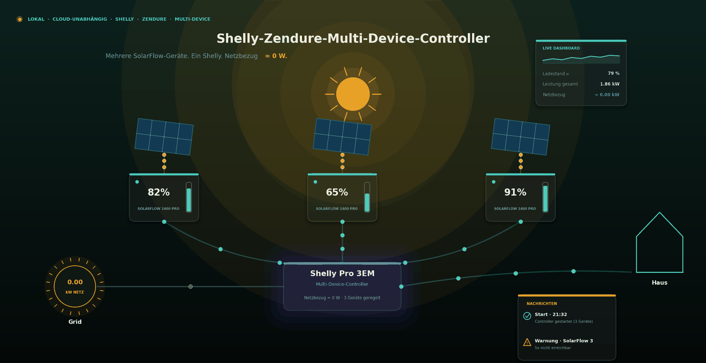
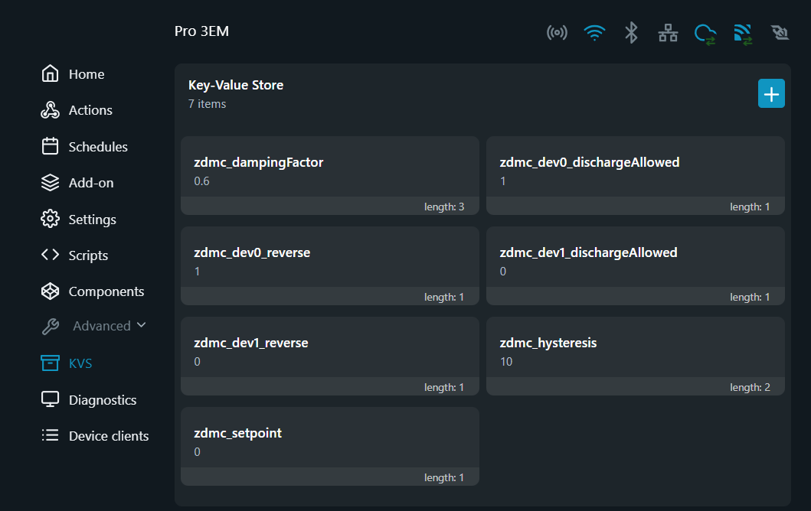

# Zendure Multi-Device Controller – Gesamtdokumentation

**Spend me a Coffee!**

<a href="https://ko-fi.com/surfer1264">
  
</a>

**Controller** zur lokalen, **cloud-unabhängigen** Regelung der Lade-/Entladeleistung
von **einem oder mehreren** Zendure-SolarFlow-Systemen. Das Script unterstützt alle Zendure-Geräte mit
zenSDK-Schnittstelle (SF800 und neuer).



Der Controller ist eine **Alternative** zu Home Assistant oder ähnlichem und
läuft direkt als Shelly-Script auf einem Shelly Gen2/3/4-Gerät – ohne zusätzliche
Infrastruktur (Server, Cloud, App) außer dem Shelly selbst und den
Zendure-Geräten im lokalen Netz.

* [Getting Started hier](readme.md)
* [Changelog](CHANGELOG.md)
* Support über meinen Github Account ([Issues](https://github.com/surfer1264/Zendure-Stuff/issues) bei Problemen, [Discussion](https://github.com/surfer1264/Zendure-Stuff/discussions) für Austausch, Anforderungen, Analysen)
* [Betriebs Protokolle liefern](../Script_poller/readme.md)

> **Achtung:** Ihr betreibt den Controller auf eigene Gefahr ⚠️ und Verantwortung.
> Der Betrieb entbindet Euch nicht von der Einhaltung regulatorischer Regeln


## Inhaltsverzeichnis
  - [Inhaltsverzeichnis](#inhaltsverzeichnis)
  - [1) Zweck](#1-zweck)
  - [2) Möglichkeiten und Flexibilität, Features](#2-möglichkeiten-und-flexibilität-features)
  - [3) Voraussetzungen](#3-voraussetzungen)
    - [3.1 Shelly](#31-shelly)
  - [4) Konfiguration](#4-konfiguration)
    - [4a) Plausibilitätsprüfungen (CONFIG-Validierung beim Start)](#4a-plausibilitätsprüfungen-config-validierung-beim-start)
    - [4b) Mehrere Solarflow-Geräte einpflegen](#4b-mehrere-solarflow-geräte-einpflegen)
    - [4c) Testmodus: `dryRun`](#4c-testmodus-dryrun)
  - [5) Smartmeter Anbindung - Die drei Grid-Quellen im Überblick](#5-smartmeter-anbindung---die-drei-grid-quellen-im-überblick)
    - [5.1) Eigene/weitere Smart Meter einbinden “http\_json”](#51-eigeneweitere-smart-meter-einbinden-http_json)
    - [5.2) Vorzeichen bei `"http_json"` prüfen](#52-vorzeichen-bei-http_json-prüfen)
  - [6) Regelverhalten](#6-regelverhalten)
    - [6a) Entladen](#6a-entladen)
    - [6b) Laden (vom Netz)](#6b-laden-vom-netz)
    - [6c) Sanfter Ausgleich (Rebalance)](#6c-sanfter-ausgleich-rebalance)
    - [6d) Bypass-Verhalten](#6d-bypass-verhalten)
    - [6e) Bypass-Überschuss-Korrektur (`socLimit = 1`)](#6e-bypass-überschuss-korrektur-soclimit--1)
  - [7) Lastaufteilung / Wie wirken `concentrateBelow` und `spreadAbove`](#7-lastaufteilung--wie-wirken-concentratebelow-und-spreadabove)
    - [7a) Mindestlast ist richtungsabhängig](#7a-mindestlast-ist-richtungsabhängig)
    - [7b) Empfehlung für Ersteinstellung](#7b-empfehlung-für-ersteinstellung)
  - [8) Detailfunktionalität](#8-detailfunktionalität)
    - [8.1) Ablauf eines Regelzyklus](#81-ablauf-eines-regelzyklus)
    - [8.2) Dämpfung der Lade-/Entladesignale](#82-dämpfung-der-lade-entladesignale)
    - [8.3) Watchdog / Timer](#83-watchdog--timer)
    - [8.4) Fehlerzähler \& Benachrichtigung](#84-fehlerzähler--benachrichtigung)
    - [8.5) Signal-Benachrichtigung (CallMeBot) – inkl. WhatsApp](#85-signal-benachrichtigung-callmebot--inkl-whatsapp)
    - [8.6) SoC-Grenzwerte: Start-Synchronisierung \& Laufzeit-Meldung (`socLimit`)](#86-soc-grenzwerte-start-synchronisierung--laufzeit-meldung-soclimit)
    - [8.7) Startprotokoll (Banner)](#87-startprotokoll-banner)
    - [8.8) Zeitlich gekoppelte Hysterese (spread → single)](#88-zeitlich-gekoppelte-hysterese-spread--single)
    - [8.9) Start/Stop-Hysterese (Laden \& Entladen)](#89-startstop-hysterese-laden--entladen)
    - [8.10) Richtungswechsel-Bremse (Beispiel)](#810-richtungswechsel-bremse-beispiel)
    - [8.11) Bedeutung von `smartMode` (0 vs. 1)](#811-bedeutung-von-smartmode-0-vs-1)
    - [8.12) Adaptives Polling / Sparmodus (`idleSkip`)](#812-adaptives-polling--sparmodus-idleskip)
  - [9) Ablauf der Regelung (Diagramm)](#9-ablauf-der-regelung-diagramm)
  - [10) Hinweis: Performance, Grenzen und Status-Prüfung des Shelly](#10-hinweis-performance-grenzen-und-status-prüfung-des-shelly)
  - [11) Bekannte Einschränkungen](#11-bekannte-einschränkungen)
  - [12) Logging](#12-logging)
    - [12.1) Start-Banner (einmalig beim Start)](#121-start-banner-einmalig-beim-start)
    - [12.2) Zyklus-Kopfzeile ("Netzsaldo"-Zeile)](#122-zyklus-kopfzeile-netzsaldo-zeile)
    - [12.3) Pro-Geräte-Statuszeile](#123-pro-geräte-statuszeile)
    - [12.4) Aktionszeilen (nur bei tatsächlicher Änderung)](#124-aktionszeilen-nur-bei-tatsächlicher-änderung)
    - [12.5) Ereigniszeilen (Zustandsänderungen)](#125-ereigniszeilen-zustandsänderungen)
    - [12.6) Fehlermeldungen](#126-fehlermeldungen)
    - [12.7) Sonstige Meldungen](#127-sonstige-meldungen)
    - [12.8) Wertetabellen (Kurzreferenz)](#128-wertetabellen-kurzreferenz)
    - [12.9) Debug](#129-debug)
  - [13) Live-Override der Regelparameter per KVS (z. B. Home Assistant)](#13-live-override-der-regelparameter-per-kvs-z-b-home-assistant)
    - [13.1) Wofür ist KVS gut?](#131-wofür-ist-kvs-gut)
    - [13.2) Gefahr: Flash-Verschleiß](#132-gefahr-flash-verschleiß)
    - [13.3) Wie hält die Implementierung Zugriffe gering?](#133-wie-hält-die-implementierung-zugriffe-gering)
      - [13.3.1) Wann schreibt das Script welche KVS-Werte?](#1331-wann-schreibt-das-script-welche-kvs-werte)
      - [13.3.2) Wann liest das Script?](#1332-wann-liest-das-script)
    - [13.4) Live-überschreibbare Werte](#134-live-überschreibbare-werte)
    - [13.5) Nutzung per Kommandozeile (curl)](#135-nutzung-per-kommandozeile-curl)
    - [13.6) Nutzung über Home Assistant](#136-nutzung-über-home-assistant)
    - [13.7) KVS Store im Shelly](#137-kvs-store-im-shelly)


---

## 1) Zweck

Das Script regelt die Lade-/Entladeleistung von einem oder mehreren
Zendure-Speichern automatisch so, dass der Netzbezug/-export des Haushalts
möglichst auf einen gewünschten Zielwert (in der Regel 0 W) ausgeglichen wird
(Nulldurchgangsregelung / Eigenverbrauchsoptimierung). Es liest den aktuellen
Netzwert und den Zustand aller konfigurierten Zendure-Geräte, berechnet daraus
**getrennte Sollwerte für Entladen und Laden** (siehe Kapitel 8.1/8.2) und
verteilt diese anschließend nach konfigurierbaren Regeln auf die einzelnen
Geräte.

> bei gemischten Konfigurationen können dabei auch **gleichzeitig**
manche Geräte laden und andere entladen. Das ist gewollt und im Sinne der Effizienz der Einzelgeräte. 


**Kernprinzipien**:

- **Lokal & cloud-unabhängig:** Die Netzleistung wird lokal im Netzwerk
  gemessen, die Kommunikation mit den Zendure-Geräten erfolgt per lokaler
  HTTP-API. Kein Umweg über die Zendure-Cloud – das Script funktioniert auch
  bei Internetausfall.
- **Takt:** Alle paar Sekunden wird die aktuelle Netzleistung
  gemessen sowie der Zustand aller Geräte abgefragt, daraus werden ein
  Entlade- und ein Ladeziel getrennt gedämpft nachgeführt – bei einem
  Lastsprung in Richtung „weniger Export“ fast sofort (siehe Kapitel
  8.1/8.2) und anschließend auf die Geräte verteilt, wenn nötig.
- **Einer oder Alle:** Bei kleinem Bedarf wird nur ein
  einzelnes Gerät angesprochen (**Konzentrationsmodus**, schont die übrigen Akkus, weniger
  Schreibzugriffe), bei größerem Bedarf wird automatisch auf alle verfügbaren
  Geräte verteilt (**Verteilmodus** nach Prinzip "Wasserfüllung").
- **Leistungsfähigkeit:** drei Geräte sind besser als eins, also stellt die Regelung sicher, dass alle Geräte gleichmässig
  geladen oder entladen werden, um so lange wie möglich die volle Power 💪 des Gesamtpakets zu erhalten. 

---

## 2) Möglichkeiten und Flexibilität, Features 

Was die Regelung kann:

- **Beliebig viele Zendure-Geräte** gleichzeitig steuern (`CONFIG.devices` ist
  ein Array – ein Gerät hinzufügen heißt: einen weiteren Eintrag ergänzen, der
  Rest des Scripts passt sich automatisch an).
- **Gewichtete Verteilung nach SOC:** Geräte mit höherem Ladestand tragen beim
  Entladen mehr bei, Geräte mit mehr freiem Platz tragen beim Laden mehr bei –
  automatisch, ohne feste Prioritäten.
- **SoC Balancing, Ausgleich** zwischen mehreren Geräten im
  Konzentrationsmodus: Ein dauerhafter, ausreichend großer SOC-Vorsprung eines
  anderen Geräts führt zu einem Wechsel des aktiven Geräts.
- **Kapazitäts-Deckelung mit Nachverteilung:** Jedes Gerät ist einzeln auf sein
  `maxOutput`/`maxInputPower` begrenzt; was ein gedeckeltes Gerät nicht
  abnehmen kann, wird automatisch auf die übrigen Geräte umverteilt.
- **Cutoffs:** Gerätegrenzen der Firmware werden berücksichtigt. Geräte werden vom Entladen oder Laden 
  ausgeschlossen, wenn die Firmware das meldet
- **Laden vom Netz ist optional und pro Gerät einzeln freischaltbar**
  (`reverse: true/false`); Geräte mit `reverse:false` werden nie zum Laden
  herangezogen. Zur Laufzeit per KVS umschaltbar (Kapitel 13).
- **Entladen ist optional und pro Gerät einzeln sperrbar**
  (`dischargeAllowed: true/false`); Geräte mit `false` werden nie zum Entladen
  herangezogen, können aber weiterhin (bei `reverse:true`) laden – z. B. um
  ein Gerät gezielt fürs Laden zu reservieren. Zur Laufzeit per KVS
  umschaltbar (Kapitel 13).
- **Drei Quellen für den Netzmesswert:** lokal auf einem Shelly Pro 3EM, per
  RPC von einem entfernten Shelly Pro 3EM, oder generisch von jedem Gerät mit
  einer JSON-über-HTTP-Schnittstelle (z. B. Zendure Smart Meter 3CT).
- **Dry-Run-Modus pro Gerät:** Ein Geräteeintrag kann auf "nur lesen und
  mitrechnen, nie schreiben" gestellt werden – nützlich, um die Verteil-Logik
  mit echten Live-Daten zu testen, ohne eine reale Schreib-Aktion auszulösen.
- **Debug-Logging** ein-/ausschaltbar über `CONFIG.debug`, ohne Code
  löschen/wieder einfügen zu müssen.
- **Hub-seitiger GridReverse-Bypass:** Optional kann der Controller zusätzlich
  zur eigenen Regellogik den firmwareeigenen `gridReverse`-Schalter der
  Hubs setzen und so das Exportieren von Energie auf Hardware-Ebene sperren, sobald kein
  Gerät mehr Kapazität hat. Über `gridReverseMode` wählbar zwischen automatischer
  Steuerung und zwei fest verdrahteten Modi ("immer erlaubt"/"immer gesperrt") –
  siehe Kapitel 6d.
- **Bypass-Überschuss-Korrektur:** Liefert ein ladegesperrtes Gerät
  (`socLimit = 1`, Bypass) real mehr Leistung, als ihm im aktuellen Zyklus
  zugeteilt wurde, wird dieser Überschuss automatisch von den übrigen,
  nicht gesperrten Geräten abgezogen – jeden Zyklus neu berechnet, ohne
  eigenen Zustand. Siehe Kapitel 6e.
- **Sparmodus (adaptives Polling):** In ruhigen Phasen – wenn der berechnete
  Output über mehrere Zyklen innerhalb der Schreib-Hysterese bleibt – setzt
  der Controller die HTTP-Abfrage der Zendure-Geräte zeitlich begrenzt aus
  und entlastet damit Geräte und Netzwerk. Die Netzmessung läuft dabei
  unverändert in **jedem** Zyklus weiter. Siehe Kapitel 8.12.
- **Live-Override per KVS:** Sollwert, Fix-Entladeleistung, `minSoc` sowie
  Entlade-/Ladefreigabe je Gerät lassen sich im laufenden Betrieb ändern,
  z. B. aus Home Assistant. Siehe Kapitel 13.
- **Manuelles AC-Laden:** Ein aus der Verteilung genommenes Gerät kann per
  KVS gezielt mit fester Leistung aus dem Netz geladen werden; die Regelung
  pausiert solange für dieses Gerät. Siehe Kapitel 13.4.
- **SOC-Kalibrierung wird respektiert:** Meldet ein Gerät eine laufende
  SOC-Kalibrierung (`socStatus = 1`), wird es aus der Verteilung genommen,
  bis die Firmware die Kalibrierung beendet hat. Siehe Kapitel 8.6.

---

## 3) Voraussetzungen

Welche Shellys getestet sind, welche Smartmeter unterstützt werden und was für Netzwerk, HEMS und Benachrichtigungen nötig ist, steht gesammelt unter **[Kompatible Geräte](../kompatible_geraete.md)**. Kurz:

- Shelly Gen2/3/4 mit Script-Engine und genug Script-Speicher (siehe 3.1)
- ein Smartmeter für den aktuellen Netz-Leistungswert (Details je Betriebsart in **Kapitel 5**)
- zenSDK-fähige Zendure-Geräte im selben Netz mit fester IP-Adresse, **aus dem HEMS entfernt**
- für Signal-/WhatsApp-Benachrichtigungen (optional): CallMeBot-Zugang (siehe Kapitel 8.5) und Internetzugang des Shelly – die Regelung selbst braucht **kein** Internet

### 3.1 Shelly

Die Shelly-Devices sind unterschiedlich mit Speicher ausgestattet. Dabei ist wichtig wieviel Script- und Laufzeitspeicher existiert. Dies bekommet man mit folgendem Befehl in der Browserzeile heraus

`http://<host>/rpc/Script.GetStatus?id=<script_id>`

Der Shelly antwortet dann (id: 2 steht hier für Script Nummer 2):

`{"id":2,"running":false,"mem_free":25200,"cpu":0}`

mem_free: 25200 ist wichtig !!! Dann ist alles gut.

ℹ️ **Ab Version 4.x** ist der Quelltext deutlich umfangreicher. Auf Geräten
mit knappem Script-Speicher bitte die **minifizierte Fassung**
(`zerooutput_multi_kvs_mini.js`, Link in Kapitel 4) verwenden – beim Laden
liegen Quelltext und Bytecode kurzzeitig gleichzeitig im Heap, was den
Speicher-Peak bestimmt. Siehe auch Kapitel 10.


---

## 4) Konfiguration

**der automatische Weg**

[Install-Exe](https://github.com/surfer1264/Zendure-Stuff/releases/latest) laden mit Upload Funktion in den Shelly


**der halbautomatische Weg**

Beginne mit Download: 
[ab Version 4.x.x Minified](zerooutput_multi_kvs_mini.js) Minifyer eingesetzt


ℹ️ INFO: [Wie das mit den Scripte im Shelly funktioniert](https://github.com/surfer1264/Zendure-Stuff/wiki/Shelly-Script-Akkudaten-auslesen#wie-das-mit-den-scripten-funktioniert)

1️⃣ Vorweg zu konfigurieren im Script ist zunächst nur der Geräteblock.

```js
{
ip: "192.168.68.XXX",         // Die IP-Adresse Eures Hubs
label: "SF2400AC",            // ein Name, frei wählbar

  minSoc: 15,                 // die erlaubte Entladegrenze (%)
  maxOutput: 2400,            // MaxPower Eures Hubs (W)

  reverse: true,              // true, wenn Euer Hub auch AC-Laden kann und darf, sonst false
  maxSoc: 100,                // die obere Ladegrenze (%)
  maxInputPower: 2400,        // maximale Ladeleistung (W)

  dischargeAllowed: true,     // true = darf entladen/exportieren, false = nur laden (Priorisierung)

  dryRun: false               // false ist Standard, true ist für Simulationszwecke
},
```

> Habt Ihr mehrere Hubs am Laufen? Block mit geschweiften Klammen und abschließendem Komma kopieren und anpassen, => Siehe **Kapitel 4b**

2️⃣ **Zweiter** wichtiger Schritt: Die Konfiguration Eures Smartmeters => **siehe Kapitel 5**

3️⃣ **Dritter** wichtiger Schritt: Konfigurieren der Schwellwerte für den Kooperationsmodus mehrerer Geräte =>  **Kapitel 7b**

⭐ Damit läuft das Script schon. Alle anderen Parameter kann man später einstellen und verstehen.

---

Alle Einstellungen befinden sich im `CONFIG`-Objekt am Anfang des Scripts.
Die folgende Tabelle bündelt sämtliche Parameter.

| Bereich | Feld | Standardwert | Beschreibung |
| --- | --- | --- | --- |
| **Geräte** (`CONFIG.devices[]`, ein Eintrag pro Zendure-Gerät) | `ip` | – (muss gesetzt werden) | IP-Adresse des Zendure-Geräts im lokalen Netz. Entspricht dem `zendure`-Parameter der Einzelgerät-Version, jetzt aber pro Geräteeintrag. |
| | `label` | – | Freier Name für Logs und Benachrichtigungen (z. B. "SF800", "SF2400"). Hat keine Auswirkung auf die Regelung selbst. |
| | `minSoc` | 15–18 % (Beispiel) | Unterhalb dieses Ladezustands wird **dieses Gerät** von der Entlade-Verteilung ausgeschlossen (Gewicht 0, siehe Kapitel 6a). Pendant zum globalen `minSoc` der Einzelgerät-Version, jetzt individuell pro Gerät einstellbar. |
| | `maxOutput` | 800 W | Maximale Entlade-/Exportleistung dieses Geräts – Kappungsgrenze in Konzentrations- und Verteilmodus. |
| | `dischargeAllowed` | `true` | Darf dieses Gerät entladen/exportieren? Geräte mit `false` erhalten in der Entlade-Gewichtung immer 0 und werden nie herangezogen (z. B. um das Laden dieses Geräts zu priorisieren). Laden (`reverse`) bleibt davon unberührt. Zur Laufzeit per KVS umschaltbar, siehe Kapitel 13. |
| | `reverse` | `false` | Darf dieses Gerät gezielt aus dem Netz geladen werden? Geräte mit `false` erhalten in der Lade-Gewichtung immer 0 und werden nie herangezogen. Zur Laufzeit per KVS umschaltbar, siehe Kapitel 13. |
| | `maxSoc` | 100 % | Obergrenze für das Laden aus dem Netz **dieses Geräts**: ab diesem SOC wird der Ladezweig für dieses Gerät gesperrt (Gewicht 0). Pendant zum globalen `maxSoc` der Einzelgerät-Version, jetzt pro Gerät. Wird zusätzlich beim Start als `socSet` an die Geräte-Firmware synchronisiert (siehe Kapitel 8.6). |
| | `maxInputPower` | z. B. 1200–2400 W | Maximale Ladeleistung vom Netz für dieses Gerät. |
| | `dryRun` | `false` | `true` = Gerät wird normal gelesen und fließt vollständig in Gewichtung/Verteilung ein, aber es wird **nie tatsächlich beschrieben**. Siehe Kapitel 4c. |
| | `inputLimit` | `0` (optional, darf fehlen) | Startwert für das manuelle AC-Laden dieses Geräts in W (`0`…`maxInputPower`). Wird in der Praxis über den KVS-Key `zdmc_devN_inputLimit` genutzt, siehe Kapitel 13.4. |
| **Netzquelle** (global) | `gridSource` | `"local"` | Betriebsart der Netzleistungsmessung: `"local"` = Script läuft direkt auf dem Shelly Pro 3EM; `"remote"` = Script läuft auf einem beliebigen anderen Shelly-Gerät und liest den Pro 3EM per RPC über das Netzwerk aus; `"http_json"` = Script liest die Netzleistung generisch per HTTP GET von einem beliebigen JSON-Smart-Meter. Details siehe Kapitel 5. |
| (**remote**) | `gridSourceIp` | – | IP-Adresse des Shelly Pro 3EM. **Nur** relevant, wenn `gridSource = "remote"`. |
| (**local/remote**) | `gridSourceEmId` | `0` | EM-Kanal-ID am Pro 3EM (in der Regel `0`). relevant, wenn `gridSource = "local" or "remote"`. |
| (**http_json**) | `gridSourceUrl` | `"http://<IP-of-your-meter>/properties/report"` | Vollständige URL des generischen JSON-Smart-Meters. **Nur** relevant, wenn `gridSource = "http_json"`. |
| (**http_json**) | `gridSourceField` | `"total_power"` | Name des JSON-Felds mit der gesamten Netzleistung in Watt. **Nur** relevant, wenn `gridSource = "http_json"`. |
| (**http_json**) | `gridSourceInvert` | `false` | `true`, falls das Vorzeichen von `gridSourceField` umgekehrt zur Erwartung des Scripts ist. Siehe Kapitel 5 zur Vorzeichenprüfung. |
| **Regelverhalten** (global) | `interval` | `4000` ms | Zykluszeit der Regelschleife. Bei mehreren Geräten steigt die tatsächliche Zyklusdauer, da alle Geräte-Anfragen sequenziell laufen (siehe Kapitel 10) – bei Bedarf großzügiger wählen. ⚠️ **Seit V2.4.4** sind `watchdog` und `httpTimeout` **keine eigenen CONFIG-Felder mehr** – `watchdog` wird beim Start automatisch als `interval × 2.5` berechnet, `httpTimeout` ist im Code fest auf `4` s verdrahtet (korrigiert – frühere Doku-Stände nannten hier 3 s bzw. 5 s; im Code steht seit 4.x `timeout: 4`, siehe Kapitel 8.3). Beides ist über `CONFIG` nicht mehr direkt einstellbar, siehe Kapitel 8.3. |
| | `setpoint` | `0` W | Ziel-Netzleistung, auf die geregelt wird (0 = Nullregelung; negativ = leichter Export; positiv = leichter Import erlaubt). Fließt seit V2.3.1 in **beide** getrennt berechneten Ziele ein (Entladeziel und Ladeziel, siehe Kapitel 8.1/8.2), nicht mehr in ein einzelnes kombiniertes Ziel. |
| | `hysteresis` | `12` W (seit V2.4.2, vorher `10` W) | Mindeständerung **pro Gerät** gegenüber dem zuletzt an dieses Gerät geschriebenen Wert, bevor ein neuer Schreibvorgang an dieses Gerät ausgelöst wird. Wird für jedes Gerät individuell geprüft. |
| | `dampingFactor` | `0.65` (seit V2.4.2, vorher `0.6`) | Dämpfungsfaktor (`0.4` bis `0.8`, seit 5.2.0; vorher bis `1`), seit V2.3.1 gleichzeitig und unabhängig angewendet auf **zwei** getrennte Sollwerte (Entladeziel und Ladeziel), jeweils bevor diese auf die Geräte verteilt werden. Der Wert springt nicht direkt zum berechneten Ziel, sondern nähert sich ihm pro Zyklus nur um diesen Anteil der Restdifferenz an. Ausnahme seit 5.1.8/5.2.0: Bei einem Sprung in Richtung „weniger Export“ gilt der feste Faktor `0.9`. **Empfehlung:** 0,6–0,7, bei `remote`/`http_json` oder 3 und mehr Geräten 0,5–0,6, über 0,7 nicht sinnvoll. Details und Begründung siehe Kapitel 8.2. |
| **Verteil-Schwellen** | `discharge.concentrateBelow` / `discharge.spreadAbove` | `600` / `800` W | Schwellen für die Umschaltung zwischen einem Gerät (Konzentration) und allen Geräten (Verteilung) beim Entladen – siehe Kapitel 7. |
| | `charge.concentrateBelow` / `charge.spreadAbove` | `600` / `800` W | Schwellen für die Umschaltung zwischen einem Gerät (Konzentration) und allen Geräten (Verteilung) beim Laden |
| | `concentrateHoldMinutes` | `3` min | Zeitlich gekoppelte Hysterese **nur** für den Wechsel von Verteil- auf Konzentrationsmodus (`spread`→`single`): Der Zielwert muss ununterbrochen (mit Einfrieren in der Totzone zwischen den Schwellen) für diese Zeit unter `concentrateBelow` bleiben, bevor gewechselt wird. Gilt gemeinsam für `discharge` und `charge`. Wird beim Start in Zyklen umgerechnet (`CONCENTRATE_HOLD_CYCLES = max(5, round(concentrateHoldMinutes × 60000 / interval))`, siehe Kapitel 8.8). Der umgekehrte Wechsel (`single`→`spread`) bleibt davon unberührt (nur zwei Zyklen Entprellung, siehe Kapitel 7). |
| **SoC Ausgleich** | `rebalance.socMargin` | `5` Prozentpunkte | Nötiger Gewichts-Vorsprung eines anderen Geräts gegenüber dem aktuell aktiven Gerät im Konzentrationsmodus, damit ein Wechsel ausgelöst wird. **Hinweis:** Dies ist das *einzige* `rebalance`-Feld – ein `holdMinutes`-Parameter existiert im `CONFIG`-Objekt nicht. Der Wechsel erfolgt **sofort**, sobald der Vorsprung erreicht ist, siehe Kapitel 6c. |
| **Netzladen** (global) | `reverseStartupPower` | `35` W | Mindest-Ladebedarf (aggregiert über alle `reverse:true`-Geräte, systemweit bezogen auf das seit V2.3.1 getrennt berechnete Ladeziel, siehe Kapitel 8.1/8.2), ab dem das Laden vom Netz überhaupt erst gestartet wird – Totzone gegen unnötiges Anspringen. |
| | `reverseStopPower` | `15` W | Bedarfs-/Leistungsschwelle, unterhalb derer das Laden wieder gestoppt wird (muss ≤ `reverseStartupPower` sein – wird beim Start automatisch korrigiert). |
| **GridReverse** (Hub-Schalter, siehe Kapitel 6d) | `gridReverseMode` | `"dynamic"` | Hauptschalter für die Hub-seitige `gridReverse`-Steuerung, seit 3.2.0 ein String-Enum statt eines Booleans (ersetzt das frühere `immerBypass`). `"dynamic"` (Standard) = das Script schaltet `gridReverse` zur Laufzeit aktiv zwischen `1` (erlaubt) und `2` (gesperrt) um, abhängig vom geräteseitig gemeldeten `socLimit` bzw. SOC **aller** erreichbaren Geräte (unabhängig von `reverse`), geprüft **einmal pro Zyklus** über `updateGridReverseLock()`. `"always1"` = Feature effektiv deaktiviert, `gridReverse` wird beim Start einmalig auf `1` (erlaubt) gesetzt – zusammen mit dem SoC-Sync, siehe Kapitel 8.6 – und danach nie wieder verändert. `"always2"` = Gegenstück: `gridReverse` wird beim Start einmalig auf `2` (gesperrt) gesetzt und danach nie wieder verändert. Details siehe Kapitel 6d. |
| | `chargeResetMargin` | `10` Prozentpunkte | Nur wirksam bei `gridReverseMode: "dynamic"`. Hysterese-Abstand unterhalb `maxSoc`: Mindestens ein erreichbares Gerät (unabhängig von `reverse`) muss diesen Abstand unterschreiten, damit eine zuvor gesetzte `gridReverse`-Sperre (`2`) wieder auf `1` zurückgesetzt wird. Verhindert wiederholtes Umschalten bei einem SOC, der knapp um `maxSoc` pendelt. Details siehe Kapitel 6d. |
| **Entladen** (global) | `dischargeStartupPower` | `35` W | Mindest-Entladebedarf (aggregiert über alle verfügbaren Geräte, systemweit bezogen auf das seit V2.3.1 getrennt berechnete Entladeziel, siehe Kapitel 8.1/8.2), ab dem das Entladen überhaupt erst gestartet wird – Pendant zu `reverseStartupPower`, aber für die Entladerichtung. Wirkt **einmalig auf Aggregatebene** in `calculate()`, nicht pro Geräteanteil. Ersetzt das frühere pro-Geräte `minOutput`. Details und Beispiel siehe Kapitel 8.9. |
| | `dischargeStopPower` | `15` W | Leistungsschwelle **pro Gerät/Geräteanteil**, unterhalb derer dieses Gerät auf 0 W gesetzt wird (muss < `dischargeStartupPower` sein – wird beim Start automatisch korrigiert). Gilt sowohl im Konzentrations- als auch im Verteilmodus, für jedes Gerät einzeln. |
| **AC-Richtungswechsel** (global) | `directionChangeHoldCycles` | `4` Zyklen (seit 4.3.0, vorher `2`) | Anzahl aufeinanderfolgender Regelzyklen, für die ein angeforderter Richtungswechsel (`acMode`, Laden↔Entladen) an einem Gerät zunächst zurückgehalten wird, bevor er tatsächlich ausgeführt wird. Während der Zurückhaltung wird das Gerät auf Standby gesetzt (`acMode 1`, 0 W) statt sofort umzuschalten. Der Zähler läuft nur so lange, wie durchgehend ein Wechsel angefordert wird – kehrt der Zielwert zwischenzeitlich auf 0 W zurück oder stimmt die angeforderte Richtung wieder mit der zuletzt tatsächlich geschriebenen Richtung überein, wird der Zähler zurückgesetzt. Wertebereich `4`–`20` (wird beim Start geklemmt) – die Bremse ist bewusst **nicht abschaltbar**. Details und Beispiel siehe Kapitel 8.10. |
| | `standbySmartModeZero` | `false` | `true` erlaubt, ein Gerät im Standby (`acMode 1`, `outputLimit 0`, `inputLimit 0`) mit `smartMode 0` zu parken – aber erst, nachdem es mindestens `standbyHoldCycles` (intern fest `15`) Zyklen ununterbrochen im Standby war. Vorher, bei `false` und außerhalb des Standby-Falls (aktives Laden oder Entladen) wird stets `smartMode 1` geschrieben. Details siehe Kapitel 8.11. |
| **Timer&DEBUG** | `errorThreshold` | `6` (seit 4.3.0, vorher `5`) | Anzahl aufeinanderfolgender Fehler desselben Typs (global oder pro Gerät), bevor eine Signal-/WhatsApp-Benachrichtigung ausgelöst wird. Siehe Kapitel 8.4. |
| **Sparmodus / adaptives Polling** (global, siehe Kapitel 8.12) | `idleSkip.enabled` | `true` | Hauptschalter. `false` = Funktion komplett aus, jeder Zyklus fragt wie früher alle Geräte per HTTP ab. |
| | `idleSkip.cyclesUnchanged` | `4` | So viele **aufeinanderfolgende Voll-Poll-Zyklen** muss der berechnete Output pro Gerät innerhalb der Schreib-Hysterese um den zuletzt geschriebenen Wert bleiben (und die Richtung gleich), bevor der Geräte-Poll ausgesetzt wird. |
| | `idleSkip.maxSkipSeconds` | `44` s | Maximales Alter der Gerätedaten (SOC/`socLimit`/Ist-Leistung) während des Aussetzens. Wird beim Start in Zyklen umgerechnet (`IDLE_SKIP_CYCLES`). Danach erfolgt zwingend wieder ein Voll-Poll. |
| **KVS** (Live-Override, siehe Kapitel 13) | `kvsEnabled` | `false` | Hauptschalter für das gesamte KVS-Live-Override-Feature. `false` = kein Seeding, kein initiales Einlesen und kein Status-Handler beim Start – alle Live-Override-Parameter (`setpoint`, `dischargeFixed`, pro Gerät `dischargeAllowed`, `reverse`, `minSoc`, `inputLimit`) bleiben dann fest auf den CONFIG-Werten, ein `KVS.Set` von außen hat keine Wirkung mehr. Ein zyklisches `KVS.GetMany` gab es nie – gelesen wird ausschließlich beim Start und ereignisgesteuert, siehe Kapitel 13.3. |
| | `kvsForceReseed` | `false` | Nur relevant bei `kvsEnabled: true`. `true` = bei **jedem** Skriptstart werden alle `zdmc_*`-KVS-Keys mit den aktuellen CONFIG-Werten überschrieben, bereits live per KVS gesetzte Werte gehen dabei verloren. ⚠️ Siehe Warnhinweis in Kapitel 13. |
| | `debug` | `false` | Ausführliches Logging der Schreib-Anfragen (exakte URL/Body, vollständige Fehlerantwort) sowie Zyklus-Timing-Meldungen. Für Diagnosezwecke temporär aktivieren, im Normalbetrieb `false` lassen. |
| **Signal / WhatsApp** (CallMeBot) | `signal.enabled` | `false` | Aktiviert/deaktiviert Benachrichtigungen insgesamt. |
| | `signal.typ` | `"WEBHOOK"` (seit 4.x, vorher `"SIGNAL"`) | `"SIGNAL"`, `"WHATSAPP"` oder `"WEBHOOK"` – wählt den Benachrichtigungsweg. `"SIGNAL"`/`"WHATSAPP"` gehen über CallMeBot, `"WEBHOOK"` per POST an eine frei wählbare URL. Details siehe Kapitel 8.5. |
| | `signal.phone` | `"PHONE-STRING"` | Telefonnummer bzw. Phone-ID für CallMeBot (z. B. `+4917XXXXXXXX`). |
| | `signal.apiKey` | `"YOUR_API_KEY"` | API-Key von CallMeBot. Nur bei `typ: "SIGNAL"`/`"WHATSAPP"` relevant. |
| | `signal.webhookUrl` | `"http://<IP-ADRESSE>:8123/api/webhook/<deine-webhook-id>"` | Ziel-URL für `typ: "WEBHOOK"`. Es wird ein POST mit festem JSON-Body `{"message": "..."}` gesendet. Nur bei `typ: "WEBHOOK"` relevant. |

**Minimal notwendige Anpassung vor dem ersten Start:** Für **jedes** Gerät in
`CONFIG.devices` muss mindestens `ip` gesetzt werden. Alle anderen Werte sind
optional und mit sinnvollen Standardwerten vorbelegt.

**Interne Werte (nicht im CONFIG-Block einstellbar):**

| Wert | Festwert | Bedeutung |
| --- | --- | --- |
| `watchdog` | `interval × 2.5` | Watchdog-Zeit, siehe Kapitel 8.3 |
| HTTP-Timeout | `4` s (Benachrichtigungen `8` s) | siehe Kapitel 8.3 |
| `dischargeFixed` | `0` | Fix-Entladeleistung. Wird nach dem CONFIG-Block fest auf `0` gesetzt und ist **nur per KVS** (`zdmc_dischargeFixed`) wirksam, siehe Kapitel 13.4 |
| `standbyHoldCycles` | `15` | Mindestanzahl Standby-Zyklen in Folge, bevor `smartMode 0` geschrieben wird (nur bei `standbySmartModeZero: true`), siehe Kapitel 8.11 |
| `SPREAD_TRIGGER_CYCLES` | `1` | Entprellung `single` → `spread`: gewechselt wird erst, wenn die Bedingung **zwei Zyklen in Folge** erfüllt ist, siehe Kapitel 7 |
| `dischargeResetMargin` | `3` | Entlade-Hysterese in Prozentpunkten: Ein Gerät, das bis `minSoc` entladen hat, darf erst ab `minSoc + dischargeResetMargin` wieder entladen (seit 5.1.4), siehe Kapitel 8.6. Steht hinter dem CONFIG-Block; wer einen anderen Wert will, kann den Key zusätzlich im CONFIG-Block setzen. Mindestens `1` (= Verhalten der Firmware) |

### 4a) Plausibilitätsprüfungen (CONFIG-Validierung beim Start)

Um Konfigurationsfehler zu vermeiden, werden folgende Validierungen & ggf. Korrekturen durchgeführt um Parameter in sinnvolle Wertebereich zu bringen.
Die Regel in folgender Tabelle beschreibt den gültigen Wertebereich. Wird dagegen verstoßen, werden die Parameter auf die jeweiligen Grenzen gesetzt.

⚠️ Die Validierung findet nur beim Start statt.

| Parameter | Regel | Korrektur bei Verstoß |
| --- | --- | --- |
| `interval` | ≥ 3000 ms | auf `3000` gesetzt |
| `dampingFactor` | zwischen `0.4` und `0.8` (seit 5.2.0, vorher bis `1`) | auf `0.4` bzw. `0.8` gesetzt |
| `concentrateBelow` (discharge/charge) | ≥ `35` | auf `35` gesetzt |
| `spreadAbove` (discharge/charge) | ≥ `50` | auf `50` gesetzt |
| `concentrateBelow` vs. `spreadAbove` | `concentrateBelow` < `spreadAbove` (echt kleiner) | `spreadAbove = concentrateBelow + 15` |
| `reverseStartupPower` vs. `reverseStopPower` | `reverseStartupPower` > `reverseStopPower` | `reverseStartupPower = reverseStopPower + 15` |
| `dischargeStopPower` | ≥ `0` | auf `15` gesetzt |
| `dischargeStartupPower` vs. `dischargeStopPower` | `dischargeStartupPower` > `dischargeStopPower` | `dischargeStartupPower = dischargeStopPower + 15` |
| `directionChangeHoldCycles` | zwischen `4` und `20` | auf `4` bzw. `20` gesetzt |
| `setpoint` | zwischen `-40` und `40` | auf `-40` bzw. `40` gesetzt |
| `hysteresis` | zwischen `5` und `40` | auf `5` bzw. `40` gesetzt |
| `rebalance.socMargin` | zwischen `5` und `25` | auf `5` bzw. `25` gesetzt |
| `minSoc` (je Gerät) | zwischen `10` und `99` | auf `10` bzw. `99` gesetzt |
| `maxSoc` (je Gerät) | zwischen `minSoc + 1` und `100` | auf `minSoc + 1` bzw. `100` gesetzt |
| `inputLimit` (je Gerät, optional) | zwischen `0` und `maxInputPower`; fehlt das Feld, gilt `0` | auf `0` bzw. `maxInputPower` gesetzt |
| `chargeResetMargin` | zwischen `10` und `25` | auf `10` bzw. `25` gesetzt |
| `idleSkip.cyclesUnchanged` | zwischen `3` und `50` | auf `3` bzw. `50` gesetzt |
| `idleSkip.maxSkipSeconds` | ≥ `interval / 1000` | auf `interval / 1000` angehoben |
| `IDLE_SKIP_CYCLES` (abgeleitet) | ≥ `3` Zyklen | `max(3, round(maxSkipSeconds × 1000 / interval))` |
| `CONCENTRATE_HOLD_CYCLES` (abgeleitet) | ≥ `5` Zyklen | `max(5, round(concentrateHoldMinutes × 60000 / interval))` |


**Kein eigenes Logging:** Der Validierungsblock selbst gibt keine
Korrektur-Meldungen aus – die jeweils gültigen Endwerte sind ohnehin im
Start-Banner (Kapitel 8.7) sichtbar.

**`watchdog` seit V2.4.4:** `watchdog` taucht in obiger Tabelle nicht mehr
auf, weil es kein eigenständiger, validierbarer CONFIG-Wert mehr ist –
er wird bei jedem Start bedingungslos als `interval × 2.5` neu berechnet
(kein Einstellen, kein „Verstoß“ mehr möglich). Details siehe Kapitel 8.3.

### 4b) Mehrere Solarflow-Geräte einpflegen

Ein weiteres Zendure-Gerät hinzuzufügen bedeutet **keine Code-Änderung**,
sondern nur einen weiteren Eintrag im `CONFIG.devices`-Array:

1. In `CONFIG.devices` ein neues Objekt `{ ... },` ergänzen (Komma nach dem
   vorherigen Eintrag nicht vergessen).
2. Mindestens `ip` setzen, `label` sinnvoll benennen (taucht so in Logs und
   Benachrichtigungen auf).
3. `minSoc`, `maxOutput` passend zum jeweiligen Gerätetyp
   einstellen (z. B. 800 W als optimale Momentanleistung für ein SF2400AC/2400Pro,
   siehe Empfehlung in Kapitel 7b).
4. `reverse`, `maxSoc`, `maxInputPower` nur relevant, falls dieses Gerät auch
   aus dem Netz laden darf.
5. `dryRun: false` für reale Geräte setzen (`true` nur zu Testzwecken, siehe
   Kapitel 4c).
6. Optional: `discharge`/`charge` → `concentrateBelow`/`spreadAbove` neu
   berechnen, da diese Schwellen von der Geräteanzahl `N` abhängen (Faustformel
   in Kapitel 7b: `spreadAbove = N × optimalPowerGerät`).
7. Bei vielen Geräten `interval` ggf. großzügiger wählen (`watchdog` folgt automatisch), da
   alle Geräte-Anfragen sequenziell laufen und die Zyklusdauer linear mit der
   Geräteanzahl steigt (siehe Kapitel 10).
8. Script neu starten – der interne Zustand (aktives Gerät, Fehlerzähler,
   Glättung) beginnt dabei bei null (siehe Kapitel 10).

Die gesamte übrige Logik (Gewichtung, Verteilung, Fehlerbehandlung,
Rebalancing) passt sich automatisch an die neue Geräteanzahl an.

### 4c) Testmodus: `dryRun`

Ein Geräteeintrag mit `dryRun: true` wird normal gelesen (SOC, Ist-Leistung)
und **fließt vollständig in Gewichtung und Verteilung ein** – es wird aber
**nie tatsächlich beschrieben**. Statt eines Schreibvorgangs erscheint im Log
nur `[DRYRUN] wuerde schreiben: X W`.

**Typischer Einsatz – Split-Logik mit nur einem echten Gerät testen:**

- Einen zweiten (dritten, ...) Eintrag mit **derselben `ip`** wie das echte
  Gerät anlegen, aber `dryRun: true` und abweichenden Werten (`minSoc`,
  `maxOutput`, ...).
- `calculate()` dedupliziert die Ist-Leistung nach `ip` – ein reales Gerät
  fließt trotz mehrerer Einträge nur **einmal** in `sumZen` (Log: `Ist-Summe`) ein. Ohne
  diese Absicherung würde dieselbe Leistung doppelt gezählt und eine
  Rückkopplungsschleife mit immer weiter steigendem Zielwert auslösen.
- Für einen sichtbaren Split zwischen echtem und Test-Eintrag müssen sich die
  Gewichte tatsächlich unterscheiden (z. B. `minSoc`), sonst gewinnt bei
  Gleichstand immer der erste Eintrag im Array.

**Ladeverhalten (`reverse`) gefahrlos testen, auch mit nur einem realen,
nicht-reverse-fähigen Gerät:**

- Echtes Gerät: `reverse: false` (bleibt dadurch in `computeChargeWeights()`
  immer mit Gewicht 0 ausgeschlossen – unabhängig vom Testaufbau).
- Zusätzlicher `dryRun`-Eintrag (gleiche `ip`): `reverse: true` mit den zu
  testenden Werten (`maxSoc`, `maxInputPower`).
- Um ohne echten Überschuss einen Lade-Zyklus anzustoßen, `CONFIG.setpoint`
  testweise auf das Maximum `40` setzen (größere Werte werden beim Start bzw.
  per KVS auf ±40 begrenzt). Das ergibt ein Ladeziel von etwa −40 W und liegt
  damit nur knapp über `reverseStartupPower` (35 W) – für einen deutlichen
  Lade-Zyklus braucht es echten Überschuss. Danach nicht vergessen, wieder
  auf den ursprünglichen Wert (i. d. R. `0`) zurückzusetzen.

**Woran man dryRun-Zeilen im Log erkennt:** Anhang
`[DRYRUN - wird nicht geschrieben]` an der `Soll`-Zeile des Geräts, gefolgt
von `[DRYRUN] wuerde schreiben: X W (Export)` bzw. `(Laden vom Netz)`.

---

## 5) Smartmeter Anbindung - Die drei Grid-Quellen im Überblick

> **Kurz gesagt:** `"local"` ist am schnellsten und zuverlässigsten, läuft
> aber zwingend auf dem Pro 3EM selbst. `"remote"` und `"http_json"` geben dir
> Freiheit, das Script auf **jedem** Shelly laufen zu lassen — der Unterschied
> liegt nur darin, *welches* Messgerät im Netz abgefragt wird. Diese
> Betriebsarten gelten identisch für die Single- und die Multi-Device-Version.
> `"remote"` und `"http_json"` nutzen intern dieselbe Auswertungsfunktion
> (`handleGenericGridResponse()`), `"local"` liest den Messwert direkt über
> `Shelly.getComponentStatus()`.

| | 1️⃣ `"local"` | 2️⃣ `"remote"` | 3️⃣ `"http_json"` |
| --- | --- | --- | --- |
| **Wo läuft das Script?** | zwingend **auf dem Shelly Pro 3EM** selbst | auf **jedem** Shelly Gen2/3-Gerät | auf **jedem** Shelly Gen2/3-Gerät |
| **Messquelle** | `Shelly.getComponentStatus("em:X")` – interner Gerätespeicher | HTTP RPC `/rpc/EM.GetStatus` eines Shelly Pro 3EM | HTTP GET auf eine beliebige, frei konfigurierbare JSON-URL |
| **Unterstützte Geräte** | nur der Pro 3EM, auf dem das Script selbst läuft | ausschließlich Shelly Pro 3EM (Standard-Firmware, unverändert) | **beliebige** Smart Meter mit JSON über HTTP GET (flach oder – per Array in `gridSourceField` – verschachtelt), z. B. Zendure Smart Meter 3CT, **Shelly 3EM (ohnePro)** |
| **Relevante Config-Felder** | `gridSourceEmId` | `gridSourceIp`, `gridSourceEmId` | `gridSourceUrl`, `gridSourceField`, `gridSourceInvert` |
| **Feldname der Leistung** | fest `total_act_power` (Shelly-intern) | fest `total_act_power` | frei konfigurierbar über `gridSourceField` (z. B. `"total_power"` beim 3CT) |
| **Latenz** | keine – synchroner, lokaler Zugriff, kein Netzwerk-Roundtrip | ein zusätzlicher HTTP-Call pro Zyklus | ein zusätzlicher HTTP-Call pro Zyklus |
| **Netzwerk nötig?** | nein | ja, zum Pro 3EM | ja, zum jeweiligen Meter |
| **Besonderheit** | schnellste & robusteste Variante, da kein HTTP-Fehlerfall möglich | Pro 3EM bleibt unangetastet mit Standard-Firmware; Script selbst kann auf schwächerer Hardware laufen | **Vorzeichen vorher prüfen!** Nicht jeder Hersteller definiert „positiv = Bezug vom Netz" gleich – ggf. `gridSourceInvert: true` setzen |


### 5.1) Eigene/weitere Smart Meter einbinden “http_json”

`"http_json"` ist bewusst generisch gehalten, damit sich künftig auch andere
Fremd-Smart-Meter ohne Codeänderung anbinden lassen – es müssen nur drei
Werte angepasst werden:

**Generisch Konfiguration**

```js
gridSource: "http_json",
gridSourceUrl: "http://<IP-des-Messgeraets>/<passender-Pfad>",
gridSourceField: "<Feldname-mit-der-Gesamtleistung-in-Watt>",
gridSourceInvert: false, // ggf. nach Test auf true setzen
```

Voraussetzung ist lediglich, dass das Gerät auf einen einfachen HTTP GET ein
**JSON-Objekt** zurückgibt (keine Authentifizierung) und darin ein Feld mit der **gesamten** Netzleistung in Watt enthalten ist. Das Feld selbst herausfinden geht am einfachsten, indem man die URL im Browser aufruft und die Antwort durchsucht.

**Beispiel Zendure Smart Meter 3CT / Zendure D0 = (flache JSON-Struktur, keine Verschachtelung):**

Befehl im Browser absetzen: `http://<IP>/properties/report` liefert

```
→ {"timestamp":...,"deviceId":"...","a_aprt_power":0,"b_aprt_power":16,
   "c_aprt_power":-14,"total_power":2}
```

Hier ist `total_power` das gesuchte Feld.

```js
gridSource: "http_json",
gridSourceUrl: "http://<IP-des-Geraets>/properties/report",
gridSourceField: "total_power",
gridSourceInvert: false   // erstmal so lassen, dann pruefen (siehe unten)
```

**Shelly 3EM (ohne Pro) (flache JSON-Struktur, keine Verschachtelung):**
```
gridSource: "http_json",
gridSourceUrl: "http://<IP-des-3EM>/status",
gridSourceField: "total_power",
gridSourceInvert: false   // ggf. auf true, falls Vorzeichen beim Test verkehrt herum ist
```


**Beispiel Tasmota (verschachtelte JSON-Struktur):**

Befehl im Browser absetzen: `http://<IP>/cm?cmnd=STATUS%2010` liefert

Achtung **BEISPIEL**

```
{“StatusSNS”:{“Time”:“2024-07-23T21:18:52”,“DVS7420”:{“energy”:20302.00,“power”:353.150,“Meter_number”:“123456”}}}
```

Hier ist `power` das gesuchte Feld, aber in einer geschachtelten Struktur, die in `gridSourceField` mitzugeben ist... die Namen VOR den geschweiften Klammern sind WICHTIG
Wir müssen die Felder VOR den öffnenden geschweiften Klammern heraussuchen und in der angegebenen Form in das das Feld `gridSourceField` eintragen.

Wenn obiges also die Antwort ist, dann

```js
gridSource: "http_json",
gridSourceUrl: "http://<IP-des-Geraets>/cm?cmnd=STATUS%2010",
gridSourceField: ["StatusSNS", "DVS7420", "power"],
gridSourceInvert: false   // erstmal so lassen
```

### 5.2) Vorzeichen bei `"http_json"` prüfen

Das Script erwartet durchgängig: **positiv = Import/Bezug vom Netz, negativ =
Export ins Netz**. Bei `"local"` und `"remote"` ist das durch die
Shelly-eigene `total_act_power`-Definition automatisch korrekt. Bei
`"http_json"` hängt es vom jeweiligen Hersteller ab – das muss einmalig
geprüft werden:

1. `gridSourceInvert: false` lassen und Script starten.
2. Einen größeren Verbraucher im Haus einschalten (mehr Netzbezug erwartet).
3. In der Shelly-Konsole die Zeile `Netzsaldo: ... W` beobachten.
4. Wird der Wert **positiver** → Vorzeichen passt, nichts weiter zu tun.
5. Wird der Wert **negativer** → `gridSourceInvert: true` setzen und erneut
   testen.

---

## 6) Regelverhalten

### 6a) Entladen

ℹ️ Seit V2.3.1 wird die Entladeverteilung **nach** der Ladeverteilung
berechnet (siehe 6b) und bekommt deren Ergebnis als Ausschlussliste
(`chargeExclude`) übergeben: Jedes Gerät, dem im selben Zyklus bereits eine
Ladeleistung ≠ 0 zugewiesen wurde, bekommt in der Entlade-Gewichtung
zusätzlich Gewicht 0 – so kann ein Gerät nicht im selben Zyklus gleichzeitig
laden **und** entladen sollen. Andere, nicht ladende Geräte können in
demselben Zyklus dennoch ganz normal entladen; Laden und Entladen sind seit
2.3.1 also **keine** sich systemweit gegenseitig ausschließenden Zustände
mehr, sondern werden pro Gerät entschieden.

1. Nur Geräte mit `dischargeAllowed: true` (Standard), ohne aktive,
   vom Gerät selbst gemeldete Entladesperre (`socLimit = 2`, siehe Kapitel
   8.6), ohne laufende SOC-Kalibrierung (`socStatus = 1`, Kapitel 8.6),
   ohne aktive Entlade-Hysterese (Kapitel 8.6)
   **und** ohne bereits im selben Zyklus zugewiesene Ladeleistung
   (`chargeExclude`, s. o.) nehmen überhaupt teil; alle anderen bekommen
   automatisch Gewicht 0 und werden nie zum Entladen herangezogen –
   unabhängig vom SOC. Für jedes übrige, verfügbare Gerät wird
   ein **Gewicht** berechnet: `SOC − minSoc`. Ein Gerät bei oder unter
   `minSoc` bekommt ebenfalls Gewicht 0 und wird von der Verteilung
   automatisch ausgeschlossen.
2. Anhand des (getrennt berechneten, siehe Kapitel 8.1/8.2) **Entladeziel-
   Werts** wird entschieden, ob **ein einzelnes
   Gerät** (Konzentrationsmodus) oder **alle verfügbaren Geräte gemeinsam**
   (Verteilmodus) angesprochen werden – siehe Kapitel 7 für die genaue
   Schwellenlogik. Der Wechsel auf ein einzelnes Gerät ist dabei **zeitlich
   verzögert** (`concentrateHoldMinutes`), der umgekehrte Wechsel auf mehrere
   Geräte erfolgt nach kurzer Entprellung von zwei Zyklen (siehe Kapitel 7
   und 8.8).
3. **Konzentrationsmodus:** Es wird das Gerät mit dem höchsten Gewicht
   gewählt ("sticky" – bleibt über mehrere Zyklen aktiv, kein Flackern).
   Reicht dessen `maxOutput` für das Ziel nicht aus, wechselt das Script
   nach **zwei aufeinanderfolgenden Zyklen** (Entprellung) in den
   Verteilmodus, unabhängig von den konfigurierten Schwellen. Im ersten
   dieser Zyklen wird das Gerät auf `maxOutput` gedeckelt.
4. **Verteilmodus (Wasserfüllung):** Der Zielwert wird proportional zum
   Gewicht auf alle aktiven Geräte aufgeteilt. Erreicht ein Gerät dabei sein
   `maxOutput`, wird es auf diesen Wert gedeckelt und der verbleibende Rest
   auf die übrigen, noch nicht gedeckelten Geräte neu verteilt (iterativ, bis
   nichts mehr übrig ist oder niemand mehr Kapazität hat).
5. **Start/Stop-Hysterese (global):** Bevor überhaupt entladen wird, muss das
   (getrennt berechnete, siehe Kapitel 8.1/8.2) **Entladeziel**
   (`dischargeTarget`) die systemweite Schwelle `dischargeStartupPower`
   überschreiten (Anlaufschwelle gegen Flackern bei minimalem Bedarf) –
   **außer** es wird bereits entladen, dann genügt zum Weiterlaufen die
   niedrigere Schwelle `dischargeStopPower`. Diese Start-Prüfung wirkt
   **einmalig auf die Gesamtsumme**, bevor die Verteilung überhaupt beginnt.
   Zusätzlich wird **pro Gerät/Geräteanteil** geprüft: Fällt der einem Gerät
   zugewiesene Anteil unter `dischargeStopPower`, wird dieses Gerät auf 0 W
   gesetzt statt auf einen Mindestwert hochgezogen – ein Gerät läuft entweder
   mit sinnvoller Leistung oder gar nicht. Ausführliches Beispiel mit allen
   vier Start/Stop-Schwellen (Laden **und** Entladen) siehe Kapitel 8.9.
6. Reicht die addierte Kapazität aller verfügbaren Geräte nicht für das Ziel
   aus, liefert das Script einfach so viel wie möglich – der Rest bleibt
   ungedeckt, es gibt keine Fehlermeldung dafür.
7. **Bypass-Überschuss-Korrektur:** Direkt nach der Verteilung wird geprüft,
   ob ladegesperrte Geräte (`socLimit = 1`) real mehr liefern als ihnen
   zugeteilt wurde; der Überschuss wird von den übrigen Geräten abgezogen.
   Siehe Kapitel 6e.
8. **Nach der Verteilung:** Bevor ein berechneter Wert tatsächlich an ein
   Gerät geschrieben wird, prüft `applyOutputs()` zusätzlich die
   Richtungswechsel-Bremse (`directionChangeHoldCycles`) – weicht die
   Richtung (`acMode`) dieses Geräts von der zuletzt tatsächlich geschriebenen
   Richtung ab, wird der Schreibvorgang für die konfigurierte Anzahl Zyklen
   zurückgehalten (Standby, 0 W). Details und Beispiel siehe Kapitel 8.10.

> ℹ️ **Wichtig:** Eine **Ladesperre** (`socLimit = 1`) schließt ein Gerät
> **nicht** vom Entladen aus – das wäre ein Deadlock (das Gerät bekäme nie
> wieder einen Entlade-Soll und käme nie aus der Sperre heraus). Nur
> `socLimit = 2` (Entladesperre) führt zu Gewicht 0. Zur Behandlung des
> Bypass-Überschusses solcher Geräte siehe Kapitel 6e.

### 6b) Laden (vom Netz)

**Achtung:** Laden vom Netz bezeichnet den Vorgang, Energie über den AC-Anschluss aufzunehmen.
Grund: Ist die Übernahme von Überschüssen (negative Werte am Smartmeter), die entweder aus den Einspeisungen
einer Dachanlage oder den exportierten Überschüssen anderer PV/BKW-Anlagen entstehen.
Ein aktives AC-Laden (ohne negative Smartmeter-Werte) wird vom Controller **nicht** angestoßen – Ausnahme ist das manuelle AC-Laden per KVS (Kapitel 13.4). 

`reverse: true` in der Konfiguration aktiviert für dieses Gerät den Lademodus. Mit der Geräteeinstellung
`gridReverse` (Netzexport, siehe Kapitel 6d) hat das nichts zu tun.

ℹ️ Seit V2.3.1 wird das **Ladeziel** (`chargeTarget`) als eigenes,
unabhängig gedämpftes Signal berechnet – aus der Ist-Leistung **nur** der
Geräte mit `reverse: true` (`sumZenReverse`), nicht mehr aus der Ist-Leistung
aller Geräte. Das verhindert, dass reine Entlade-Geräte (`reverse: false`)
das Ladeziel verfälschen. Die Ladeverteilung läuft in `calculate()` **vor**
der Entladeverteilung; Geräte, die dabei tatsächlich eine Ladeleistung ≠ 0
zugewiesen bekommen, werden anschließend von der Entladeverteilung
ausgeschlossen (`chargeExclude`, siehe Kapitel 6a).

1. Nur Geräte mit `reverse: true` **und** ohne aktive, vom Gerät selbst
   gemeldete Ladesperre (`socLimit = 1`, siehe Kapitel 8.6) **und** ohne laufende
   SOC-Kalibrierung (`socStatus = 1`) nehmen überhaupt teil; alle anderen bekommen automatisch Gewicht 0.
2. Das Gewicht ist gespiegelt zum Entladen: `maxSoc − SOC`. Ein Gerät bei/über
   `maxSoc` bekommt Gewicht 0.
3. Bevor überhaupt geladen wird, muss das Ladeziel die systemweite Schwelle
   `reverseStartupPower` überschreiten (Anlaufschwelle gegen Flackern bei
   minimalem Überschuss). Läuft das Laden bereits, genügt zum Weiterlaufen die
   niedrigere Schwelle `reverseStopPower`.
4. Danach gilt exakt dieselbe Logik wie beim Entladen (Konzentration vs.
   Verteilung inkl. der zeitlich gekoppelten Hysterese aus `concentrateHoldMinutes`,
   Sticky-Auswahl, Wasserfüllung, entprellter Kapazitäts-Override), nur gespiegelt und
   gedeckelt auf `maxInputPower` statt `maxOutput`. Vergleichendes Beispiel
   beider Richtungen (Laden **und** Entladen) mit allen vier Start/Stop-Werten
   siehe Kapitel 8.9. Zur abschließenden Richtungswechsel-Bremse vor dem
   eigentlichen Schreibvorgang siehe Kapitel 8.10.

### 6c) Sanfter Ausgleich (Rebalance)

- Gilt nur im **Konzentrationsmodus** (ein Gerät aktiv) – im **Verteilmodus** nicht
  relevant.
- Aktives Gerät bleibt aktiv ("sticky"), keine Neubewertung nach reinem
  Gewichtsvergleich in jedem Zyklus.
- **Sofortiger Wechsel** (ohne Verzögerung): aktives Gerät wird ungültig –
  nicht erreichbar oder Gewicht 0 (durch `minSoc`/`maxSoc`, `socLimit`,
  `socStatus = 1`, `dischargeAllowed: false` bzw. `reverse: false` oder – beim
  Entladen – weil das Gerät im selben Zyklus lädt).
- **Wechsel zu einem besseren Kandidaten**, sobald: Vorsprung ≥
  `rebalance.socMargin` Prozentpunkte.
- Entladen (`state.discharge`) und Laden (`state.charge`) haben getrennte,
  unabhängige Zähler/Auswahl.

### 6d) Bypass-Verhalten

Neben der script-internen Steuerung über `minSoc`/`maxSoc`/`outputLimit`
(Kapitel 6a/6b) besitzen die Solarflow-Hubs einen zusätzlichen, **eigenen**
Schalter in der Firmware: `gridReverse`. Er regelt, was das Gerät tun darf,
wenn es seine **Ladesperre** erreicht hat – konkret, ob es überhaupt Leistung
in das Netz exportieren darf, unabhängig davon, was das Script per
`outputLimit`/`acMode` gerade anfordert.

> ⚠️ **Wichtig zur Abgrenzung:** `gridReverse` ist eine reine
> **Geräteeinstellung zum Netzexport** und hat **nichts** mit der
> Lade-Eigenschaft `reverse` des Scripts zu tun. `reverse: true/false`
> entscheidet, ob der Controller ein Gerät **aus dem Netz laden** darf;
> `gridReverse` entscheidet, ob das Gerät **ins Netz exportieren** darf.
> Beide Werte sind vollständig unabhängig voneinander. Frühere Doku-Stände
> haben beides fälschlich gekoppelt.

| `gridReverse` | Bedeutung |
| ---: | --- |
| `0` | Deaktiviert (Bedeutung laut Hersteller nicht dokumentiert, wird vom Script nie gesetzt) |
| `1` | Netzexport erlaubt |
| `2` | Netzexport verboten |

Ob und wie das Script diesen Schalter zusätzlich zur eigenen Regellogik
setzt, steuert `CONFIG.gridReverseMode` (Kapitel 4) – bis Version 3.1.x hieß
dieser Schalter `immerBypass` und war ein reiner Boolean; seit **3.2.0** ist
er ein String-Enum mit drei Werten: `"dynamic"` (Standard, entspricht dem
früheren `immerBypass: false`), `"always1"` (entspricht dem früheren
`immerBypass: true`) und `"always2"`.

**Modus `gridReverseMode: "always1"`**

- Netzexport erlaubt und erwünscht!
- Beim Start wird `gridReverse` für **jedes** konfigurierte Gerät einmalig
  auf `1` gesetzt – zusammen mit dem regulären `minSoc`/`socSet`-Sync in
  `syncSocLimitsDevice()`, als Teil desselben HTTP-Schreibvorgangs (siehe
  Kapitel 8.6). Ausgenommen sind nur `dryRun`-Einträge.
- Danach wird `gridReverse` **nie wieder** verändert, unabhängig vom
  Ladezustand.

**Modus `gridReverseMode: "always2"`**

- Netzexport dauerhaft verboten.
- Beim Start wird `gridReverse` für **jedes** konfigurierte Gerät einmalig
  auf `2` gesetzt – ebenfalls als Teil des SoC-Sync-Schreibvorgangs (siehe
  Kapitel 8.6).
- Danach wird `gridReverse` **nie wieder** verändert, unabhängig vom
  Ladezustand.
- Sinnvoll, um den firmwareseitigen Export-Schalter unabhängig von der
  eigentlichen Regellogik dauerhaft hart zu sperren, z. B. aus
  regulatorischen Gründen.

**Modus `gridReverseMode: "dynamic"` (Standard)**

- Netzexport wird gesperrt, sobald **alle erreichbaren Geräte** eine
  geräteseitige Ladesperre melden – und wieder freigegeben, sobald wieder
  echter Ladespielraum besteht.
- Die Sperr-/Freigabelogik läuft über eine eigene Funktion,
  `updateGridReverseLock()`, die in `calculate()` **einmal pro Zyklus
  garantiert** aufgerufen wird – direkt nachdem feststeht, dass mindestens
  ein Gerät verfügbar ist, noch bevor Entlade-/Ladeziel berechnet werden.
  **Seit 3.2.0:** Vorher (bis 3.1.x) war diese Prüfung auf
  `computeChargeWeights()` (Sperren) und `distributeDischarge()` (Freigeben)
  verteilt und lief nur mit, wenn der jeweilige Pfad (Laden bzw. Entladen)
  in diesem Zyklus überhaupt ausgeführt wurde – dadurch konnte sich z. B.
  eine fällige Freigabe verzögern, wenn ein Zyklus zufällig nur entladen
  hat. Die zentrale Funktion reagiert jetzt in jedem Zyklus zuverlässig,
  unabhängig davon, ob geladen, entladen oder beides gleichzeitig passiert.

**Sperren (`gridReverse = 2`)** – Funktion `allDevicesAtChargeLimit()`:

- Es muss **mindestens ein** Gerät im aktuellen Zyklus erreichbar sein
  (`available = true`).
- **Jedes** erreichbare Gerät muss `socLimit = 1` (Ladesperre) melden.
  Meldet auch nur ein erreichbares Gerät `socLimit ≠ 1`, wird nicht gesperrt.
- **Nicht erreichbare Geräte werden übersprungen** – sie blockieren die
  Sperre weder, noch lösen sie sie aus.
- Die Prüfung läuft **fleet-weit über alle Geräte, unabhängig von
  `reverse`**. Ein reines Entladegerät (`reverse: false`) zählt genauso mit
  wie ein ladefähiges.
- ℹ️ **Geändert gegenüber 3.2.0:** Der lokal konfigurierte SOC-Vergleich
  (`SOC ≥ maxSoc`) geht in die Sperrbedingung **nicht mehr** ein; maßgeblich
  ist ausschließlich das vom Gerät selbst gemeldete `socLimit`.

**Freigeben (`gridReverse = 1`)** – Funktion `anyDeviceClearlyBelowMax()`:

- Sobald **mindestens ein erreichbares Gerät** seinen SOC klar unter
  `maxSoc − chargeResetMargin` gebracht hat – und zuvor gesperrt war.
- Auch diese Prüfung läuft fleet-weit über alle Geräte, unabhängig von
  `reverse`.

**Weitere Eigenschaften des dynamischen Modus:**

- Beide Übergänge lösen jeweils **nur einmal pro tatsächlichem
  Zustandswechsel** einen Schreibvorgang aus (Flankenerkennung über
  `state.allMaxedLogged`) – kein wiederholtes Schreiben in jedem Zyklus,
  auch wenn die Bedingung über viele Zyklen hinweg wahr bleibt.
- **Zustandsübernahme beim Start:** Meldet ein Gerät beim einmaligen
  SoC-Sync bereits `gridReverse = 2`, setzt das Script `state.allMaxedLogged`
  direkt auf `true`. Damit startet der Controller nach einem Neustart nicht
  fälschlich im Zustand „nicht gesperrt" und schreibt keine überflüssige
  Freigabe.
- Geschrieben wird über `setGridReverseAll()` → `setGridReverseDevice()`.
  Übersprungen werden dabei ausschließlich Geräte mit `dryRun: true` oder
  ohne bekannte Seriennummer. **Alle** übrigen Geräte werden beschrieben,
  unabhängig von `reverse`.
- Warum so kompliziert? Der Export ist zunächst nötig, um anderen Geräten ein
  Überschussladen zu ermöglichen. Wenn aber alle Geräte ihre Ladesperre
  erreicht haben, soll der Export unterbunden werden. Daher muss zwischen
  Erlauben und Verbieten umgeschaltet werden.

**Hinweis zur Auslösebedingung:** Da nicht erreichbare Geräte übersprungen
werden, kann ein HTTP-Timeout die Sperre nicht mehr fälschlich auslösen
(anders als bis 3.2.x dokumentiert). Umgekehrt gilt: Ist im aktuellen Zyklus
**nur ein einziges** Gerät erreichbar und meldet dieses `socLimit = 1`, wird
gesperrt – auch wenn die übrigen, gerade nicht erreichbaren Geräte noch
Ladespielraum hätten. Sobald sie wieder verfügbar sind, wird die Sperre im
nächsten Zyklus regulär aufgehoben.

**Diagnose:** Schlägt ein `gridReverse`-Schreibvorgang fehl, erscheint
`[Label]: gridReverse=X fehlgeschlagen` im Log; mit `debug: true`
zusätzlich die vollständige Antwort/Fehlermeldung (`DEBUG
[Label]/gridReverse - res: ... | error_code: ... | error_message: ...`),
siehe Kapitel 12.9.

**Seit V2.4.5:** Der zuletzt bekannte `gridReverse`-Wert des Geräts wird
zusätzlich als eigenes Feld `gridR` in die reguläre Pro-Geräte-Logzeile in
`applyOutputs()` aufgenommen – **in jedem Zyklus**, nicht mehr nur bei einem
fehlgeschlagenen Schreibvorgang:

```
SF2400: SOC 45% | socL 0 | gridR 2 | Ist 195 W | Soll 195 W | acMode 2 (Export)
```

`gridR` zeigt `1` (Export erlaubt), `2` (Export gesperrt) oder `n/a`, solange
noch kein Wert vom Gerät gelesen wurde. Damit lässt sich der Bypass-Status
fortlaufend im normalen Log verfolgen, ohne `debug: true` aktivieren zu
müssen. Das Feldkürzel für die SoC-Sperre wurde im selben Zug von `socLimit`
auf `socL` verkürzt, siehe Kapitel 12.3.

**Nicht per KVS live-überschreibbar:** `gridReverseMode` und
`chargeResetMargin` sind reine `CONFIG`-Werte (siehe Kapitel 13) – anders
als `setpoint`, `dischargeAllowed`, `reverse`, `minSoc` und `inputLimit` gibt
es dafür aktuell keinen KVS-Key.

### 6e) Bypass-Überschuss-Korrektur (`socLimit = 1`)

> ℹ️ **Neu ab 4.2.2.** Ersetzt vollständig den in 3.2.0 dokumentierten
> Mechanismus `excessSocLimit1`, der den Überschuss vom **Ladeziel**
> (`rawCharge`) abgezogen hat. Diesen Abzug gibt es nicht mehr.

**Das Problem:** Ein Gerät mit `socLimit = 1` (Akku voll, Laden vom Netz
gesperrt) befindet sich typischerweise im Bypass – ankommende PV-Leistung
läuft durch das Gerät hindurch nach draußen. Es liefert dann real oft
**mehr** Leistung, als ihm der Controller zugeteilt hat. Ohne Korrektur
würde der Regelkreis diesen Mehrbetrag nicht dem verursachenden Gerät
zuordnen, und die übrigen Geräte würden weiter entladen, obwohl schon
genug Leistung im Haus ist.

**Die Korrektur** (`applyBypassExcessCorrection()`), läuft in `calculate()`
direkt nach der Entladeverteilung und **vor** dem Zusammenführen von Lade-
und Entlade-Output:

1. Für jedes erreichbare Gerät mit `socLimit = 1` wird geprüft:
   `Ueberschuss = zenPower − dischargeOutput[i]`. Referenz ist also der
   **in diesem Zyklus zugeteilte Soll**, nicht der zuletzt geschriebene
   `outputLimit`.
2. Nur **Überlieferung** (`> 0`) zählt und wird über alle betroffenen Geräte
   aufsummiert. **Unterlieferung wird bewusst ignoriert** – ein Gerät, das
   gerade seinen Akku hochfährt, gleicht der normale Regelkreis über den
   Netzsaldo im nächsten Zyklus von selbst aus.
3. Der Gesamtüberschuss wird **anteilig** (proportional zum jeweiligen
   Soll-Anteil) von den übrigen, **nicht** gesperrten Geräten abgezogen.
4. Ein Anteil wird dabei **nie negativ** (seit 5.1.2): Fällt er unter
   `dischargeStopPower`, wird das Gerät auf 0 W gesetzt. Ein verbleibender
   Überschuss geht zunächst in den Export und wird im Folgezyklus vom
   regulären **Ladepfad** übernommen – `rawCharge` wird negativ, da
   `sumZenReverse` Geräte mit `socLimit = 1` ausschließt. Dort gelten alle
   Laderegeln: nur `reverse: true`, Gewicht `maxSoc − SOC` (das leerere Gerät
   lädt mehr), Deckel `maxInputPower`, Start/Stop-Schwellen und
   Konzentration/Verteilung. Gibt es kein ladefähiges Gerät, bleibt es beim
   Export (sofern `gridReverse` ihn erlaubt, Kapitel 6d).
   ℹ️ Bis 5.1.1 konnte ein Anteil negativ werden und wirkte dann direkt als
   Ladebefehl – auch bei `reverse: false`, ohne Deckel und verteilt nach
   Entlade-Gewicht (das vollere Gerät lud mehr).
5. **Sonderfall:** Entlädt gerade kein nicht-gesperrtes Gerät aktiv
   (`poolTotal ≤ 0`), greift die Korrektur nicht und der Output bleibt
   unverändert. Das fängt der reguläre Ladepfad im nächsten Zyklus ab, da
   `sumZenReverse` Geräte mit `socLimit = 1` ohnehin ausschließt.

**Zustandslos:** Kein Timer, kein Merker, keine Glättung – die Korrektur ist
eine reine Funktion der Ist-/Soll-Werte genau dieses einen Zyklus und wird
jeden Zyklus neu berechnet.

**Im Log** erscheint in **jedem** Zyklus, in dem die Korrektur greift:

```
Bypass-Korrektur: 240 W Ueberschuss von gesperrten Geraeten auf uebrige Geraete umgelegt
```


## 7) Lastaufteilung / Wie wirken `concentrateBelow` und `spreadAbove`

Steuern, ab wann zwischen "ein Gerät" (`Single`, Konzentration) und "alle Geräte"
(Verteilung, `spread` ) umgeschaltet wird – als **asymmetrische** Hysterese:

- `single` → `spread`: sobald das Ziel **zwei Zyklen in Folge über
  `spreadAbove`** liegt (kurze Entprellung, intern `SPREAD_TRIGGER_CYCLES = 1`).
  Fällt es dazwischen wieder darunter, beginnt die Zählung neu.
- `spread` → `single`: **nicht mehr sofort.** Das Ziel muss zusätzlich
  **ununterbrochen für `concentrateHoldMinutes` Minuten unter
  `concentrateBelow`** bleiben, bevor tatsächlich auf ein einzelnes Gerät
  gewechselt wird. Die genaue Zähl-/Einfrier-Logik dieser Haltezeit steht in
  Kapitel 8.8. Diese zeitliche Kopplung wurde ergänzt, weil eine reine
  Wert-Hysterese bei periodisch schwankenden Lasten knapp um die Schwellen
  herum (Wolken/Sonne-Wechsel, taktende Großverbraucher wie Fritteusen) sonst
  zu häufigem Modus-Flackern zwischen Konzentration und Verteilung führen
  kann.
- Zwischen den beiden Schwellen (`concentrateBelow` ... `spreadAbove`, die
  "Totzone") bleibt der zuletzt aktive Modus unverändert; die
  Haltezeit-Zählung für den `spread`→`single`-Wechsel läuft in diesem Bereich
  **weder weiter noch wird sie zurückgesetzt** (eingefroren).
- `concentrateBelow` muss echt kleiner als `spreadAbove` sein (sonst wird beim
  Start `spreadAbove = concentrateBelow + 15` gesetzt). Untergrenzen:
  `concentrateBelow` ≥ 35 W, `spreadAbove` ≥ 50 W.
- **Ausnahme:** Reicht das gewählte Einzelgerät (`maxOutput`/`maxInputPower`)
  nicht für das Ziel, wird – ebenfalls nach zwei Zyklen in Folge – in den
  Verteilmodus gewechselt, unabhängig von `spreadAbove`. Bis dahin bleibt das
  Einzelgerät auf seiner Obergrenze gedeckelt.

Die Schwellenwerte `concentrateBelow`/`spreadAbove` sind weiterhin getrennt
für `discharge`/`charge` konfigurierbar; die Haltezeit
`concentrateHoldMinutes` ist dagegen ein gemeinsamer, globaler Wert für beide
Richtungen (siehe Kapitel 4).

### 7a) Mindestlast ist richtungsabhängig

Ein Gerät arbeitet allein bis zum Erreichen von (`spreadAbove`).
Der Hausbedrf wird auf die Anzahl der Geräte `N` verteilt.
Beim **Verharren nach fallendem Ziel** sinkt die
Last bis auf `concentrateBelow / N` – dieser Wert entscheidet über das
Verlassen des Modus, nicht `spreadAbove`.

**Beispiel** (3 Geräte, `maxOutput 2400 W`,
gleiches Gewicht), `concentrateBelow: 1440`, `spreadAbove: 2400`:

**Aufwärts (600 → 3000 W):**

| Ziel (W) | Modus | Gerät 1 | Gerät 2 | Gerät 3 |
| ---: | :--- | ---: | ---: | ---: |
| 600–2400 | single | = Ziel | 0 | 0 |
| **2500** | **spread** | 833 | 833 | 833 |
| 2600 | spread | 867 | 867 | 867 |
| 2700 | spread | 900 | 900 | 900 |
| 2800 | spread | 933 | 933 | 933 |
| 2900 | spread | 967 | 967 | 967 |
| 3000 | spread | 1000 | 1000 | 1000 |

**Abwärts (3000 → 600 W):**

| Ziel (W) | Modus | Gerät 1 | Gerät 2 | Gerät 3 |
| ---: | :--- | ---: | ---: | ---: |
| 3000–2500 | spread | Ziel/3 | Ziel/3 | Ziel/3 |
| 2400 | spread | 800 | 800 | 800 |
| 2300 | spread | 767 | 767 | 767 |
| 2000 | spread | 667 | 667 | 667 |
| **1500** | **spread** | **500** | **500** | **500** |
| **1400** | **single** | **1400** | 0 | 0 |
| 1300–600 | single | = Ziel | 0 | 0 |

- Bei 2400 W liefern beide Richtungen unterschiedliche Ergebnisse – direkter
  Beleg der Hysterese.
- Tiefster Punkt: 500 W (bei Ziel 1500 W) ≈ `concentrateBelow / N = 480 W` –
  nicht die vollen `spreadAbove / N = 800 W`.
- Vereinfachte Darstellung: Real erfolgt der Wechsel auf `spread` erst im
  zweiten Zyklus über 2400 W (im ersten liefert Gerät 1 gedeckelt 2400 W),
  der Wechsel auf `single` erst nach der Haltezeit unter `concentrateBelow`
  (Kapitel 8.8).

ℹ️ Dieses Beispiel ist unabhängig von den Start/Stop-Schwellen
(`dischargeStartupPower`/`dischargeStopPower`, Kapitel 8.9) – alle gezeigten
Werte liegen weit über deren Standard-Bereich (35 W/15 W) und wären in der
Praxis in jedem Fall aktiv.

### 7b) Empfehlung für Ersteinstellung

- N = Anzahl Geräte
- `optimalPowerGerät` = z.B. 2400 W für einen SF2400Pro
- `spreadAbove` kleiner oder gleich `optimalPowerGerät`
- `concentrateBelow` ≈ 0,6 × `spreadAbove`

Kompromiss zwischen Hysterese-Puffer und Mindestlast als Startpunkt.

Beispiel: SF2400Pro
- `spreadAbove` = 2400
- `concentrateBelow` ≈ 2000

Beispiel: SF800
- `spreadAbove` = 800
- `concentrateBelow` ≈ 600

**Hinweis:** Den Konzentrationsmodus ganz abzuschalten (`spreadAbove` bzw.
`concentrateBelow` = 0) ist nicht möglich – die Werte werden beim Start auf
mindestens 50 W bzw. 35 W angehoben. Sehr kleine Werte führen dazu, dass
praktisch immer alle Geräte laufen (ineffizient).

---

## 8) Detailfunktionalität

### 8.1) Ablauf eines Regelzyklus

1. **Timer** löst alle `interval` ms (Standard 4 s) `update()` aus.
2. `update()` prüft `state.busy`:
   - Läuft ein vorheriger Zyklus noch → der Takt wird übersprungen. Seit
     5.1.3 erscheint dazu die Logzeile
     `Takt uebersprungen - Zyklus N laeuft noch seit X ms` (Kapitel 12.7).
     Hängt der Zyklus dauerhaft, greift nach `interval × 2.5` der Watchdog
     (Kapitel 8.3).
   - Andernfalls: `lock()` setzt `state.busy = true`, erhöht `state.cycleId`
     und startet einen Watchdog-Timer (`watchdog` ms, siehe 8.3).
3. `readGridPower()` ermittelt den aktuellen Netz-Leistungswert – je nach
   `CONFIG.gridSource` lokal, per RPC (`remote`) oder generisch per HTTP-JSON
   (`http_json`), siehe Kapitel 5. Schlägt das fehl, wird ein Fehler vom Typ
   `em` gemeldet, `unlock()` aufgerufen und der Zyklus abgebrochen – **ohne**
   dass überhaupt ein Gerät gelesen wird.
4. **Sparmodus-Weiche (`idleSkip`, seit 4.x):** Steht noch ein Skip-Guthaben
   an (`state.idleSkipRemaining > 0`), wird der Geräte-Poll in diesem Zyklus
   **komplett übersprungen**. Es geht direkt mit dem frisch gemessenen
   Netzwert und den zuletzt bekannten Gerätedaten zu `calculate()`. Ist kein
   Skip aktiv, folgt der reguläre Voll-Poll (Schritt 5). Details siehe
   Kapitel 8.12.
5. `readAllDevices()` fragt **sequenziell** (ein Gerät nach dem anderen, nicht
   parallel) für jedes konfigurierte Gerät `/properties/report` ab: SOC, das
   geräteseitig gemeldete `socLimit` (0/1/2, siehe Kapitel 8.6), den
   Kalibrierstatus `socStatus`, den aktuellen `gridReverse`-Wert (siehe Kapitel 6d), die aktuelle
   Ist-Leistung (`zenPower`, aus `acMode`/`outputHomePower`/
   `gridInputPower` abgeleitet) sowie die Seriennummer. Nicht erreichbare, nicht
   parsbare oder Geräte ohne Seriennummer werden übersprungen (Fehlerzähler
   `connect`/`json`/`serial` pro Gerät), bleiben aber `available = false` und
   fließen entsprechend nicht in die Verteilung ein. Vor jedem Voll-Poll wird
   `available` für alle Geräte auf `false` zurückgesetzt; in Skip-Zyklen
   bleibt der zuletzt bekannte Stand erhalten.
6. `calculate()` bildet **zwei getrennte** Zielgrößen (seit V2.3.1, siehe
   auch den Hinweis am Dokumentanfang und Kapitel 8.2):
   - `sumZen` = Summe der Ist-Leistung **aller verfügbaren** Geräte,
     dedupliziert nach `ip` – Basis für das **Entladeziel**.
   - `sumZenReverse` = Summe der Ist-Leistung **nur der Geräte mit
     `reverse: true`, die keine Ladesperre (`socLimit = 1`) melden**, ebenfalls dedupliziert nach `ip` – Basis für das
     **Ladeziel**.
   - ⚠️ **Entfallen seit 4.2.2:** Das in 3.2.0 dokumentierte
     `excessSocLimit1` (Abzug vom Ladeziel) existiert **nicht mehr**. Der
     Bypass-Überschuss ladegesperrter Geräte wird jetzt erst **nach** der
     Verteilung korrigiert, siehe Kapitel 6e.
   - Sind gar keine Geräte verfügbar, wird der Zyklus ohne Schreibversuch
     beendet ("Kein Geraet erreichbar").
   - **gridReverse-Steuerung:** Danach läuft einmal `updateGridReverseLock()`
     (nur bei `gridReverseMode: "dynamic"`, Kapitel 6d). Ein dabei ggf.
     ausgelöster Schreibvorgang läuft asynchron neben dem Zyklus.
   - **Entladeziel:** `raw = round((gridPower − setpoint) + sumZen)`,
     gedämpft auf `state.smoothedOutput` → `dischargeTarget`. Ist per KVS
     `dischargeFixed > 0` gesetzt, wird `dischargeTarget` durch diesen
     Fixwert ersetzt (Log-Suffix `[FIX]`); die Glättung läuft im Hintergrund
     weiter.
   - **Ladeziel:** `rawCharge = round((gridPower − setpoint) + sumZenReverse)`,
     unabhängig gedämpft auf `state.smoothedCharge` → `chargeTarget`.
   - **Laden zuerst:** Ist mind. ein Gerät `reverse`-fähig und ist
     `chargeTarget < 0` und entweder bereits am Laden (`sumZenReverse < 0`)
     oder Bedarf ≥ `reverseStartupPower` → `distributeCharge(chargeTarget)`
     (Kapitel 6b) liefert `chargeOutput`. Alle Geräte mit `chargeOutput ≠ 0`
     werden in `chargeExclude` vermerkt. Ist kein Gerät `reverse`-fähig oder
     die Anlauf-Totzone noch nicht erreicht → `chargeOutput` bleibt für alle
     Geräte 0 W.
   - **Entladen danach:** Ist `dischargeTarget ≥ 0` und entweder bereits am
     Entladen (`sumZen > 0`) oder Bedarf ≥ `dischargeStartupPower` →
     `distributeDischarge(dischargeTarget, chargeExclude)` (Kapitel 6a)
     liefert `dischargeOutput` – Geräte in `chargeExclude` werden dabei mit
     Gewicht 0 übersprungen. Sonst bleibt `dischargeOutput` für alle Geräte
     0 W (Anlauf-Totzone, systemweit, siehe Kapitel 8.9).
   - **Bypass-Korrektur:** Auf `dischargeOutput` wird
     `applyBypassExcessCorrection()` angewandt (Kapitel 6e).
   - **Zusammenführen:** Pro Gerät gilt `output[i] = chargeOutput[i]`, falls
     das ≠ 0 ist, sonst `dischargeOutput[i]`. Da `chargeExclude` eine
     Überschneidung verhindert, kann dabei ein Teil der Geräte im selben
     Zyklus laden, während andere gleichzeitig entladen.
   - **Sparmodus-Bewertung:** Zum Schluss prüft `calculate()` über
     `isOutputWithinHysteresis()`, ob der berechnete Output je Gerät
     innerhalb der Schreib-Hysterese um den zuletzt geschriebenen Wert liegt,
     und startet bzw. beendet daraufhin einen Sparmodus-Zeitraum
     (Kapitel 8.12).
7. Geräte im manuellen AC-Laden (`dischargeAllowed: false`, `reverse: false`
   **und** `inputLimit > 0`, Kapitel 13.4) werden komplett übersprungen – kein
   Plan, kein Schreibvorgang. Für alle **übrigen** Geräte wird zunächst der rohe Plan (`acMode`, `outputLimit`/
   `inputLimit`, `smartMode`) aus dem Zielwert abgeleitet. Weicht die
   angeforderte Richtung (`acMode`) dabei von der zuletzt tatsächlich
   geschriebenen Richtung dieses Geräts ab, greift die Richtungswechsel-Bremse
   (`directionChangeHoldCycles`, siehe Kapitel 8.10): Der Plan wird für die
   konfigurierte Anzahl Zyklen durch einen Standby-Plan (`acMode 1`, 0 W)
   ersetzt, bevor der eigentliche Wechsel zugelassen wird. Ein Zielwert von
   0 W setzt den Zähler dieser Bremse sofort zurück.
   Anschließend entscheidet `resolveStandbySmartMode()` über den `smartMode`
   (Kapitel 8.11).
   `applyOutputs()` vergleicht anschließend für **jedes** Gerät den
   resultierenden Wert mit dem zuletzt geschriebenen `outputLimit`: Nur wenn
   die Änderung **unter** `hysteresis` liegt **und** sich weder `acMode` noch
   `smartMode` gegenüber dem zuletzt geschriebenen Zustand ändern, entfällt
   der Schreibvorgang für dieses Gerät. `dryRun`-Geräte werden nur geloggt
   (inkl. simuliertem Standby-Zustand), nie tatsächlich geschrieben (siehe
   4c).
8. `writeAllDevices()` schreibt die verbleibenden Geräte **sequenziell** per
   HTTP POST `/properties/write` (`acMode`, `outputLimit`/`inputLimit`,
   `smartMode`) – alle drei Werte stammen aus dem bereits in Schritt 6
   berechneten Plan, sodass Log-Vorschau und tatsächlicher Schreibvorgang
   stets denselben Stand verwenden. Erfolg/Fehlschlag wird pro Gerät im
   Fehlerzähler `write` erfasst.
9. Am Ende jedes Pfades wird `unlock()` aufgerufen: `state.busy = false`,
   Watchdog-Timer wird gelöscht.

### 8.2) Dämpfung der Lade-/Entladesignale

Seit V2.3.1 gibt es **zwei unabhängige** Glättungen – eine für das
Entladeziel, eine für das Ladeziel, beide mit demselben `dampingFactor`,
aber jeweils auf ihr eigenes Roh-Signal angewendet. Seit 5.1.8 ist die
Dämpfung **asymmetrisch**, seit 5.2.0 greift die schnelle Richtung nur bei
einem echten Sprung:

```text
JUMP_THRESHOLD = min(3 × hysteresis, 50)     // bei hysteresis 12: 36 W
JUMP_FACTOR    = 0.9                         // Konstante im Script, nicht im CONFIG-Block

a = (raw < smoothed − JUMP_THRESHOLD) ? JUMP_FACTOR : dampingFactor
state.smoothedOutput = state.smoothedOutput + a * (raw       - state.smoothedOutput)   // Entladen
state.smoothedCharge = state.smoothedCharge + a * (rawCharge - state.smoothedCharge)   // Laden (eigenes a)
```

- **Richtung „weniger Export“ bei einem Sprung schnell:** Liegt der neue
  Rohwert mehr als `JUMP_THRESHOLD` unter dem bisherigen geglätteten Wert,
  übernimmt der Controller sofort 90 % der Änderung. Beim Entladen heißt
  das: Sinkt die Last (Wasserkocher aus), wird die Entladeleistung sofort
  zurückgenommen. Beim Laden: Steigt der PV-Überschuss (Wolke weg), wird
  sofort mehr geladen. Der Faktor ist 0,9 statt 1, weil die Solarflows rund
  3 s für eine Leistungsänderung brauchen – ein voller Sprung schoss beim
  nächsten Messen leicht über und wurde im Folgetakt wieder zurückgenommen.
- **Alles andere gedämpft:** Kleinere Abweichungen (Messrauschen) und die
  Gegenrichtung (mehr entladen, weniger laden) laufen mit `dampingFactor`.
  In der Gegenrichtung entsteht dadurch kurz Netzbezug statt Einspeisung.
- **Schwelle** je nach `hysteresis`: 12 W → 36 W, 13 W → 39 W, ab 17 W →
  50 W. Schwelle und Faktor stehen im Startbanner in der Zeile `Damping`
  (Kapitel 12.1).
- Die Dämpfung wirkt jeweils auf das **rohe** Entlade- bzw. Lade-Signal
  (`raw` aus Netzleistung + Summe **aller** verfügbaren Geräte, bzw.
  `rawCharge` aus Netzleistung + Summe **nur der `reverse:true`**-Geräte,
  siehe Kapitel 8.1), **bevor** das jeweilige Ziel auf die einzelnen Geräte
  verteilt wird – nicht auf den Ausgabewert eines einzelnen Geräts. Ein
  Gerätewechsel im Konzentrationsmodus oder eine Kapazitätsgrenze eines
  einzelnen Geräts verändert also nicht die Glättung selbst, sondern nur,
  wie das bereits geglättete Ziel anschließend verteilt wird.
- Weil beide Signale unabhängig voneinander geglättet werden, kann sich das
  Lade- und das Entladeziel in ihrem zeitlichen Verhalten leicht
  unterscheiden – z. B. wenn nur ein Teil der Geräte `reverse: true` gesetzt
  hat und deren Ist-Leistung entsprechend nicht (Entladen) bzw. ausschließlich
  (Laden) in die jeweilige Summe einfließt.
- Beide Zustände (`state.smoothedOutput`/`state.smoothedCharge`) werden beim
  ersten Lauf nach Script-Start direkt auf ihren jeweils ersten berechneten
  Roh-Wert gesetzt (kein Einschwingen von 0 aus nötig).
- `dampingFactor` ist seit 5.2.0 auf **0,4 bis 0,8** begrenzt (vorher bis
  1,0). Höhere Werte setzt der Controller beim Start auf 0,8 (Kapitel 4a).
  Ganz ohne Dämpfung lässt sich nicht mehr regeln.

#### Empfehlung für `dampingFactor`

| Situation | Empfohlener Wert |
| --- | --- |
| Standard (`gridSource: "local"`, `interval` 4000 ms) | **0,6–0,7**, Default `0.65` |
| `gridSource: "remote"` oder `"http_json"`, oder 3 und mehr Geräte | **0,5–0,6** |
| `interval` 3000 ms | **0,6** |

**Über 0,7 nicht sinnvoll.** Die Energiebilanz wird dadurch nicht besser,
nur die Zahl der Schreibvorgänge und Richtungswechsel steigt. Bei taktenden
Lasten (Herd-Thermostat, Induktion, Heißluftfritteuse) kann es dann auch zu
häufigeren Wechseln zwischen Laden und Entladen kommen. Schnelle Reaktion
auf Lastabwurf liefert seit 5.1.8 ohnehin die schnelle Flanke
(`JUMP_FACTOR`), nicht ein hoher `dampingFactor`.

Grundlage ist eine Simulation mit 4 s Takt und 3 s Reaktionszeit der
Geräte (siehe [Changelog](CHANGELOG.md) 5.1.8 und 5.2.0). Bei `remote`
und `http_json` kommt der Messwert mit zusätzlicher Verzögerung an, bei
mehreren Geräten dauert ein Zyklus länger – in beiden Fällen ist der
Regelkreis träger, und eine stärkere Dämpfung verhindert Überschwingen.

### 8.3) Watchdog / Timer

Zusammengefasst: Der Watchdog ist reine **Buchhaltung** auf Script-Ebene (“ich erlaube dem nächsten Zyklus zu starten”). Der Watchdog räumt ausschließlich den logischen Zustand des Scripts auf – nichts, was tatsächlich schon an die Firmware/das Netzwerk übergeben wurde.

⚠️ **Seit V2.4.4 geändert:** `watchdog` und `httpTimeout` sind **keine
eigenen CONFIG-Felder mehr** und lassen sich nicht mehr direkt einstellen:

- `watchdog` wird bei **jedem Start** bedingungslos aus `interval` abgeleitet:
  `CONFIG.watchdog = interval × 2.5`. Wer den Watchdog-Zeitraum ändern
  möchte, tut das also indirekt über `interval` (siehe Tabelle Kapitel 4).
- `httpTimeout` (pro einzelnem HTTP-Call an Geräte/Grid-Meter) ist im Code
  fest auf `4` Sekunden verdrahtet (**Korrektur gegenüber früheren
  Doku-Ständen**, die hier `3` s bzw. `5` s nannten – im aktuellen Code steht
  `timeout: 4`) und taucht auch nicht im Start-Banner auf (siehe Kapitel 8.7). Die
  Signal-/Webhook-Benachrichtigungen nutzen unabhängig davon weiterhin einen
  eigenen, ebenfalls fest verdrahteten Timeout von `8` Sekunden (ebenfalls
  korrigiert, vorher fälschlich als 15 s dokumentiert).

Bei `lock()` wird ein Timer über `watchdog` ms gestartet.
Seine Funktion: Er stellt sicher, dass das Script **auch nach einem hängenden
HTTP-Request wieder handlungsfähig ist**. Läuft der Timer ab, ohne dass
`unlock()` zuvor aufgerufen wurde – z. B. weil ein Gerät nicht antwortet und
der Callback nie feuert – wird `state.busy` zwangsweise auf `false`
zurückgesetzt, ein Fehler vom Typ `watchdog` gemeldet (global, in
`state.errors`), und der nächste reguläre Timer-Tick kann einen neuen Zyklus
starten.

Da bei mehreren Geräten **sequenziell** gelesen und geschrieben wird (siehe
8.1 und Kapitel 10), muss `watchdog` den gesamten Zyklus abdecken – Netz
lesen + alle Geräte lesen + Verteilung + alle Schreibvorgänge. Der fest
verdrahtete `httpTimeout` von 4 s (pro einzelnem HTTP-Call) ist bewusst
deutlich kürzer als der abgeleitete `watchdog` (Faktor 2.5 × `interval`),
damit jeder Einzel-Call sicher terminiert (erfolgreich oder mit Fehler),
bevor der Gesamt-Watchdog überhaupt greifen könnte – so bleibt in der Praxis
Zeit für einen sauberen, regulären Zyklusabbruch statt eines harten
Watchdog-Resets.

Zusätzliche Absicherung im Multi-Script: Jeder asynchrone Callback (Grid-Read,
Geräte-Read, `calculate()`, `applyOutputs()`, `writeDevice()`) prüft zu Beginn
`myCycle !== state.cycleId` (`debugStale()`) und bricht ab, falls der Zyklus,
zu dem der Callback gehört, inzwischen durch einen Watchdog-Reset oder einen
neuen Tick überholt wurde. Das verhindert, dass eine verspätet eintreffende
Antwort eines bereits abgebrochenen Zyklus noch Zustand eines **neueren**
Zyklus überschreibt (siehe auch die „Bekannte Einschränkung" in Kapitel 11).

**Empfehlung für `interval`**

Nicht unter 3 Sekunden gehen. Der daraus abgeleitete `watchdog`-Wert
(`interval × 2.5`) steht danach automatisch im Start-Banner:

| Anzahl Geräte | Bem. | `interval` (s) | `httpTimeout` (s, fest) | `watchdog` (ms, abgeleitet) |
| --- | --- | --- | --- | --- |
| 1 | | 3000 | 4 (fest) | 7500 |
| 2 | | 3500 | 4 (fest) | 8750 |
| 3 | default | 4000 | 4 (fest) | 10000 |
| 4 | | 4500 | 4 (fest) | 11250 |

ℹ️ Der Sparmodus (Kapitel 8.12) verkürzt die Zyklusdauer in ruhigen Phasen
deutlich, da die Geräte-Reads entfallen – am `watchdog`-Wert ändert das
nichts, er bleibt auf den Worst Case (Voll-Poll-Zyklus) ausgelegt.

### 8.4) Fehlerzähler & Benachrichtigung

Anders als in der Einzelgerät-Version, wo alle sechs Fehlerarten in einem
gemeinsamen Zähler-Objekt lagen, sind die Zähler hier in **global** und
**pro Gerät** aufgeteilt:

| Geltungsbereich | Typ | Ausgelöst durch |
| --- | --- | --- |
| Global (`state.errors`) | `em` | Netzmesswert nicht verfügbar (`local`: `em:0` fehlt; `remote`: Pro 3EM nicht erreichbar/Antwort ungültig; `http_json`: Meter nicht erreichbar, Antwort nicht als JSON parsbar, oder konfiguriertes `gridSourceField` fehlt) |
| Global (`state.errors`) | `watchdog` | Zyklus durch Watchdog abgebrochen (siehe 8.3) |
| Global (`state.errors`) | `kvs` | `KVS.GetMany` fehlgeschlagen (nur relevant bei `kvsEnabled: true`, siehe Kapitel 13) |
| Pro Gerät (`ds.errors`) | `connect` | Gerät nicht erreichbar (HTTP-Fehler) |
| Pro Gerät (`ds.errors`) | `json` | Antwort des Geräts nicht als JSON parsbar |
| Pro Gerät (`ds.errors`) | `serial` | Keine Seriennummer in der Geräte-Antwort |
| Pro Gerät (`ds.errors`) | `write` | Schreibvorgang an dieses Gerät fehlgeschlagen |

Ablauf (identisch zur Einzelgerät-Version, jetzt pro Zähler-Objekt):

- Jeder Fehlschlag eines Typs erhöht dessen Zähler (`reportError`).
- Jeder Erfolg dieses Typs setzt den Zähler zurück (`reportSuccess`).
- Erreicht ein Zähler den konfigurierten `errorThreshold` (Standard seit
  4.3.0: 6 aufeinanderfolgende Fehlschläge, vorher 5), wird **einmalig** eine Benachrichtigung
  gesendet – bei Geräte-Fehlern inkl. `label` des betroffenen Geräts. Erst
  wenn der Fehler behoben ist, wird bei erneutem Auftreten wieder
  benachrichtigt.
- Ist eine Benachrichtigung aktiv und der Fehler behebt sich, wird automatisch
  eine „behoben"-Meldung verschickt.

Dieses Schwellwert-Verfahren verhindert Alarm-Spam bei einzelnen,
kurzzeitigen Netzwerk-Ausreißern und meldet nur anhaltende Probleme.

### 8.5) Signal-Benachrichtigung (CallMeBot) – inkl. WhatsApp

`sendSignalMessage(text)` sendet Nachrichten über die kostenlose
CallMeBot-API per HTTP GET. Die Funktion ist inaktiv, solange
`CONFIG.signal.enabled = false` gesetzt ist – die Kernregelung ist davon
vollständig unabhängig. Sonderzeichen werden über `simpleEncode()`
URL-kodiert (Leerzeichen, Umlaute, Satzzeichen etc.).

Über `CONFIG.signal.typ` lässt sich zwischen **SIGNAL**, **WHATSAPP** oder **WEBHOOK** wählen.

```js
signal: {
  enabled: true,
  typ: "SIGNAL",          // "SIGNAL" oder "WHATSAPP" oder "WEBHOOK"
  phone: "PHONE-STRING",  // Telefonnummer bzw. Phone-ID von CallMeBot
  apiKey: "YOUR_API_KEY",
  webhookUrl: "http://<IP-ADRESSE>:8123/api/webhook/<deine-webhook-id>" // only webhook
}
```

- `typ: "SIGNAL"` → Aufruf von
  `https://api.callmebot.com/signal/send.php?phone=...&apikey=...&text=...`
- `typ: "WHATSAPP"` → Aufruf von
  `https://api.callmebot.com/whatsapp.php?phone=...&text=...&apikey=...`
  (Feldreihenfolge im Query-String unterscheidet sich leicht von Signal,
  ist aber im Script bereits korrekt so implementiert.)

**Einrichtung (für beide Varianten identisch im Prinzip):** Über
[CallMeBot](https://www.callmebot.com) wird ein kostenloser API-Key für den
gewünschten Messenger angefordert:

1. Im Messenger (Signal **oder** WhatsApp) den jeweiligen CallMeBot-Kontakt
   anlegen bzw. die von CallMeBot vorgegebene Nummer speichern.
2. Die von CallMeBot vorgegebene Freigabenachricht an diesen Kontakt senden
   (für Signal z. B. *"I allow callmebot to send me messages"* – der exakte
   Text und die Kontaktnummer für WhatsApp können abweichen, siehe die
   aktuelle Anleitung auf [callmebot.com](https://www.callmebot.com), da sich
   Freigabetexte und IDs von Zeit zu Zeit ändern können).
3. Der Bot antwortet mit dem persönlichen `apikey`.
4. `phone` (Telefonnummer bzw. die von CallMeBot zurückgegebene Phone-ID) und
   `apiKey` in `CONFIG.signal` eintragen, `typ` passend auf `"SIGNAL"` oder
   `"WHATSAPP"` setzen, `enabled: true` setzen.

Weiterführende, ausführliche Anleitung inkl. Screenshots zur CallMeBot-
Einrichtung (am Beispiel eines anderen Scripts aus demselben Projekt, das
Prinzip ist identisch): [Shelly-Script-Akkudaten-auslesen – Wiki](https://github.com/surfer1264/Zendure-Stuff/wiki/Shelly-Script-Akkudaten-auslesen)

**Welche Nachrichten verschickt das Script:**

- Einmalig beim Start (siehe 8.7): "✅ Multi-Device-Controller gestartet
  (N Geraete)."
- Bei Erreichen von `errorThreshold` für einen Fehlertyp – global oder pro
  Gerät inkl. `label` (siehe 8.4).
- Als „behoben"-Meldung, sobald ein zuvor gemeldeter Fehler sich wieder
  erholt.

**Webhook**

WAs ist das? Ein Webhook ist eine automatisierte, ereignisgesteuerte Schnittstelle, die Daten in Echtzeit über HTTP von einer Anwendung an eine andere sendet. 

Um Webhook im HomeAssistent verarbeiten zu können, muss man sich eine Automation anlegen, damit die Nachrichten des Shelly Controller aufgefangen werden können, anbei die relevante yaml-Datei, mit der die Automation getestet wurde. Die Webhook-Id vergibt Home Assistent, oder Ihr definiert diese.

```yaml
alias: Webhook
description: ""
triggers:
  - trigger: webhook
    allowed_methods:
      - POST
      - PUT
    local_only: true
    webhook_id: "<deine-webhook-id>"
conditions: []
actions:
  - action: notify.notify
    metadata: {}
    data:
      message: "{{ trigger.json.message }}"
      title: Zendure Controller
mode: single
```


### 8.6) SoC-Grenzwerte: Start-Synchronisierung & Laufzeit-Meldung (`socLimit`)

**Einmalige Synchronisierung beim Start:** `syncSocLimitsAll()` läuft
**einmalig beim Script-Start**, bevor der reguläre Regelbetrieb (der
`interval`-Timer) startet, und schreibt für **jedes** konfigurierte Gerät
(außer `dryRun`-Einträge, die dabei nur geloggt werden) die konfigurierten
`minSoc`/`maxSoc`-Werte direkt in die Firmware-eigenen SoC-Grenzwert-
Properties des Zendure-Geräts:

- `minSoc` (Script) → `minSoc`-Property (Zendure, ×10, z. B. 15 % → `150`)
- `maxSoc` (Script) → `socSet`-Property (Zendure, ×10, z. B. 100 % →
  `1000`)

Ist zusätzlich `CONFIG.gridReverseMode` auf `"always1"` oder `"always2"`
gesetzt, wird `gridReverse` (entsprechend `1` bzw. `2`) in **demselben**
`properties/write`-Aufruf mitgeschickt (ein HTTP-Request statt zwei) – und
zwar für **jedes** Gerät, unabhängig von `reverse` (frühere Doku-Stände
behaupteten hier fälschlich „nur `reverse: true`"). Bei
`gridReverseMode: "dynamic"` (Standard) wird beim Sync **kein**
`gridReverse`-Wert mitgeschickt, da dieser Modus `gridReverse` ausschließlich
zur Laufzeit über `updateGridReverseLock()` steuert. Details siehe Kapitel 6d.

**Zustandsübernahme beim Start:** Meldet ein Gerät in der Sync-Antwort
bereits `gridReverse = 2`, setzt das Script `state.allMaxedLogged = true`.
Damit übernimmt der Controller einen vor dem Neustart gesetzten Sperrzustand,
statt im dynamischen Modus fälschlich von „nicht gesperrt" auszugehen.

**Laufzeit-Rückmeldung über `socLimit`:** Zusätzlich liest `readDevice()` in
**jedem** Regelzyklus das vom Gerät selbst zurückgemeldete Feld
`properties.socLimit` aus `/properties/report` und speichert es in
`ds.socLimit`:

| `socLimit` | Bedeutung | Auswirkung |
| ---: | --- | --- |
| `0` | keine Einschränkung | Laden und Entladen wie gewohnt möglich |
| `1` | Ladesperre vom Gerät gemeldet | Gerät erhält in `computeChargeWeights()` immer Gewicht 0 (Laden vom Netz gesperrt). **Entladen bleibt ausdrücklich erlaubt** – das Gerät bekommt weiterhin einen Entlade-Soll (Deadlock-Vermeidung, siehe Kapitel 6a/6e). Zusätzlich Auslöser der fleet-weiten `gridReverse`-Sperre (Kapitel 6d). |
| `2` | Entladesperre vom Gerät gemeldet | Gerät erhält in `computeDischargeWeights()` immer Gewicht 0 (Entladen gesperrt), Laden bleibt unberührt |

Ändert sich `socLimit` gegenüber dem vorherigen Zyklus, wird das einmalig
geloggt (`[Label]: socLimit=1 vom Geraet gemeldet - Laden vom Netz gesperrt
(Entladen weiterhin moeglich)` bzw. sinngemäß für `socLimit=2` und die
Rückkehr auf `0`). Der aktuelle Wert erscheint außerdem in jeder
Vorschau-Zeile in `applyOutputs()` (siehe Kapitel 12.3). Dieser Mechanismus
ist unabhängig von den lokal konfigurierten `minSoc`/`maxSoc`-Grenzen aus
Kapitel 4 – beide Sperren wirken parallel und additiv.

**Entlade-Hysterese (seit 5.1.4):** Die Firmware hebt `socLimit = 2` bereits
bei `minSoc + 1` % wieder auf. Lädt PV ein leer gelaufenes Gerät gerade so
weit nach, würde es sofort wieder entladen, nach wenigen Wattstunden erneut
`minSoc` erreichen und in den Standby gehen – das Gerät flattert an der
Grenze. Deshalb merkt sich der Controller pro Gerät eine Entladesperre
(`ds.dischargeLocked`):

- **gesetzt**, sobald das Gerät `socLimit = 2` meldet oder SOC ≤ `minSoc` ist,
- **aufgehoben** erst bei SOC ≥ `minSoc + dischargeResetMargin` (Standard
  `3`, Kapitel 4 „Interne Werte“) – unabhängig davon, wann die Firmware ihre
  Sperre aufhebt.

Solange die Sperre aktiv ist, bekommt das Gerät beim Entladen Gewicht 0.
Laden bleibt davon unberührt. Der Akku wird weiterhin bis `minSoc` genutzt,
verzögert wird nur das **Wiedereinschalten**.

Beispiel (`minSoc` 15 %, Margin 3): Entladen bis 15 % → Sperre → PV lädt
auf 16 % (Firmware gibt frei) und 17 % → weiterhin gesperrt → ab 18 % wieder
Entladen.

ℹ️ Nach einem Neustart des Skripts ist die Sperre zunächst aufgehoben. Ein
Gerät, das zu diesem Zeitpunkt zwischen `minSoc + 1` und `minSoc + Margin − 1`
steht, darf deshalb einmalig sofort entladen, bis es wieder `minSoc`
erreicht.

**SOC-Kalibrierung (`socStatus`):** `readDevice()` liest zusätzlich
`properties.socStatus`. Meldet ein Gerät `socStatus = 1` (SOC-Kalibrierung
läuft), wird es sowohl aus der Entlade- als auch aus der Lade-Gewichtung
ausgenommen (Gewicht 0) – die Firmware verwaltet die Kalibrierung selbst.
Bei `socStatus = 0` ist es wieder normal verfügbar. Beide Übergänge werden
einmalig geloggt (Kapitel 12.5).

### 8.7) Startprotokoll (Banner)

Beim Scriptstart werden alle aktiven Konfigurationswerte einmalig ins Log
geschrieben – u. a. Geräteliste (Array-Index als `[devN]`, Label, IP,
Entladen-Status (`dischargeAllowed`), `minSoc`, `maxOutput`,
Lade-vom-Netz-Status inkl. `maxInputPower`/`maxSoc`, DRYRUN-Kennzeichnung),
Grid-Quelle (bei `remote` inkl. IP, bei `http_json` inkl.
URL/Feldname/Invert-Status), Intervall, Watchdog, Sollwert,
Hysterese, Dämpfungsfaktor, Verteil-Schwellen für Entladen und Laden,
Konzentrieren-Haltezeit, Ausgleichs-Schwelle, Reverse-Start/Stop-Werte,
Discharge-Start/Stop-Werte (Kapitel 8.9), Richtungswechsel-Bremse
(Kapitel 8.10), Fehlerschwelle, Debug-, Signal- und KVS-Status,
`gridReverse`-Modus (Kapitel 6d) sowie den **Sparmodus-Status**
(Kapitel 8.12). Bei `kvsEnabled: true` kommen zwei weitere Zeilen mit der
Liste der Live-Override-Keys und dem `kvsForceReseed`-Status hinzu.

⚠️ **Korrigiert:** Ein **HTTP-Timeout** steht **nicht** im Banner – frühere
Doku-Stände führten ihn hier fälschlich auf (der Wert ist fest verdrahtet,
siehe Kapitel 8.3).

Der `[devN]`-Index im Banner entspricht dem
Array-Index in `CONFIG.devices` und damit dem `N` in den
per-Geräte-KVS-Keys (`zdmc_devN_...`, siehe Kapitel 13). Die Ausgabe erfolgt
zeilenweise über eine leicht zeitversetzte Timer-Kette (`printBannerLine`,
150 ms Abstand), um Truncation/Verlust einzelner Zeilen in der
Shelly-Konsole zu vermeiden.

**Speicherverhalten (seit 4.3.0):** Die Bannerzeilen werden **lazy** erzeugt –
`bannerLine(i)` baut immer nur die gerade auszugebende Zeile, statt vorab ein
Array mit allen ~26 Strings im Heap zu halten. Die Ausgabe ist dabei
zeichengleich zur früheren Array-Variante.

Reihenfolge beim Start:

1. Banner wird zeilenweise ausgegeben.
2. Ist `signal.enabled` aktiv, wird eine Start-Nachricht verschickt
   ("... gestartet (N Geräte).").
3. `syncSocLimitsAll()` läuft einmalig über alle Geräte (siehe 8.6).
4. Nur bei `kvsEnabled: true`: KVS-Seeding, initiales Einlesen der Overrides
   und Registrierung des Status-Handlers (siehe Kapitel 13).
5. Erst danach startet der reguläre `interval`-Timer und damit der
   eigentliche Regelbetrieb.
6. **Freigabe des Einmal-Codes (seit 4.3.0):** Unmittelbar nach dem Start
   werden – verzögert über `Timer.set(0, ...)`, damit keine dieser Funktionen
   mehr auf dem Aufruf-Stack liegt – die nur beim Start benötigten Funktionen
   (`printBannerLine`, `bannerLine`, `syncSocLimitsDevice`,
   `syncSocLimitsAll`, `seedKvsDefaults`, `seedKvsDefaultsStep`, `checkBand`)
   auf `null` gesetzt und damit zur Garbage Collection freigegeben. Der
   Vorgang läuft in einem `try/catch` – erlaubt die mJS-Laufzeit das
   Überschreiben nicht, wird es stillschweigend ignoriert und das Script
   läuft unverändert weiter.

   Zusätzlich werden – abhängig von der (nicht per KVS änderbaren)
   Konfiguration – Funktionen freigegeben, deren Aufrufstellen dann nie
   erreicht werden:

| Bedingung | zusätzlich freigegeben |
| --- | --- |
| `kvsEnabled: false` | `readKvsOverrides`, `kvsItemsToMap`, `applyKvsValue`, `syncMinSocDevice`, `syncInputLimitDevice` |
| Signal aus oder `typ` ≠ `"WEBHOOK"` | `sendWebhookMessage` |
| Signal aus oder `typ` = `"WEBHOOK"` | `simpleEncode` |
| `gridSource: "local"` | `handleGenericGridResponse` |
| `gridReverseMode` ≠ `"dynamic"` | `setGridReverseAll`, `setGridReverseDevice` |

> ⚠️ **Für Selbst-Erweiterer:** Alle oben genannten Funktionen sind nach dem
> Start (unter der jeweiligen Bedingung) **nicht mehr aufrufbar**. Wer eigene
> Laufzeitpfade ergänzt, darf sie nicht verwenden bzw. muss die Freigabeliste
> in `startController()` anpassen. `syncMinSocDevice()` und
> `syncInputLimitDevice()` bleiben nur bei `kvsEnabled: true` erhalten, weil
> der KVS-Live-Override sie dann zur Laufzeit braucht (Kapitel 13.4).

### 8.8) Zeitlich gekoppelte Hysterese (spread → single)

Die reine Leistungs-Hysterese aus Kapitel 7 (`concentrateBelow`/`spreadAbove`)
prüft nur den *Momentanwert* des jeweiligen Ziels (Entladeziel bzw.
Ladeziel, seit V2.3.1 getrennt berechnet, siehe Kapitel 8.1/8.2). Bei
periodisch schwankenden Lasten knapp um diese Schwellen (Wolken/Sonne-Wechsel,
taktende Großverbraucher wie eine Heißluftfritteuse) reicht das allein nicht
aus – das Ziel pendelt dann ständig über und unter `concentrateBelow`, und
das Script würde ohne weitere Absicherung ebenso ständig zwischen
Konzentrations- und Verteilmodus hin- und herschalten (häufigere
Schreibvorgänge, unruhigeres Verhalten der Geräte).

Deshalb ist der Wechsel **`spread` → `single`** zusätzlich an eine Haltezeit
gekoppelt; der Wechsel **`single` → `spread`** bleibt bewusst schnell (nur
zwei Zyklen Entprellung, siehe Kapitel 7), da ein
kurzfristig steigender Bedarf möglichst schnell auf alle Geräte verteilt
werden soll.

**Zustand:** Jede Richtung führt einen eigenen Zähler:
`state.discharge.holdCycles` bzw. `state.charge.holdCycles`.


**Umrechnung Minuten → Zyklen:** Einmalig beim Start berechnet:

```
CONCENTRATE_HOLD_CYCLES = max(5, round(concentrateHoldMinutes * 60000 / interval))
```

Bei den Standardwerten (`concentrateHoldMinutes: 3`, `interval: 4000`) ergibt
das `CONCENTRATE_HOLD_CYCLES = 45` Zyklen.

**Zusammenspiel mit dem Kapazitäts-Override:** Reicht das aktuell aktive
Einzelgerät (`maxOutput`/`maxInputPower`) für das Ziel nicht mehr aus, wird
nach zwei aufeinanderfolgenden Zyklen (Entprellung) in den Verteilmodus
gewechselt (siehe Kapitel 6a/6b) – unabhängig von der Haltezeit-Logik. Beim
Wechsel wird `holdCycles` auf 0 zurückgesetzt.

**Beispiel** (`concentrateBelow: 2000`, `spreadAbove: 2400`,
`concentrateHoldMinutes: 3`, `interval: 4000` → 45 Zyklen Haltezeit):

Ziel fällt von 2600 W auf 1800 W und bleibt dort für 2 Minuten (30 Zyklen),
steigt kurz auf 2100 W (Totzone – Zähler friert bei 30 ein, kein Reset),
fällt danach wieder auf 1800 W zurück: Der Zähler zählt ab hier weiter bei 30
– nach weiteren 15 Zyklen (45 insgesamt) erfolgt der Wechsel auf `"single"`.
Wäre das Ziel stattdessen kurz auf 2500 W gestiegen (über `spreadAbove`),
hätte der Zähler auf 0 zurückgesetzt und wäre komplett neu gestartet.

---

### 8.9) Start/Stop-Hysterese (Laden & Entladen)

Sowohl Laden als auch Entladen kennen je **zwei globale Schwellen** – eine
Start- und eine (niedrigere) Stop-Schwelle. Beide Schwellenpaare sind nach
demselben Prinzip aufgebaut, wirken aber auf zwei unterschiedlichen Ebenen:

| Schwelle | Wert (Standard) | Ebene |
| --- | --- | --- |
| `dischargeStartupPower` | 35 W | **Aggregat** – einmal pro Zyklus, auf die Summe aller Geräte |
| `dischargeStopPower` | 15 W | **Pro Gerät/Geräteanteil** – jedes Mal, für jedes Gerät einzeln |
| `reverseStartupPower` | 35 W | **Aggregat** – einmal pro Zyklus, auf die Summe aller Geräte |
| `reverseStopPower` | 15 W | **Pro Gerät/Geräteanteil** – jedes Mal, für jedes Gerät einzeln |

**Die Start-Schwelle wirkt nur einmal, für das jeweilige (seit V2.3.1
getrennte, siehe Kapitel 8.1/8.2) Ziel, ganz oben in `calculate()`:**

```js
let alreadyDischarging = sumZen > 0;
if (dischargeTarget >= 0 &&
    (alreadyDischarging || dischargeTarget >= CONFIG.dischargeStartupPower)) {
  dischargeOutput = distributeDischarge(dischargeTarget, chargeExclude);
} else {
  dischargeOutput = zeroOutputs();   // Anlauf-Totzone: gar nicht erst starten
}
```

Sie prüft das **Entlade-Gesamtziel** (`dischargeTarget`), nicht den Anteil
eines einzelnen Geräts. Läuft die Entladung bereits (`sumZen > 0`, aus der
zuletzt gemessenen Ist-Leistung **aller** verfügbaren Geräte), greift die
Start-Schwelle gar nicht mehr – dann zählt nur noch die (niedrigere)
Stop-Schwelle. Die spiegelbildliche Prüfung für das Laden verwendet
`chargeTarget`/`sumZenReverse` und läuft, wie in Kapitel 6b beschrieben, im
selben Zyklus **vor** dieser Entlade-Prüfung.

**Die Stop-Schwelle wirkt dagegen wiederholt, für jedes Gerät einzeln** – im
Konzentrationsmodus direkt in `distributeDischarge()`, im Verteilmodus am
Ende von `waterFillDischarge()` (analog `waterFillCharge()` auf der
Ladeseite):

```js
if (o < CONFIG.dischargeStopPower) {
  o = 0;   // Anteil zu klein -> AUS, nicht auf einen Mindestwert angehoben
}
```

Das ersetzt das frühere pro-Gerät `minOutput`: Ein Gerät läuft entweder mit
sinnvoller Leistung oder gar nicht, nie dauerhaft mit winzigen,
ineffizienten Werten.

**Beispiel – ein Gerät, Entladen (`dischargeStartupPower: 35`,
`dischargeStopPower: 15`):**

| Zyklus | Ziel | Zustand vorher | Ergebnis | Warum |
| ---: | ---: | --- | ---: | --- |
| 1 | 30 W | aus | **0 W** | unter Start-Schwelle (35 W), noch nicht aktiv → bleibt aus |
| 2 | 40 W | aus | **40 W** | ≥ Start-Schwelle (35 W) → läuft sofort mit vollem Zielwert an |
| 3 | 20 W | aktiv (40 W) | **20 W** | bereits aktiv, 20 W ≥ Stop-Schwelle (15 W) → bleibt an |
| 4 | 10 W | aktiv (20 W) | **0 W** | bereits aktiv, aber 10 W < Stop-Schwelle (15 W) → schaltet ab |
| 5 | 30 W | aus | **0 W** | wieder aus dem Stand: 30 W < Start-Schwelle (35 W) → bleibt aus |

Auffällig: Zyklus 3 (20 W) und Zyklus 5 (30 W) erhalten trotz höheren
Zielwerts unterschiedliche Ergebnisse – reiner Beleg der Start≠Stop-Hysterese
(Zyklus 3 profitiert davon, dass das Gerät bereits lief).

**Dieselbe Logik gespiegelt für Laden** (`reverseStartupPower: 35`,
`reverseStopPower: 15`) – nur mit umgekehrtem Vorzeichen und
`maxInputPower` statt `maxOutput` als Kappungsgrenze; siehe Kapitel 6b.

**Verteilmodus – ein wichtiger Randfall:** Die Stop-Schwelle wird **pro
Geräteanteil** geprüft, nicht auf die Summe. Sind mehrere Geräte gleichzeitig
aktiv (Verteilmodus) und der jeweilige Anteil jedes einzelnen Geräts liegt
unter der Stop-Schwelle, werden **alle** betroffenen Geräte auf 0 gesetzt –
auch wenn die Summe aller Anteile noch über der Start-Schwelle läge. Das ist
bewusst so (identisch zum bestehenden Verhalten von `waterFillCharge()`):
kein Sonderfall zwingt ein einzelnes Gerät zu einer Mindestleistung, wenn
sein fairer Anteil eigentlich zu klein wäre.

---

### 8.10) Richtungswechsel-Bremse (Beispiel)

**Warum überhaupt nötig:** Solarflows (ohne eigene smarte Umschaltrampe)
können bei sehr schnellen Vorzeichenwechseln des Smartmeters (z. B.
Sekundenbruchteil-Sprung von deutlichem Import auf deutlichen Export)
unnötig oft zwischen Laden und Entladen hin- und herschalten.
`directionChangeHoldCycles` bremst **nur** diesen Richtungswechsel (`acMode`
1↔2) – Leistungsänderungen **innerhalb** derselben Richtung sind davon nicht
betroffen und laufen weiterhin sofort (nur über die normale `hysteresis`
gefiltert). Ob eine solche Bremse nötig ist (oder nicht), kann nur der
Hersteller des jeweiligen Geräts beantworten. Das Script schafft hierfür
lediglich die Möglichkeit eines kontrollierten Übergangs.

**Zwei Werte pro Gerät, intern gepflegt:**

- `ds.realDirection` – die zuletzt **tatsächlich mit Leistung ≠ 0**
  geschriebene (oder bei `dryRun` simulierte) Richtung. Wird **nicht**
  aktualisiert, solange das Gerät im Standby (0 W) gehalten wird.
- `ds.reversalHoldCount` – Anzahl der Zyklen in Folge, in denen durchgehend
  ein Wechsel weg von `ds.realDirection` angefordert wurde.

**Ablauf, wenn ein Richtungswechsel ansteht (`enforceDirectionCooldown()`):**

1. Die Verteilung (Kapitel 6/8.1) berechnet wie gewohnt den rohen Zielwert
   für ein Gerät (`rawPlan`), unabhängig von der Bremse.
2. Ist der Zielwert **0 W** → `reversalHoldCount` wird zurückgesetzt, der
   Plan geht unverändert durch.
3. Stimmt die angeforderte Richtung mit `ds.realDirection` überein (oder
   existiert noch keine `realDirection`, z. B. direkt nach Scriptstart) →
   `reversalHoldCount` wird zurückgesetzt, der Plan geht unverändert durch.
4. Andernfalls (echter Richtungswechsel angefordert) wird
   `reversalHoldCount` um 1 erhöht:
   - Ist der neue Zählerstand **größer** als `directionChangeHoldCycles` →
     die Bremszeit ist abgelaufen, der rohe Plan geht unverändert durch,
     **direkt mit dem vollen aktuellen Zielwert** der neuen Richtung (kein
     schrittweises Hochfahren). `ds.realDirection` wird nach erfolgreichem
     Schreiben auf die neue Richtung aktualisiert.
   - Sonst → der Plan wird überschrieben: **Standby** (`acMode 1`, 0 W,
     `smartMode 1`; ob später `smartMode 0` zulässig ist, entscheidet
     `resolveStandbySmartMode()`, Kapitel 8.11). Es erfolgt **kein**
     `acMode`-Wechsel am Gerät.

**Beispiel** (`interval: 4000` ms, `directionChangeHoldCycles: 4` = Standard und Minimum):

| Zyklus | Ziel (roh) | `reversalHoldCount` danach | tatsächlich geschrieben | `realDirection` danach |
| ---: | ---: | ---: | ---: | ---: |
| 1 | +500 W (Entladen) | 0 (keine `realDirection` vorhanden) | `acMode 2`, **500 W** | `2` |
| 2 | −500 W (Laden) | 1 (1 ≤ 4 → Bremse aktiv) | `acMode 1` **Standby**, **0 W** | bleibt `2` |
| 3 | −500 W (Laden) | 2 (Bremse aktiv) | Standby, 0 W (kein neuer Schreibvorgang, da Wert/`acMode`/`smartMode` unverändert) | bleibt `2` |
| 4 | −500 W (Laden) | 3 (Bremse aktiv) | Standby, 0 W (kein neuer Schreibvorgang) | bleibt `2` |
| 5 | −500 W (Laden) | 4 (4 ≤ 4 → Bremse aktiv) | Standby, 0 W (kein neuer Schreibvorgang) | bleibt `2` |
| 6 | −500 W (Laden) | 5 (5 > 4 → Bremse abgelaufen) | `acMode 1`, **−500 W**, sofort voller Wert | `1` |

Über vier Zyklen (2–5) wird das Gerät im Standby gehalten, der eigentliche
Richtungswechsel erfolgt im fünften angeforderten Zyklus (Zyklus 6).
`directionChangeHoldCycles` entspricht damit genau der Anzahl
zurückgehaltener Zyklen. Der Wert ist auf `4`–`20` begrenzt und **nicht
abschaltbar**; bei `interval: 4000` ms dauert ein Richtungswechsel damit
mindestens rund 16 s.

**Wichtig, was die Bremse NICHT tut:** Sie sieht den eigentlichen
Sekundenbruchteil-Flip beim Smartmeter selbst nie – der liegt schneller als
die Abtastrate des Scripts. Sie verhindert stattdessen, dass das Script bei
mehreren aufeinanderfolgenden, aber echten Polls mit wechselndem Vorzeichen
jedes Mal sofort real umschaltet. Anders als eine reine Zeit-Sperre zählt sie
ausschließlich **Regelzyklen mit tatsächlich angefordertem Wechsel** – pendelt
der Zielwert zwischendurch auf 0 W zurück, beginnt die Zählung von vorn.

**Sichtbarkeit im Log:** Ein aktiv gehaltener Standby ist an der Kennzeichnung
`[Cooldown haelt Standby]` am Ende der Pro-Geräte-Statuszeile erkennbar
(Kapitel 12.3). Die ausführliche Zeile
`Richtungswechsel blockiert (X/Y), halte Standby` erscheint **ausschließlich
bei `debug: true`** und enthält **kein** Gerätelabel – frühere Doku-Stände
gaben hier ein Format mit Gerätenamen an, das es im Code nicht gibt.

### 8.11) Bedeutung von `smartMode` (0 vs. 1)

Bei jedem Schreibvorgang (`/properties/write`) übermittelt das Script neben
`acMode`, `outputLimit` und `inputLimit` immer auch ein Feld `smartMode`.
Dieses Kapitel fasst zusammen, wann das Script welchen Wert setzt und was
das bewirkt. 

**Wo `smartMode` im Code entschieden wird:**

Die Entscheidung ist zweistufig. `planWrite()` liefert zunächst in **allen**
Fällen `smartMode: 1`:

```js
function planWrite(target, cfg, ds) {
  if (target === 0) {
    // Standby (auch Volltank): immer acMode 1,
    // smartMode entscheidet resolveStandbySmartMode()
    return { acMode: 1, outputLimit: 0, inputLimit: 0, smartMode: 1 };
  }

  if (target > 0) {
    return { acMode: 2, outputLimit: target, inputLimit: 0, smartMode: 1 }; // export
  }

  return { acMode: 1, outputLimit: 0, inputLimit: Math.abs(target), smartMode: 1 }; // laden
}
```

Auch der Standby-Ersatzplan der Richtungswechsel-Bremse
(`enforceDirectionCooldown()`, Kapitel 8.10) setzt `smartMode: 1`. Erst
danach entscheidet `resolveStandbySmartMode()` pro Gerät:

- Ist der Plan **kein** Standby oder steht `standbySmartModeZero` auf
  `false` → `smartMode 1`, der Standby-Zähler `ds.standbyHoldCount` wird auf
  0 gesetzt.
- Ist der Plan Standby (0 W – egal ob regulär oder durch die
  Richtungswechsel-Bremse erzwungen) → der Zähler wird um 1 erhöht. Erst ab
  `standbyHoldCycles` (intern fest **15**) Zyklen in Folge wird
  `smartMode 0` freigegeben.

Die Haltezeit verhindert Flash-Schreibvorgänge bei kurzen Nulldurchgängen
bzw. Pendelbewegungen um den Netto-Nullpunkt (z. B. schwankender PV-Ertrag
nahe 0 W).

**Die Regel in Worten:**

| Situation | `acMode` | `smartMode` |
| --- | --- | --- |
| Standby (0 W), weniger als 15 Zyklen in Folge | `1` | `1` |
| Standby (0 W), ab 15 Zyklen in Folge, `standbySmartModeZero: true` | `1` | `0` |
| Standby (0 W), `standbySmartModeZero: false` | `1` | `1` |
| Entladen/Export (Zielwert > 0 W) | `2` | immer `1` |
| Laden vom Netz (Zielwert < 0 W) | `1` | immer `1` |

Variabel ist also ausschließlich der Wert für den länger andauernden
0-W-Standby-Fall, gesteuert über den CONFIG-Schalter `standbySmartModeZero`
(siehe Kapitel 4):

```js
// true->smartMode 0, false->1
standbySmartModeZero: false,
```

ℹ️ Der Wechsel `smartMode 1 → 0` nach 15 Standby-Zyklen ist eine Änderung
gegenüber dem zuletzt geschriebenen Zustand und löst genau einen
Schreibvorgang aus (Logzeile `... (Idle, smartMode 0)`).

**Wirkung auf Geräteseite:** Zendure dokumentiert die genaue Bedeutung von
`smartMode` nicht offiziell öffentlich; das folgende basiert auf dem
Verhalten, das in den Testläufen mit dieser Script-Familie beobachtet wurde,
und ist daher als Erfahrungswert zu verstehen, nicht als garantierte
Herstellerspezifikation.  Beobachtet werden konnte, dass Solarflows mit `smartmode =1`nicht in den Standby gehen und weiter aktiv  sind mit geringen Leistungsabgaben (z.B. 21W). Die Nutzung von `smartmode = 0`erscheint hier als Lösungsoption.

- **`smartMode: 1`** – das Gerät übernimmt Daten in den RAM des Gerätes. 
- **`smartMode: 0`** – die Daten werden in den Flashspeicher des Gerätes geschrieben. Dies wird ausschließlich im 0-W-Standby-Fall
  verwendet (sofern `standbySmartModeZero: true` gesetzt ist und das Gerät
  mindestens 15 Zyklen in Folge im Standby war). Ob und wie
  stark sich das Geräteverhalten dadurch gegenüber `smartMode: 1` bei 0 W
  unterscheidet, hängt vom jeweiligen Gerätetyp/Firmwarestand ab und wurde
  im Rahmen dieser Doku nicht abschließend untersucht.

Da `standbySmartModeZero` nur den Standby-Fall betrifft, hat der Schalter
**keinen** Einfluss auf das eigentliche Regelverhalten (Verteilung,
Hysterese, Richtungswechsel-Bremse) – er ändert ausschließlich, mit welchem
`smartMode`-Wert ein Gerät bei 0 W geparkt wird. 

> Achtung: das hochfrequente Schreiben von Daten mit `smartmode = 0` darf nicht erfolgen und kann den Flashspeicher schädigen. Die Haltezeit `standbyHoldCycles` (15 Zyklen) begrenzt das, schließt es aber nicht vollständig aus. Wer kein ungewöhnliches Verhalten feststellt, sollte `standbySmartModeZero: false` setzen

### 8.12) Adaptives Polling / Sparmodus (`idleSkip`)

> ℹ️ **Neu ab 4.x.** Ziel: HTTP-Last auf den Zendure-Geräten und im WLAN
> reduzieren, **ohne** die Reaktionsgeschwindigkeit auf Lastwechsel zu
> verschlechtern.

**Die Grundidee:** In ruhigen Phasen ändert sich am kommandierten Wert
faktisch nichts – z. B. wenn beide Geräte `socLimit: 2` melden und ohnehin
auf 0 W stehen, oder wenn ein stabiler Export nur leicht rauscht. Der
Controller fragt in solchen Phasen trotzdem jeden Zyklus alle Geräte per
HTTP ab, ohne dass sich daraus eine Aktion ergibt. Genau diese Abfragen
setzt der Sparmodus zeitlich begrenzt aus.

**Was ausgesetzt wird – und was nicht:**

| | Im Sparmodus |
| --- | --- |
| Netzmesswert (`readGridPower`) | wird **weiterhin in jedem Zyklus** gelesen |
| `calculate()` | läuft **weiterhin in jedem Zyklus** |
| Schreibvorgänge an die Geräte | erfolgen **weiterhin normal**, sobald die Hysterese verlassen wird |
| Geräte-Poll (`/properties/report`) | wird **ausgesetzt** – SOC, `socLimit`, `gridReverse` und Ist-Leistung bleiben auf dem zuletzt gelesenen Stand |

Damit bleibt die Regelung auf **Lastwechsel im Haus** unverändert schnell:
Der Netzsaldo ist in jedem Zyklus aktuell, `calculate()` rechnet mit frischen
Netzdaten und lediglich mit etwas älteren Gerätedaten.

**Einstieg in den Sparmodus:** Nur in einem **Voll-Poll-Zyklus** (also einem
Zyklus mit frisch gelesenen Gerätedaten) darf ein neuer Sparmodus-Zeitraum
beginnen. Bedingung ist `isOutputWithinHysteresis()`: Für jedes erreichbare
Gerät muss gelten

- es gibt bereits einen Anker, d. h. `outputLimit` und `acMode` sind bekannt
  (nach dem ersten Schreibvorgang), **und**
- die geplante Richtung (`acMode`, Export vs. Import/Idle) ist **unverändert**,
  **und**
- `|neuer Output − zuletzt geschriebener outputLimit| < CONFIG.hysteresis`.

Trifft das `idleSkip.cyclesUnchanged` Zyklen **in Folge** zu, wird der
Geräte-Poll für `IDLE_SKIP_CYCLES` Zyklen ausgesetzt und der Zähler
zurückgesetzt.

> **Anker ist bewusst `ds.outputLimit`** – also der zuletzt tatsächlich
> **geschriebene** Wert, nicht der Wert des Vorzyklus. Ein Vergleich von
> Zyklus zu Zyklus würde zulassen, dass der Sollwert über viele kleine
> Schritte langsam aus dem Band „wegdriftet", ohne dass es je auffällt.

> **Ein Richtungswechsel zählt immer als Änderung**, unabhängig vom
> Watt-Betrag. Ein Wechsel Export ↔ Import/Idle darf nie in einem
> Skip-Zyklus untergehen.

**Ausstieg / Früherabbruch:** In einem Skip-Zyklus wird `calculate()` normal
gerechnet und `isOutputWithinHysteresis()` erneut geprüft. Verlässt der
Output das Band oder wechselt die Richtung, wird der Sparmodus **sofort**
beendet (`idleSkipRemaining = 0`), und der nächste Zyklus ist wieder ein
Voll-Poll-Zyklus.

**Kein Selbstverlängern (Fix in 4.2.1):** In einem Skip-Zyklus kann **kein
neuer** Sparmodus-Zeitraum gestartet werden – nur der Früherabbruch wird
geprüft. Ohne diese Sperre (Flag `state.idleSkipActiveThisCycle`) würde sich
ein Skip-Zeitraum mit veralteten Daten nahtlos an den nächsten anhängen und
`maxSkipSeconds` wäre wirkungslos. So ist garantiert: Nach spätestens
`maxSkipSeconds` folgt zwingend wieder ein Voll-Poll mit frischen
Gerätedaten.

**Umrechnung Sekunden → Zyklen** (einmalig beim Start, unabhängig vom
gewählten `interval`):

```
IDLE_SKIP_CYCLES = max(3, round(maxSkipSeconds * 1000 / interval))
```

Bei den Standardwerten (`maxSkipSeconds: 44`, `interval: 4000`) ergibt das
`IDLE_SKIP_CYCLES = 11` Zyklen, also rund 44 s ohne Geräte-Poll.

**Rechenbeispiel** (2 Geräte, `interval: 4000`, `cyclesUnchanged: 4`,
`IDLE_SKIP_CYCLES: 11`):

| Zyklus | Art | Geräte-Reads | Ereignis |
| ---: | --- | ---: | --- |
| 1–3 | Voll-Poll | 2 | Output innerhalb Hysterese, Zähler 1→3 |
| 4 | Voll-Poll | 2 | Zähler erreicht 4 → Sparmodus startet, 11 Zyklen |
| 5–15 | Skip | 0 | nur Netzmessung, `calculate()` läuft weiter |
| 16 | Voll-Poll | 2 | Skip-Guthaben aufgebraucht, frische Gerätedaten |

Statt 32 Geräte-Abfragen in 16 Zyklen fallen nur 10 an. Bricht in Zyklus 9
ein großer Verbraucher zu, verlässt der Output die Hysterese, der Sparmodus
endet sofort und ab Zyklus 10 wird wieder voll gepollt.

**Meldungen im Log:**

```
Sparmodus: Output seit 4 Zyklen in Hysterese (12 W) - setze Polling fuer 11 Zyklen aus
Sparmodus beendet: Output verlaesst die Hysterese (12 W) oder Richtungswechsel
```

Mit `debug: true` zusätzlich pro Skip-Zyklus:

```
DEBUG Sparmodus: Geraete-Poll ausgesetzt (7 Zyklen verbleibend, Netzmessung aktuell)
```

**Was man wissen sollte:**

- Während eines Skip-Zyklus sind `SOC`, `socL`, `gridR` und `Ist` in der
  Pro-Geräte-Statuszeile (Kapitel 12.3) bis zu `maxSkipSeconds` alt.
- Ein Gerät, das während eines Skip-Zeitraums neu eine Sperre (`socLimit`)
  meldet oder ausfällt, wird erst beim nächsten Voll-Poll erkannt.
  `maxSkipSeconds` ist deshalb bewusst der Hebel für den Kompromiss zwischen
  Entlastung und Aktualität – wer maximale Aktualität will, setzt
  `idleSkip.enabled: false`.
- Der Sparmodus greift praktisch nie, wenn sich die Hauslast dauernd bewegt –
  genau dann ist er auch nicht nötig.
- Die Wirkung wurde an realen Mehrstunden-Logs verifiziert: Skip-Zyklen
  reduzieren die CPU-Last des Scripts statistisch messbar.

---

## 9) Ablauf der Regelung (Diagramm)

```mermaid
flowchart TD
    A(["Timer-Tick alle CONFIG.interval ms: update()"]) --> B{"Vorheriger Zyklus noch aktiv? (state.busy)"}
    B -->|"ja"| B1["Takt verwerfen, Log: Takt uebersprungen"]
    B -->|"nein"| C["lock(): cycleId + 1, Watchdog starten (interval x 2.5)"]
    C --> D["Netzleistung lesen (local / remote / http_json)"]
    D --> E{"Erfolgreich?"}
    E -->|"nein"| E1["Fehler em zaehlen, unlock()"]
    E -->|"ja"| SK{"Sparmodus aktiv? (idleSkipRemaining > 0)"}
    SK -->|"ja"| SK1["Geraete-Poll aussetzen, letzte bekannte Geraetedaten verwenden"]
    SK -->|"nein"| F["Alle Geraete sequenziell lesen: SOC, socLimit, socStatus, gridReverse, Ist-Leistung, Seriennummer"]
    SK1 --> G
    F --> G{"Mind. 1 Geraet verfuegbar?"}
    G -->|"nein"| G1["Kein Geraet erreichbar, unlock()"]
    G -->|"ja"| H["Summen, dedupliziert nach IP: sumZen (alle verfuegbaren), sumZenReverse (nur reverse:true UND socLimit != 1)"]
    H --> H1["updateGridReverseLock() (nur gridReverseMode=dynamic): alle erreichbaren socLimit=1 -> gridReverse=2 (Export verboten); ein Geraet SOC unter maxSoc - chargeResetMargin -> gridReverse=1 (Export erlaubt)"]
    H1 --> I1["Entladeziel: raw = Grid - Setpoint + sumZen, gedaempft"]
    H1 --> I2["Ladeziel: rawCharge = Grid - Setpoint + sumZenReverse, unabhaengig gedaempft -> chargeTarget"]

    I1 --> FX{"dischargeFixed > 0? (KVS)"}
    FX -->|"ja"| FX1["dischargeTarget = dischargeFixed [FIX]"]
    FX -->|"nein"| FX2["dischargeTarget = gedaempftes Entladeziel"]

    I2 --> L1{"Mind. 1 Geraet mit reverse:true?"}
    L1 -->|"nein"| M2["chargeOutput: alle Geraete 0 W"]
    L1 -->|"ja"| L2{"chargeTarget < 0 UND (bereits am Laden ODER Bedarf ab reverseStartupPower)?"}
    L2 -->|"nein"| M2
    L2 -->|"ja"| N["Gewicht = maxSoc - SOC (0 bei reverse:false, socLimit=1, socStatus=1, nicht erreichbar)"]
    N --> P{"Modus Laden: single->spread ueber spreadAbove ODER maxInputPower des aktiven Geraets ueberschritten, 2 Zyklen in Folge; spread->single erst nach Haltezeit unter concentrateBelow"}
    P -->|"single"| S["Sticky-Geraet: hoechstes Gewicht, Wechsel ab socMargin; gedeckelt auf maxInputPower"]
    P -->|"spread"| T["Wasserfuellung, gedeckelt an maxInputPower"]
    S --> X["chargeOutput je Geraet (Anteil unter reverseStopPower wird 0)"]
    T --> X

    X --> X1["chargeExclude: Geraete mit chargeOutput != 0 merken"]
    M2 --> X1

    FX1 --> J1
    FX2 --> J1
    X1 --> J1{"dischargeTarget >= 0 UND (bereits am Entladen ODER Bedarf ab dischargeStartupPower)?"}
    J1 -->|"nein"| M["dischargeOutput: alle Geraete 0 W"]
    J1 -->|"ja"| K["Gewicht = SOC - minSoc (0 bei dischargeAllowed:false, socLimit=2, Entladesperre bis minSoc + dischargeResetMargin, socStatus=1, chargeExclude, nicht erreichbar)"]
    K --> O{"Modus Entladen: single->spread ueber spreadAbove ODER maxOutput des aktiven Geraets ueberschritten, 2 Zyklen in Folge; spread->single erst nach Haltezeit unter concentrateBelow"}
    O -->|"single"| Q["Sticky-Geraet: hoechstes Gewicht, Wechsel ab socMargin; gedeckelt auf maxOutput"]
    O -->|"spread"| R["Wasserfuellung, gedeckelt an maxOutput"]
    Q --> V["dischargeOutput je Geraet (Anteil unter dischargeStopPower wird 0)"]
    R --> V

    V --> BP["Bypass-Korrektur: Ueberschuss von socLimit=1-Geraeten anteilig von uebrigen abziehen (nie negativ, Rest uebernimmt Ladepfad im Folgezyklus)"]
    M --> BP
    BP --> Z1["Pro Geraet: chargeOutput != 0? -> chargeOutput, sonst dischargeOutput"]
    Z1 --> SP["Sparmodus bewerten: Output je Geraet in Hysterese und Richtung gleich? -> Skip starten (nur nach Voll-Poll) bzw. beenden"]
    SP --> MC

    MC{"Pro Geraet: manuelles AC-Laden aktiv? (dischargeAllowed=false UND reverse=false UND inputLimit > 0)"}
    MC -->|"ja"| MC1["Geraet ueberspringen, Regelung pausiert"]
    MC -->|"nein"| PW["planWrite(): 0 W -> acMode 1 Standby; > 0 -> acMode 2 Export; < 0 -> acMode 1 Laden"]
    PW --> CD1{"Zielwert = 0 W?"}
    CD1 -->|"ja"| CD1z["reversalHoldCount = 0"]
    CD1 -->|"nein"| CD1b{"Richtung weicht von realDirection ab?"}
    CD1b -->|"nein"| CD1y["reversalHoldCount = 0"]
    CD1b -->|"ja"| CD2["reversalHoldCount + 1"]
    CD2 --> CD3{"reversalHoldCount > directionChangeHoldCycles?"}
    CD3 -->|"nein"| CD4["Standby erzwingen: acMode 1, 0 W"]
    CD1z --> SM
    CD1y --> SM
    CD3 -->|"ja"| SM
    CD4 --> SM
    SM["smartMode: 0 nur bei standbySmartModeZero:true UND mind. standbyHoldCycles (15) Standby-Zyklen in Folge, sonst 1"]
    SM --> AV{"Geraet in diesem Zyklus erreichbar?"}
    AV -->|"nein"| YN["nicht schreiben"]
    AV -->|"ja"| Y{"Aenderung ggue. zuletzt geschriebenem Wert >= hysteresis ODER acMode/smartMode geaendert?"}
    Y -->|"nein"| YN
    Y -->|"ja"| Z{"dryRun?"}
    Z -->|"ja"| AA["Nur loggen und Cache simulieren: wuerde schreiben X W"]
    Z -->|"nein"| AB["Sequenziell schreiben: POST /properties/write (acMode, outputLimit, inputLimit, smartMode)"]
    AB --> AC{"Erfolgreich, code 200?"}
    AC -->|"ja"| AD["acMode, outputLimit, smartMode uebernehmen, realDirection ggf. aktualisieren, Fehlerzaehler zuruecksetzen"]
    AC -->|"nein"| AE["Fehler write zaehlen, naechster Zyklus: erneuter Versuch"]

    MC1 --> AF
    YN --> AF
    AA --> AF
    AD --> AF
    AE --> AF
    AF["Nach letztem Geraet: unlock(), Watchdog stoppen"]
    AF -.-> A
    B1 -.-> A
    E1 -.-> A
    G1 -.-> A
```




## 10) Hinweis: Performance, Grenzen und Status-Prüfung des Shelly

**Performance & Grenzen**

- Community-Script, kein offizielles Zendure- oder Shelly-Produkt. Keine
  Garantie für Funktion oder Genauigkeit – Einsatz auf eigenes Risiko,
  insbesondere bei automatisierter Steuerung realer Ladeleistungen.
- Shelly-Scripts laufen im selben Task wie die restliche Geräte-Firmware und
  teilen sich dessen Rechenzeit – sie dürfen nicht lange blockieren. Andere
  parallel laufende Funktionen auf demselben Gerät (Energiemessung,
  Cloud-Verbindung, weitere Scripts) konkurrieren um dieselben Ressourcen.
- Begrenzter Script-Speicher (in unseren Tests ca. 25 KB gesamt pro Script,
  geräte-/firmwareabhängig) und begrenzte Aufruf-Tiefe – bei vielen Geräten
  oder eigenen Erweiterungen der Logik kann das an Grenzen stoßen (in diesem
  Script bereits durch gezielte `Timer.set(0, ...)`-Sprünge abgefangen, siehe
  Testverlauf).
- Maximal 3 Scripts gleichzeitig laufend pro Shelly-Gerät.
- **Begrenzter Call-Pool:** Der Shelly verwaltet nur eine begrenzte Zahl
  gleichzeitiger `Shelly.call()`-Aufrufe (HTTP, KVS). Ist der Pool voll,
  fängt `safeCall()` (seit 4.5.1) den Fehler ab, loggt
  `Shelly.call abgewiesen (<Methode>): ...` und führt den betroffenen Pfad
  über den normalen Fehlerweg weiter, damit der Zyklus sauber endet statt
  bis zum Watchdog zu hängen. Der abgewiesene Aufruf geht dabei verloren und
  wird **nicht** wiederholt. Reguläre Leistungs-Schreibvorgänge holt der
  nächste Zyklus automatisch nach; Einmal-Schreibvorgänge (`gridReverse`,
  `minSoc`-/`inputLimit`-Sync) dagegen nicht.
- Alle Geräte-Anfragen laufen bewusst sequentiell, nicht parallel – die
  Zykluszeit steigt linear mit der Anzahl der Geräte. Bei vielen Geräten
  `CONFIG.interval` großzügiger wählen (`watchdog` folgt automatisch).
- **Sparmodus (Kapitel 8.12)** senkt die HTTP-Last in ruhigen Phasen
  deutlich, weil dann keine Geräte-Reads stattfinden. Die Netzmessung und
  damit die Reaktionszeit auf Lastwechsel bleiben davon unberührt. Die
  Auslegung von `interval`/`watchdog` richtet sich weiterhin nach dem
  Worst Case, also dem Voll-Poll-Zyklus.
- **Speicherbedarf:** Der Quelltext ist inzwischen deutlich gewachsen. Auf
  Geräten mit knappem Script-Speicher ist die **minifizierte Fassung**
  (`zerooutput_multi_kvs_mini.js`, Link in Kapitel 4) zu verwenden – beim
  Laden liegen Quelltext und Bytecode kurzzeitig gleichzeitig im Heap, was
  den Speicher-Peak der Startphase bestimmt. Seit 4.3.0 gibt das Script
  zusätzlich die Roh-Antworten (`res = null` nach `JSON.parse`) und den
  Einmal-Code der Startphase aktiv wieder frei (siehe Kapitel 8.7).
- Kein Echtzeitverhalten garantiert – WLAN-Aussetzer, Netzwerklatenz und
  reale Rampzeiten der Wechselrichter können zu spürbaren Verzögerungen
  führen.
- Interner Zustand (aktives Gerät, Fehlerzähler, Glättung) geht bei einem
  Geräte-Neustart verloren und beginnt bei null – keine Persistenz über einen
  Neustart hinweg.


---

## 11) Bekannte Einschränkungen

**Race Condition zwischen Watchdog und HTTP-Callback**

Da HTTP-Aufrufe asynchron laufen, kann es grundsätzlich zu einer Race
Condition zwischen einem Watchdog-Reset und einem noch laufenden
HTTP-Callback kommen (der Callback wirkt sich ggf. auf einen bereits neu
gestarteten Zyklus aus). Im Multi-Device-Script wird dem bereits aktiv
entgegengewirkt: Jeder relevante Callback prüft `myCycle !== state.cycleId`
(`debugStale()`) und verwirft veraltete Antworten, statt sie auf einen
inzwischen neueren Zyklus anzuwenden (siehe Kapitel 8.3/8.1). Damit ist die
in der Einzelgerät-Version noch offene Einschränkung hier größtenteils
adressiert – ausgeschlossen ist eine Restunschärfe bei sehr knapp getakteten
`interval`/`watchdog`-Kombinationen dennoch nicht vollständig. Seit V2.4.4
ist `httpTimeout` fest verdrahtet (aktuell **4 s**) und `watchdog` wird automatisch
als `interval × 2.5` abgeleitet (siehe 8.3) – wer hier zusätzlichen
Sicherheitsabstand möchte, kann das nur noch indirekt über eine großzügigere
Wahl von `interval` erreichen.

**Veraltete Gerätedaten im Sparmodus**

Während eines Sparmodus-Zeitraums (Kapitel 8.12) rechnet der Controller mit
Gerätedaten, die bis zu `idleSkip.maxSkipSeconds` alt sein können. Eine neu
auftretende geräteseitige Sperre (`socLimit`) oder ein Geräteausfall wird
erst beim nächsten Voll-Poll erkannt. Der Netzsaldo ist davon nicht betroffen
und bleibt in jedem Zyklus aktuell. Wer das ausschließen möchte, setzt
`idleSkip.enabled: false`.

**Keine Persistenz**

Interner Zustand (aktives Gerät, Fehlerzähler, Glättung, Sparmodus-Zähler)
geht bei einem Script- oder Geräteneustart verloren. Einzige Ausnahme ist die
Übernahme eines bestehenden `gridReverse = 2` beim SoC-Sync (Kapitel 8.6).

**Keine Laufzeit-Synchronisierung mit der Zendure-App**

Im laufenden Betrieb findet keine Synchronisation von Einstellungen mit dem
Solarflow statt (Ausnahmen: `minSoc` und `inputLimit` per KVS-Override, Kapitel 13.4).
Änderungen in der Zendure-App können den Betrieb beeinflussen.

## 12) Logging 

Jede Zeile im Log beginnt mit einem Zeitstempel-Präfix, das vom Shelly-System selbst gesetzt wird:

```
[YYYY-MM-DD HH:MM:SS] [Script 1] <Nachricht>
```

Dieses Präfix wird im Folgenden weggelassen und nur die eigentliche Nachricht erläutert.

---

### 12.1) Start-Banner (einmalig beim Start)

Wird beim Skriptstart einmal komplett ausgegeben:

```
--------------------------------
Version 5.2.0
Multi-Device Controller gestartet
Geraete    : 2
  - [dev0] SF2400Pro (192.168.169.42): Entladen ja, minSoc 10%, maxOutput 2300 W, Laden vom Netz ja (maxInput 2300 W, maxSoc 100%)
  - [dev1] SF800Pro (192.168.69.231): Entladen ja, minSoc 25%, maxOutput 800 W, Laden vom Netz ja (maxInput 1000 W, maxSoc 100%)
Grid source: local
Interval   : 4000 ms
Watchdog   : 10000 ms
Setpoint   : 0 W
Hysteresis : 12 W (pro Geraet)
Damping    : 0.65 (Sprung > 36 W in Richtung weniger Export: 0.9)
Entladen   : ein Geraet unter 600 W, verteilen ueber 1000 W
Laden      : ein Geraet unter 600 W, verteilen ueber 1000 W
Konzentrieren-Haltezeit: 3 min (45 Zyklen) - gilt fuer spread->single, discharge+charge
Ausgleich  : ab 10 Prozentpunkten Vorsprung, sofort
Reverse Start/Stop: 35 W / 15 W
Discharge Start/Stop: 35 W / 15 W
Richtungswechsel-Bremse: 4 Takt(e) (pro Geraet)
Err.Thresh : 6
Debug      : deaktiviert
Signal     : aktiviert (WEBHOOK)
KVS-Feature: deaktiviert (kein Live-Override)
gridReverse-Modus: dynamic
Sparmodus  : aktiviert (ab 4 gleichen Zyklen, max. 11 Zyklen aussetzen / 44 s)
--------------------------------
```

Enthält die vollständige zum Startzeitpunkt aktive Konfiguration (`CONFIG`-Block). Diese Werte ändern sich während des Betriebs nicht mehr, außer bei aktivem KVS-Live-Override (`setpoint`, `dischargeFixed` sowie `dischargeAllowed`, `reverse`, `minSoc` und `inputLimit` je Gerät).

**Zeilen, die nur unter bestimmten Bedingungen erscheinen:**

- `Sparmodus  : deaktiviert` – wenn `idleSkip.enabled: false` gesetzt ist.
- Bei `kvsEnabled: true` folgen vor der Abschlusszeile zusätzlich:

```
KVS-Keys   : zdmc_*
KVS-Force-Reseed  : aus (Standard, empfohlen)
```

ℹ️ Ein **HTTP-Timeout** wird im Banner **nicht** ausgegeben (der Wert ist fest
verdrahtet, siehe Kapitel 8.3).

---

### 12.2) Zyklus-Kopfzeile ("Netzsaldo"-Zeile)

Wird **einmal pro Regelzyklus** ausgegeben (Standardintervall: 4000 ms) und definiert den Beginn eines neuen Zyklus im Log.

```
Netzsaldo: -4 W | Ist-Summe: 387 W | Regelsignal: 384 W | Ladekorrektur: 0 W
```

| Feld | Herkunft im Code | Bedeutung |
| --- | --- | --- |
| **Netzsaldo** | `state.gridPower` | Aktuell gemessene Netzleistung. Negativ = Einspeisung/Überschuss, positiv = Bezug. Da der Setpoint 0 W ist, entspricht dieser Wert direkt der Regelabweichung. |
| **Ist-Summe** | `sumZen` | Summe der tatsächlichen Ist-Leistung **aller** erreichbaren Geräte (unabhängig davon, ob sie gerade laden dürfen). |
| **Regelsignal** | `dischargeTarget` | Geglättetes (Damping-Faktor) kombiniertes Entlade-Zielsignal für alle Geräte zusammen — **vor** der Verteilung auf einzelne Geräte. Bei aktivem `zdmc_dischargeFixed` steht hier der Fixwert mit Suffix `[FIX]` (z. B. `Regelsignal: 800 W [FIX]`). |
| **Ladekorrektur** | `chargeTarget − dischargeTarget` | Differenz zwischen dem separat berechneten Lade-Zielsignal und dem Regelsignal. Sie ist genau dann `0 W`, wenn `sumZen` und `sumZenReverse` identisch sind — also wenn **alle** erreichbaren Geräte `reverse: true` haben **und** keines `socLimit = 1` meldet. Ungleich 0 wird der Wert folglich in **zwei** Fällen: (a) mindestens ein Gerät ist `reverse: false` und fällt damit aus dem Ladeziel heraus, oder (b) mindestens ein Gerät meldet eine Ladesperre (`socL 1`) und wird aus `sumZenReverse` ausgeschlossen. Zusätzlich gilt: Bei aktivem `[FIX]` ist sie praktisch immer ≠ 0, da das Regelsignal dann der Fixwert ist. |

**Wichtig:** Ein positives Regelsignal bedeutet "aktuell entladen/exportieren", ein negatives (`Regelsignal + Ladekorrektur < 0` und unterhalb der Start-Schwelle) bedeutet "aktuell laden vom Netz". Das eigentliche Ladesignal selbst wird nicht mehr separat angezeigt, ergibt sich aber aus `Regelsignal + Ladekorrektur`.

⚠️ **Nicht zu verwechseln mit der Bypass-Korrektur.** Die Umlage des
Bypass-Überschusses ladegesperrter Geräte (Kapitel 6e) taucht **nicht** in
dieser Zeile auf, sondern als eigene Meldung `Bypass-Korrektur: X W ...`
(siehe Kapitel 12.5). Frühere Doku-Stände haben beides vermischt.

---

### 12.3) Pro-Geräte-Statuszeile

Wird **pro Gerät und Zyklus** direkt nach der Netzsaldo-Zeile ausgegeben (eingerückt mit zwei Leerzeichen):

```
  SF2400Pro: SOC 88% | socL 0 | gridR 1 | Ist 523 W | Soll 799 W | acMode 2 (Export)
```

| Feld | Bedeutung |
| --- | --- |
| `SOC` | Aktueller Ladezustand des Geräts in %. `n/a`, wenn das Gerät im aktuellen Zyklus nicht erreichbar war (letzter bekannter Wert wird dann für die Regelung weiterverwendet). |
| `socL` (socLimit) | `0` = uneingeschränkt, `1` = Ladesperre (Netzladung gesperrt, Entladen weiterhin möglich), `2` = Entladesperre (Entladen gesperrt, Laden weiterhin möglich). Wird direkt vom Gerät gemeldet. |
| `gridR` (gridReverse) | Aktueller Wert der `gridReverse`-Eigenschaft des Geräts. `n/a`, solange noch kein Wert vom Gerät bekannt ist. 1	Netzexport erlaubt, 2	Netzexport verboten |
| `Ist` | Tatsächlich vom Gerät gemeldete aktuelle Leistung (`zenPower`), unabhängig vom kommandierten Wert. |
| `Soll` | Für dieses Gerät im aktuellen Zyklus berechneter Ziel-Leistungswert (nach Verteilung des kombinierten Regelsignals auf die Geräte). |
| `offGP` | Nur mit `debug: true` und nur bei Geräten mit Offgrid-Ausgang (seit 5.1.9): aktuelle Leistung am Offgrid-Ausgang (`gridOffPower`) in W. Steht zwischen `Soll` und `acMode`. |
| `acMode` | `1` = Import/Idle, `2` = Export. Die Zahl gibt den intern geplanten Modus wieder, in Klammern die Klartext-Bezeichnung. |

**Optionale Zusätze am Zeilenende:**
- `[Cooldown haelt Standby]` — Richtungswechsel wurde durch die Richtungswechsel-Bremse blockiert, Gerät bleibt im Standby (Kapitel 8.10).
- `[DRYRUN - wird nicht geschrieben]` — Gerät ist im Simulationsmodus (`dryRun: true`), es wird nichts an das Gerät gesendet.

**Sonderfall manuelles AC-Laden:** Für ein Gerät im manuellen AC-Laden
(Kapitel 13.4) erscheint statt der Statuszeile nur:

```
  SF800Pro: manuelles Laden aktiv (500 W) - Regelung fuer dieses Geraet pausiert
```

⚠️ **Aktualität im Sparmodus:** In Skip-Zyklen (Kapitel 8.12) stammen `SOC`,
`socL`, `gridR` und `Ist` aus dem letzten Voll-Poll und können bis zu
`idleSkip.maxSkipSeconds` alt sein. `Soll` und `acMode` sind dagegen immer
frisch berechnet, da `calculate()` in jedem Zyklus mit dem aktuellen
Netzmesswert läuft. Ob ein Zyklus ein Skip-Zyklus war, ist im Normal-Log
nicht markiert — mit `debug: true` zeigt die Zeile
`DEBUG Sparmodus: Geraete-Poll ausgesetzt (...)` es an.

---

### 12.4) Aktionszeilen (nur bei tatsächlicher Änderung)

Diese Zeilen erscheinen **nur**, wenn tatsächlich ein Schreibvorgang an ein Gerät ausgelöst wird (nicht in jedem Zyklus):

```
SF2400Pro: Leistung gesetzt: 799 W (Export, smartMode 1)
```
Bestätigt einen erfolgreichen Schreibvorgang der Zielleistung. `smartMode 0` erscheint nur bei `standbySmartModeZero: true`, nachdem das Gerät mindestens 15 Zyklen in Folge im Standby war (Kapitel 8.11), `smartMode 1` ist der Normalbetrieb.

```
  SF800Pro: gridReverse=2 gesetzt
  SF800Pro: gridReverse=2 fehlgeschlagen
```
Umschaltung der `gridReverse`-Eigenschaft (Netzexport-Freigabe des Geräts: `1` = Export erlaubt, `2` = Export verboten). Wird nur bei `gridReverseMode: "dynamic"` und Kapazitätsänderung ausgelöst, zentral geprüft über `updateGridReverseLock()` (siehe Kapitel 6d).

---

### 12.5) Ereigniszeilen (Zustandsänderungen)

Erscheinen nur bei tatsächlichem Übergang, nicht in jedem Zyklus:

| Meldung | Auslöser |
| --- | --- |
| `<Geraet>: socLimit=1 vom Geraet gemeldet - Laden vom Netz gesperrt (Entladen weiterhin moeglich)` | Übergang `socL` → 1 (i. d. R. SOC erreicht `maxSoc`) |
| `<Geraet>: socLimit=2 vom Geraet gemeldet - Entladen gesperrt (Laden weiterhin moeglich)` | Übergang `socL` → 2 (i. d. R. SOC erreicht `minSoc`) |
| `<Geraet>: socLimit wieder 0 - Laden und Entladen uneingeschraenkt moeglich` | Übergang zurück auf `socL` = 0 |
| `<Geraet>: socStatus=1 - SOC-Kalibrierung gestartet, Geraet wird aus Verteilung ausgenommen (Firmware verwaltet Kalibrierung selbst)` | Gerät startet eine SOC-Kalibrierung, Gewicht 0 für Laden und Entladen (Kapitel 8.6) |
| `<Geraet>: socStatus=0 - SOC-Kalibrierung beendet, Geraet wieder normal verfuegbar` | Kalibrierung beendet, Gerät nimmt wieder an der Verteilung teil |
| `<Geraet>: SOC-Obergrenze erreicht (X% >= Y%) - Laden vom Netz gesperrt` | Interne Sperre durch das Script selbst (`maxSoc`-Schwelle), unabhängig vom geräteseitigen `socLimit` |
| `<Geraet>: SOC wieder unter Obergrenze (X% < Y%) - Laden bei Bedarf wieder moeglich` | Gegenstück dazu |
| `Ausgleich: bevorzugtes Geraet wechselt zu <Geraet> (Vorsprung X Prozentpunkte)` | SOC-Rebalancing zwischen den Geräten greift |
| `Bypass-Korrektur: X W Ueberschuss von gesperrten Geraeten auf uebrige Geraete umgelegt` | Ein Gerät mit `socLimit = 1` liefert real mehr als zugeteilt; der Überschuss wurde anteilig von den übrigen Geräten abgezogen (Kapitel 6e). Erscheint – abweichend von den übrigen Zeilen dieser Tabelle – in **jedem** Zyklus, in dem die Korrektur greift |
| `Sparmodus: Output seit X Zyklen in Hysterese (Y W) - setze Polling fuer Z Zyklen aus` | Ein Sparmodus-Zeitraum beginnt, der Geräte-Poll wird ausgesetzt (Kapitel 8.12) |
| `Sparmodus beendet: Output verlaesst die Hysterese (Y W) oder Richtungswechsel` | Früherabbruch des Sparmodus, ab dem nächsten Zyklus wird wieder voll gepollt |
| `Kein Geraet erreichbar - Zyklus uebersprungen` | Alle konfigurierten Geräte waren im aktuellen Zyklus nicht erreichbar; der Zyklus wird ohne Regelung beendet |

ℹ️ Überschreitet das Ziel die Kapazität des aktiven Einzelgeräts, gibt es im
Normal-Log **keine** eigene Meldung. Nur mit `debug: true` erscheint
`DEBUG <Geraet>: Ziel X W ueber maxOutput - waehrend Entprellung am Deckel (Y W) gehalten`
bzw. `DEBUG <Geraet>: Ladebedarf X W ueber maxInputPower - waehrend Entprellung am Deckel (Y W) gehalten`.

⚠️ **Korrektur gegenüber früheren Doku-Ständen:** Eine Zeile
`Richtungswechsel blockiert (X/Y Takte) fuer <Geraet>` gibt es **nicht**. Der
Code gibt `Richtungswechsel blockiert (X/Y), halte Standby` aus – **ohne**
Gerätelabel und **ausschließlich bei `debug: true`**. Im Normalbetrieb ist
eine aktive Bremse nur am Zusatz `[Cooldown haelt Standby]` in der
Pro-Geräte-Statuszeile erkennbar (Kapitel 12.3).

---

### 12.6) Fehlermeldungen

Einheitliches Format für alle wiederkehrenden technischen Fehler:

```
FEHLER (<Label>/<Typ>): <Meldungstext> - aufeinanderfolgende Fehler: <N>
```

| Label/Typ | Bedeutung |
| --- | --- |
| `<Geraet>/connect` | Gerät unter der konfigurierten IP nicht erreichbar |
| `<Geraet>/json` | Antwort des Geräts nicht als JSON parsbar |
| `<Geraet>/serial` | Keine Seriennummer in der Geräte-Antwort |
| `<Geraet>/write` | Schreibvorgang (Leistung setzen) fehlgeschlagen |
| `<Messquelle>/em` | Netzmesswert (Grid) konnte nicht gelesen werden |
| `System/watchdog` | Ein Regelzyklus hat das Watchdog-Zeitlimit überschritten und wurde als hängengeblieben markiert |
| `KVS/kvs` | Live-Override-Werte konnten nicht aus dem KVS gelesen werden (nur bei `kvsEnabled: true`) |

Der Zähler `aufeinanderfolgende Fehler` läuft hoch, solange derselbe Fehlertyp beim selben Gerät/System in Folge auftritt, und wird bei erfolgreichem Zyklus wieder auf 0 zurückgesetzt. Ab `errorThreshold` (Banner: `Err.Thresh`, Standard seit 4.3.0: **6**) aufeinanderfolgenden Fehlern wird einmalig eine Signal-/Webhook-Benachrichtigung ausgelöst; bei Behebung erfolgt eine weitere Benachrichtigung ("Fehler behoben").

Außerhalb dieses Formats kann zusätzlich erscheinen:

```
Shelly.call abgewiesen (HTTP.GET): ...
```

Der Call-Pool des Shelly war voll, der Aufruf wurde verworfen (Kapitel 10).
Ein daraus folgender Fehler (z. B. `connect`) wird zusätzlich regulär gezählt.

---

### 12.7) Sonstige Meldungen

- `Takt uebersprungen - Zyklus N laeuft noch seit X ms` — Der Timer hat
  einen neuen Takt ausgelöst, während der vorherige Zyklus N noch nicht
  fertig war (z. B. weil ein Gerät langsam antwortet). Der Takt wird
  verworfen. Vereinzelt ist das unkritisch; tritt die Zeile häufig auf, ist
  `interval` für die Anzahl der Geräte zu knapp (Kapitel 4b). Bleibt der
  Zyklus ganz hängen, folgt nach `interval × 2.5` die Watchdog-Fehlermeldung
  (Kapitel 12.6).

**Start- und Benachrichtigungs-Meldungen**

- `Sende Webhook-Benachrichtigung...` / `Webhook-Benachrichtigung erfolgreich gesendet.` — Versand externer Benachrichtigungen (nur bei `signal.enabled: true`). Analog `Sende Signal-Nachricht...` bei `typ: "SIGNAL"`/`"WHATSAPP"`.
- `Webhook-Timeout (-104), Nachricht kam vermutlich trotzdem an.` — bekannter Sonderfall; der Versand ist meist trotzdem erfolgreich.
- `Synchronisiere SoC-Grenzwerte einmalig... ` / `SoC-Sync abgeschlossen.` — Klammern um den einmaligen Start-Sync.
- `<Geraet>: SoC-Grenzwerte synchronisiert (minSoc X%, maxSoc Y%)` — einmalig beim Start, Übertragung der konfigurierten SOC-Grenzen an das Gerät. Bei `gridReverseMode: "always1"`/`"always2"` ergänzt um `, gridReverse=N`.
- `<Geraet>: SoC-Sync uebersprungen - ...` — SOC-Grenzwert-Synchronisierung beim Start fehlgeschlagen (Gerät nicht erreichbar, Parse-Fehler oder fehlende Seriennummer).
- `<Geraet>: SoC-Sync fehlgeschlagen beim Schreiben` — das Gerät war erreichbar, hat den Schreibvorgang aber nicht mit `200` quittiert.
- `Starte Regelbetrieb.` — ab hier läuft der `interval`-Timer.

**KVS-Meldungen** (nur bei `kvsEnabled: true`, siehe Kapitel 13)

- `KVS-Funktion ist deaktiviert - KVS wird ignoriert.` bzw. `KVS-Seed uebersprungen - kvsEnabled: false` — bei `kvsEnabled: false`.
- `Pruefe KVS auf fehlende Werte (einmalig)...` / `KVS-Seed: schreibe N fehlende(n) Default-Wert(e)...` / `KVS-Seed abgeschlossen.`
- `KVS-Seed: kvsForceReseed aktiv - schreibe N Wert(e) aus CONFIG (bestehende Live-Overrides werden ueberschrieben!)`
- `KVS-Seed: <key> konnte nicht geschrieben werden (...)`
- `Lade initiale KVS-Overrides...` / `KVS Event-Listener aktiv.`
- `KVS-Aenderung erkannt (Rev: N) - Lade Overrides...` / `KVS-Overrides aktualisiert.`
- `<Geraet>: minSoc auf Geraet synchronisiert (X%)` bzw. `<Geraet>: minSoc-Sync fehlgeschlagen beim Schreiben` — Folge eines `zdmc_devN_minSoc`-Overrides (Kapitel 13.4).
- `<Geraet>: manuelles Laden erzwungen (acMode 1), inputLimit gesetzt: X W` bzw. `<Geraet>: inputLimit-Sync fehlgeschlagen` — Folge eines `zdmc_devN_inputLimit`-Overrides (Kapitel 13.4).

**Allgemein**

- Zeilen mit vorangestelltem `DEBUG` erscheinen ausschließlich bei `debug: true` in der Konfiguration und sind nicht Teil des regulären Betriebs-Logs.

---

### 12.8) Wertetabellen (Kurzreferenz)

| Feld | Wert | Bedeutung |
| --- | --- | --- |
| `socLimit` (socL) | 0 | Normalbetrieb, keine Einschränkung |
| | 1 | Ladesperre (Laden vom Netz gesperrt) |
| | 2 | Entladesperre (Entladen gesperrt) |
| `gridReverse` (gridR) | 1 | Netzexport freigegeben |
| | 2 | Netzexport gesperrt |
| `acMode` | 1 | Import/Idle |
| | 2 | Export |
| `reverse` (CONFIG) | `true` | Laden aus dem Netz für dieses Gerät erlaubt |
| | `false` | Laden aus dem Netz für dieses Gerät nicht erlaubt |
| `dischargeAllowed` (CONFIG) | `true` | Entladen/Export für dieses Gerät erlaubt |
| | `false` | Entladen/Export für dieses Gerät gesperrt |

> ⚠️ `reverse` (Script-Konfiguration: darf **geladen** werden) und
> `gridReverse` (Geräteeinstellung: darf **exportiert** werden) sind zwei
> voneinander unabhängige Dinge – siehe Kapitel 6d.

---
### 12.9) Debug

**Befehle zur Statusprüfung** (im Browser aufrufen, `<IP>` durch die
Shelly-Adresse ersetzen):

| Zweck | Befehl |
| --- | --- |
| Laufende Scripts auflisten (IDs, Name, Status) | `http://<IP>/rpc/Script.List` |
| Speicherverbrauch eines bestimmten Scripts | `http://<IP>/rpc/Script.GetStatus?id=<ID>` |
| Geräte-Betriebszeit, RAM des Gesamtsystems | `http://<IP>/rpc/Sys.GetStatus` |

**Debugmodus aktivieren**

1️⃣ Parameter `debug: true` setzen


**Script starten**

2️⃣ Auswerten

* zeigt alle Initalisierungsparameter
* zeigt Verteilungslogik
* zeigt Zykluszeiten
* zeigt REST-Call Aufrufe
* alle Zeilen mit "DEBUG" am Anfang werden nur mit `debug: true` ausgegeben
* Fehlersituationen und Verworfene Zyklen werden sichtbar(er)

**siehe Kapitel 12 Logging**

**Shelly Log aus der Konsole kopieren**


**Langzeitlog erstellen**

siehe: https://github.com/surfer1264/Zendure-Stuff/tree/main/shelly_script/Script_poller


## 13) Live-Override der Regelparameter per KVS (z. B. Home Assistant)

**KVS = Key-Value-Store** – ein kleiner, eingebauter Speicher im Shelly.

### 13.1) Wofür ist KVS gut?

Damit lassen sich einzelne Regelparameter **von außen** ändern – z. B. per
curl-Befehl oder aus Home Assistant –, **während das Script läuft**. Kein
Neustart, keine Code-Änderung, kein neuer Deploy.

Typischer Einsatz: ein Gerät kurzfristig vom Entladen ausschließen, den
Sollwert nachjustieren, die `minSoc`-Grenze eines Geräts live ändern – oder
seit 4.5.0 ein aus der Lastverteilung genommenes Gerät gezielt mit einer
festen Leistung aus dem Netz laden (`inputLimit`, siehe 13.4).

Ist ein Wert im KVS ungültig oder der KVS nicht erreichbar, bleibt einfach
der zuletzt gültige Wert stehen – die Regelung läuft immer weiter.

### 13.2) Gefahr: Flash-Verschleiß

> ⚠️ Der KVS liegt im **Flash-Speicher** des Shelly – der verträgt nur eine
> begrenzte Anzahl an Schreibzyklen. Betroffen sind ausschließlich
> **Schreibvorgänge** (`KVS.Set`); Lesen schadet dem Flash nicht.
>
> **Kritisch wird es, wenn etwas regelmäßig automatisch schreibt** – z. B.
> sekündlich per Polling oder bei jedem Sensor-Update – statt nur bei
> echter Bedienung durch dich.
>
> **Daher:**
> - `KVS.Set` nur bei echter Nutzer-Interaktion auslösen (siehe Beispiele
>   unten), nie zyklisch/automatisch.
> - `kvsForceReseed` nur kurz auf `true` setzen, einmal neu starten lassen,
>   danach sofort wieder auf `false` – sonst schreibt jeder künftige
>   Neustart (Redeploy, Stromausfall, Watchdog) unnötig alle Keys neu.
> - Feature ungenutzt? `kvsEnabled: false` setzen – dann passiert gar nichts.

### 13.3) Wie hält die Implementierung Zugriffe gering?

**Schreiben (`KVS.Set`):** Das Script selbst schreibt nur **einmal beim
Start** (Seeding) – und nur für Keys, die noch fehlen. Während des
laufenden Betriebs schreibt das Script **nie** von sich aus in den KVS.
Jeder weitere Schreibvorgang kommt ausschließlich von außen (dein
curl-Aufruf, deine Home-Assistant-Automation).

**Lesen (`KVS.GetMany`):** Das Script liest **nicht** in jedem
Regelzyklus neu. Es liest nur:
- zweimal beim Start (einmal für das Seeding, einmal für die Overrides), und
- danach **ereignisgesteuert**: Der Shelly meldet über einen
  `Shelly.addStatusHandler` jede Änderung am KVS (`sys.kvs_rev`). Erst dann
  liest das Script per `KVS.GetMany` neu ein.

Es wird also **kein Polling** betrieben – wie oft gelesen wird, hängt
allein davon ab, wie oft sich wirklich ein Wert ändert, nicht vom
Regelintervall.

#### 13.3.1) Wann schreibt das Script welche KVS-Werte?

Maßgeblich sind die beiden CONFIG-Schalter `kvsEnabled` und
`kvsForceReseed`. Der Startzeitpunkt liegt **nach** dem SoC-Sync und
**vor** dem Start des Regel-Timers (Reihenfolge siehe Kapitel 8.7).

| Zeitpunkt | `kvsEnabled: false` | `kvsEnabled: true`, `kvsForceReseed: false` (Standard) | `kvsEnabled: true`, `kvsForceReseed: true` |
| --- | --- | --- | --- |
| Start, vor dem Regelbetrieb | **kein KVS-Zugriff**, weder lesend noch schreibend. Log: `KVS-Seed uebersprungen - kvsEnabled: false` / `KVS-Funktion ist deaktiviert - KVS wird ignoriert.` | 1× `KVS.GetMany`, danach `KVS.Set` **nur für fehlende Keys** – bestehende Live-Overrides bleiben erhalten | 1× `KVS.GetMany`, danach `KVS.Set` für **alle** Keys – bestehende Live-Overrides werden überschrieben |
| Laufender Regelbetrieb | – | **nie** | **nie** |
| Bei KVS-Änderung von außen | – | nur **Lesen** (`KVS.GetMany`) | nur **Lesen** (`KVS.GetMany`) |
| Bei Skript-Neustart | – | erneut nur fehlende Keys (im Normalfall: keine) | erneut **alle** Keys |

Geschrieben werden immer genau diese Keys – insgesamt `2 + 4 × Geräteanzahl`
(bei zwei Geräten also 10):

| Key | geschriebener Wert | Wertebereich der Quelle |
| --- | --- | --- |
| `zdmc_setpoint` | `CONFIG.setpoint` | −40 … 40 W |
| `zdmc_dischargeFixed` | `CONFIG.dischargeFixed` | `0` oder `≥ dischargeStartupPower` W |
| `zdmc_devN_dischargeAllowed` | `1`, außer `dischargeAllowed: false` → `0` | `0` / `1` |
| `zdmc_devN_reverse` | `1` bei `reverse: true`, sonst `0` | `0` / `1` |
| `zdmc_devN_minSoc` | `CONFIG.devices[N].minSoc` | 10 … 99 % |
| `zdmc_devN_inputLimit` | `CONFIG.devices[N].inputLimit` | 0 … `maxInputPower` |

> ℹ️ Geschrieben wird der **normalisierte** CONFIG-Wert, also der Stand
> *nach* der Klemmung beim Start (Kapitel 4a) – nicht zwingend das, was
> wörtlich im CONFIG-Block steht. Beispiel: `setpoint: -60` im CONFIG landet
> als `-40` im KVS.

> ℹ️ Schlägt das einleitende `KVS.GetMany` fehl, wird das Seeding komplett
> übersprungen (`KVS-Seed uebersprungen - KVS.GetMany nicht verfuegbar`) –
> es wird dann **kein einziger** Key geschrieben. Das anschließende Einlesen
> der Overrides läuft trotzdem.

Nach dem Start sind `seedKvsDefaults()` und `seedKvsDefaultsStep()` auf
`null` gesetzt und damit freigegeben (Kapitel 8.7, Schritt 6) – ein
nachträgliches Seeding zur Laufzeit ist konstruktiv ausgeschlossen.

#### 13.3.2) Wann liest das Script?

| Auslöser | `kvsEnabled: false` | `kvsEnabled: true` |
| --- | --- | --- |
| Seeding beim Start | – | 1× `KVS.GetMany` |
| Initiales Einlesen beim Start | – | 1× `KVS.GetMany` (`Lade initiale KVS-Overrides...`) |
| Änderung an einem beliebigen KVS-Key | – | 1× `KVS.GetMany` je Änderung, ausgelöst über `sys.kvs_rev` |
| Regelzyklus | – | **kein** Zugriff |

Der Status-Handler wird nur bei `kvsEnabled: true` überhaupt registriert
(`KVS Event-Listener aktiv.`).

> ⚠️ **Der Status-Handler läuft asynchron zum Regelzyklus.** Startet zwischen
> dem `KVS.GetMany` und dessen Antwort ein neuer Regelzyklus, verwirft das
> Skript die Antwort als veraltet (`cycleId`-Prüfung, mit `debug: true`
> sichtbar als `DEBUG readKvsOverrides -> verworfen`). Der Override wird dann
> **stillschweigend nicht übernommen** und erst beim nächsten KVS-Ereignis
> nachgezogen. Bleibt eine Änderung wirkungslos: denselben Wert noch einmal
> setzen.

> ⚠️ Die von `minSoc`/`inputLimit` ausgelösten Geräte-Schreibvorgänge
> (siehe 13.4) laufen ebenfalls außerhalb des Zyklus und können mit den
> POSTs aus `writeAllDevices()` zusammentreffen. Deshalb: KVS-Werte
> bedienen, nicht takten.

### 13.4) Live-überschreibbare Werte

| KVS-Key | überschreibt | Gültigkeitsbereich | Besonderheit |
| --- | --- | --- | --- |
| `zdmc_setpoint` | `CONFIG.setpoint` | -40…40 (W) | – |
| `zdmc_dischargeFixed` | `CONFIG.dischargeFixed` | `0` oder `≥ dischargeStartupPower` (W), keine Obergrenze | Globaler Fix-Sollwert für die Entladung. `0` = aus (normale Netzsaldo-Regelung). Ist der Wert aktiv (`> 0`), ersetzt er im Entladepfad die Netzsaldo-basierte Berechnung **komplett** – der Ladepfad (`chargeTarget`) bleibt unberührt. Löst **keinen** Schreibvorgang am Zendure-Gerät aus, reiner Software-Override der Regelung. In der Zyklus-Kopfzeile (Kapitel 12.2) am Suffix `[FIX]` hinter dem Regelsignal erkennbar. |
| `zdmc_devN_dischargeAllowed` | `CONFIG.devices[N].dischargeAllowed` | `0` / `1` | – |
| `zdmc_devN_reverse` | `CONFIG.devices[N].reverse` | `0` / `1` | `1` = Laden aus dem Netz erlaubt |
| `zdmc_devN_minSoc` | `CONFIG.devices[N].minSoc` | 10…99 (%) | Löst zusätzlich sofort einen Schreibvorgang **am Zendure-Gerät selbst** aus (`syncMinSocDevice()`) – die Hardware-Schutzgrenze wird live mitaktualisiert. |
| `zdmc_devN_inputLimit` | `CONFIG.devices[N].inputLimit` | 0…`maxInputPower` (W) | **Seit 4.5.0.** Reine Zusatz-Schnittstelle für manuelles AC-Laden, **kein** Bestandteil der Regelung. Löst bei Änderung sofort `syncInputLimitDevice()` aus – ein POST mit `acMode 1`, `outputLimit 0`, `inputLimit` und `smartMode 1`, das Laden wird also explizit erzwungen. `0` = aus (Gerät geht in Standby). |

`N` = Array-Index des Geräts, siehe `[devN]` im Start-Banner (Kapitel 8.7).
`hysteresis` und `dampingFactor` bleiben reine `CONFIG`-Werte, nicht per
KVS überschreibbar. Ebenso `gridReverseMode`, `chargeResetMargin`, der
gesamte `idleSkip`-Block sowie alle Kapazitätsgrenzen (`maxOutput`,
`maxInputPower`, `maxSoc`).

> ℹ️ Ungültige oder außerhalb des Bereichs liegende KVS-Werte werden
> **ignoriert**, der zuletzt gültige Wert bleibt stehen. Mit `debug: true`
> wird das jeweils protokolliert (`KVS <key>: ... - ignoriert`).

**Besonderheiten zu `inputLimit`**

Der Wert wird gegen `CONFIG.devices[N].maxInputPower` geprüft (siehe Konfigurationsblock) – und
`maxInputPower` ist selbst **nicht** per KVS überschreibbar. Die Werte, die an die Schnittstelle gegeben werden sind also analog extern zu validieren.

**Benutzung von `inputLimit`**

> ⚠️ **Voraussetzung:** Das Gerät muss vorher aus der Lastverteilung
> genommen werden (`zdmc_devN_reverse` = `0` **und**
> `zdmc_devN_dischargeAllowed` = `0`). Sonst rechnet die Regelung weiter mit
> dem Gerät und überschreibt `inputLimit` beim nächsten eigenen
> Schreibvorgang – `planWrite()` setzt `inputLimit` immer mit
> (`0` bei Export/Standby, `|Zielwert|` beim geregelten Laden).


> ℹ️ **Seit 5.0.3** erzwingt `syncInputLimitDevice()` `acMode 1` (Laden)
> gleich mit – das Laden startet also unabhängig davon, in welchem Modus das
> Gerät gerade stand. Software-Cache (`acMode`/`outputLimit`/`smartMode`)
> und Richtungswechsel-Schutz werden danach nachgezogen.

> ℹ️ **Regelung pausiert:** Solange `dischargeAllowed = 0`, `reverse = 0`
> **und** `inputLimit > 0` gelten, wird das Gerät in `applyOutputs()`
> komplett übersprungen – kein Plan, kein Schreibvorgang (Log:
> `manuelles Laden aktiv (X W) - Regelung fuer dieses Geraet pausiert`).
> Seine Ladeleistung fließt weiter in die `Ist-Summe` ein; die übrigen
> Geräte gleichen sie daher **nicht** durch Entladen aus.

> ⚠️ **Neustart:** Steht im KVS beim Skriptstart `inputLimit > 0`, weicht der
> Wert vom CONFIG-Wert ab und löst beim initialen Einlesen sofort
> `syncInputLimitDevice()` aus. Ein manuelles Laden läuft nach einem Neustart
> also weiter.

**Beenden:** `zdmc_devN_inputLimit = 0` setzen (Gerät geht in Standby),
danach `zdmc_devN_reverse` bzw. `zdmc_devN_dischargeAllowed` wieder auf `1`,
damit das Gerät in die Regelung zurückkehrt.

**die KVS-Schalter: Zwei Schalter, die das Feature selbst steuern** (nur im
`CONFIG`-Block gesetzt, nicht per KVS):

| CONFIG-Parameter | Standard | Wirkung |
| --- | --- | --- |
| `kvsEnabled` | `false` | Hauptschalter. `false` deaktiviert das Feature komplett – kein Seeding, kein Einlesen, kein Status-Handler. Alle Live-Override-Parameter (`setpoint`, `dischargeFixed`, je Gerät `dischargeAllowed`, `reverse`, `minSoc`, `inputLimit`) bleiben fest auf den CONFIG-Werten, ein `KVS.Set` von außen hat keine Wirkung. |
| `kvsForceReseed` | `false` | Nur bei `kvsEnabled: true` relevant. `true` überschreibt bei **jedem** Start alle Keys mit CONFIG – siehe Warnhinweis oben und die Matrix in 13.3.1. |

### 13.5) Nutzung per Kommandozeile (curl)

Direkt im LAN gegen die Shelly-eigene RPC-API, ganz ohne Home Assistant:

```bash
# Sollwert setzen
curl -X POST "http://<shelly-ip>/rpc/KVS.Set" -H "Content-Type: application/json" \
  -d '{"key":"zdmc_setpoint","value":-50}'

# Fix-Entladeleistung aktivieren (ersetzt die Netzsaldo-Regelung im Entladepfad)
curl -X POST "http://<shelly-ip>/rpc/KVS.Set" -H "Content-Type: application/json" \
  -d '{"key":"zdmc_dischargeFixed","value":800}'

# Fix-Entladeleistung wieder ausschalten (zurueck zur Netzsaldo-Regelung)
curl -X POST "http://<shelly-ip>/rpc/KVS.Set" -H "Content-Type: application/json" \
  -d '{"key":"zdmc_dischargeFixed","value":0}'

# Geraet 1: Entladen sperren / wieder freigeben
curl -X POST "http://<shelly-ip>/rpc/KVS.Set" -H "Content-Type: application/json" \
  -d '{"key":"zdmc_dev1_dischargeAllowed","value":0}'
curl -X POST "http://<shelly-ip>/rpc/KVS.Set" -H "Content-Type: application/json" \
  -d '{"key":"zdmc_dev1_dischargeAllowed","value":1}'

# Geraet 1: Laden vom Netz erlauben / sperren
curl -X POST "http://<shelly-ip>/rpc/KVS.Set" -H "Content-Type: application/json" \
  -d '{"key":"zdmc_dev1_reverse","value":1}'
curl -X POST "http://<shelly-ip>/rpc/KVS.Set" -H "Content-Type: application/json" \
  -d '{"key":"zdmc_dev1_reverse","value":0}'

# Geraet 1: minSoc auf 25% setzen
curl -X POST "http://<shelly-ip>/rpc/KVS.Set" -H "Content-Type: application/json" \
  -d '{"key":"zdmc_dev1_minSoc","value":25}'

# Geraet 1: manuelles AC-Laden mit 500 W starten
# (vorher reverse=0 und dischargeAllowed=0 setzen, siehe 13.4)
curl -X POST "http://<shelly-ip>/rpc/KVS.Set" -H "Content-Type: application/json" \
  -d '{"key":"zdmc_dev1_inputLimit","value":500}'

# Geraet 1: manuelles AC-Laden beenden
curl -X POST "http://<shelly-ip>/rpc/KVS.Set" -H "Content-Type: application/json" \
  -d '{"key":"zdmc_dev1_inputLimit","value":0}'
```

Kontrolle, ob ein Wert angekommen ist:

```bash
curl "http://<shelly-ip>/rpc/KVS.Get?key=zdmc_setpoint"
```

Der neue Wert wird **sofort** übernommen: Der Shelly meldet die KVS-Änderung
über den Status-Handler, das Script liest daraufhin neu ein – unabhängig vom
Regelintervall. Im Shelly-Log erscheint dazu
`KVS-Aenderung erkannt (Rev: N) - Lade Overrides...`.

### 13.6) Nutzung über Home Assistant

**Drei Bausteine, sauber getrennt:** ein gemeinsam genutzter REST-Sensor-Block
(liest alle `zdmc_*`-Keys **in einem einzigen HTTP-Request**), genau **ein**
generischer `rest_command` (schreibt beliebige Keys) und darauf aufbauende
`number`-/`switch`-Template-Entities. Kein `input_number`-Helfer nötig – der
Zustand kommt als echte Rückmeldung vom Shelly, nicht optimistisch aus dem
zuletzt geklickten Wert.

**Einbindung in `configuration.yaml`:**

https://github.com/surfer1264/Zendure-Stuff/blob/main/shelly_script/Controller/yaml/configuration.yaml

```yaml
template: !include_dir_merge_list templates/
rest_command: !include rest_commands.yaml
rest: !include rest.yaml
```

**1) `rest.yaml` – ein `resource:`-Block für alle Keys.** Ein einzelner
`KVS.GetMany?match=zdmc_*`-Aufruf liefert alle Live-Override-Werte auf
einmal; darunter ein `sensor:`-Eintrag pro Key, der seinen Wert per Jinja
`selectattr()` aus der gemeinsamen Antwort herausfiltert. Alle Sensoren
teilen sich denselben Poll – nicht ein HTTP-Request je Parameter:

```yaml
- resource: "http://192.168.178.117/rpc/KVS.GetMany?match=zdmc_*"
  scan_interval: 600
  timeout: 10
  sensor:
    - name: "ZDMC dischargeFixed"
      unique_id: zdmc_kvs_dischargefixed
      unit_of_measurement: "W"
      value_template: >
        
        {{ m[0].value if m else none }}
    # ... je ein weiterer sensor:-Eintrag für setpoint, devN_minSoc,
    #     devN_inputLimit, devN_dischargeAllowed, devN_reverse
```

https://github.com/surfer1264/Zendure-Stuff/blob/main/shelly_script/Controller/yaml/rest.yaml

**2) `rest_commands.yaml` – ein generischer Befehl für alle Keys**, Key und
Wert werden beim Aufruf als Parameter übergeben statt je Parameter einen
eigenen `rest_command` zu pflegen:

```yaml
zdmc_kvs_set:
  url: "http://192.168.178.117/rpc/KVS.Set"
  method: POST
  content_type: "application/json"
  payload: '{"key":"{{ key }}","value":{{ value }}}'
```

https://github.com/surfer1264/Zendure-Stuff/blob/main/shelly_script/Controller/yaml/rest_commands.yaml

**3) `kvs.yaml` (unter `templates/`) – `number`/`switch`-Entities.** `state`
liest direkt den zugehörigen Sensor aus 1); `set_value`/`turn_on`/`turn_off`
ruft den generischen `rest_command` aus 2) mit dem passenden Key auf, wartet
1 s und stößt danach per `homeassistant.update_entity` einen Re-Poll des
betroffenen Sensors an. Da alle Sensoren denselben `resource:`-Block teilen,
aktualisiert dieser eine Aufruf **alle** zehn Werte neu, nicht nur den
geänderten:

```yaml
- number:
  - name: "Zendure Fixed"
    unique_id: zdmc_dischargefixed
    state: "{{ states('sensor.zdmc_dischargefixed') | float(0) }}"
    availability: "{{ states('sensor.zdmc_dischargefixed') not in ['unknown','unavailable'] }}"
    min: 0
    max: 1600
    step: 20
    unit_of_measurement: "W"
    set_value:
      - action: rest_command.zdmc_kvs_set
        data: { key: zdmc_dischargeFixed, value: "{{ value | int }}" }
      - delay: "00:00:01"
      - action: homeassistant.update_entity
        target: { entity_id: sensor.zdmc_dischargefixed }
```

https://github.com/surfer1264/Zendure-Stuff/blob/main/shelly_script/Controller/yaml/template/kvs.yaml

Schalter (`switch`) folgen demselben Muster, nur mit `turn_on`/`turn_off`
statt `set_value` und Werten `1`/`0`.

**Aktuell konfigurierte Entities (Stand `kvs.yaml`):**

| Parameter | KVS-Key | HA `unique_id` | Typ | Grenzen laut `kvs.yaml` |
| --- | --- | --- | --- | --- |
| Sollwert | `zdmc_setpoint` | `zdmc_setpoint` | `number` | −40…40 W, Schritt 5 |
| Fix-Entladeleistung | `zdmc_dischargeFixed` | `zdmc_dischargefixed` | `number` | 0…1600 W, Schritt 20 |
| dev0 minSoc | `zdmc_dev0_minSoc` | `zdmc_dev0_minsoc` | `number` | 10…90 %, Schritt 1 |
| dev1 minSoc | `zdmc_dev1_minSoc` | `zdmc_dev1_minsoc` | `number` | 10…90 %, Schritt 1 |
| dev0 AC-Laden (inputLimit) | `zdmc_dev0_inputLimit` | `zdmc_dev0_inputlimit` | `number` | 0…1000 W, Schritt 50 |
| dev1 AC-Laden (inputLimit) | `zdmc_dev1_inputLimit` | `zdmc_dev1_inputlimit` | `number` | 0…1000 W, Schritt 50 |
| dev0 Entladen erlaubt | `zdmc_dev0_dischargeAllowed` | `zdmc_dev0_discharge_allowed` | `switch` | 0/1 |
| dev1 Entladen erlaubt | `zdmc_dev1_dischargeAllowed` | `zdmc_dev1_discharge_allowed` | `switch` | 0/1 |
| dev0 Laden erlaubt (reverse) | `zdmc_dev0_reverse` | `zdmc_dev0_charge_allowed` | `switch` | 0/1 |
| dev1 Laden erlaubt (reverse) | `zdmc_dev1_reverse` | `zdmc_dev1_charge_allowed` | `switch` | 0/1 |

> ℹ️ **Zwei Zeitachsen, nicht verwechseln.** Übernommen wird ein per
> `KVS.Set` gesetzter Wert im Script **sofort** (Status-Handler auf
> `sys.kvs_rev`, Kapitel 13.3.2) – unabhängig davon, ob der Aufruf von HA,
> curl oder sonstwo kommt. Die **Anzeige** in Home Assistant hinkt dagegen
> dem `scan_interval` von 600 s (10 min) hinterher, außer der Wert wurde
> über genau diese `number`/`switch`-Entity gesetzt (dann erzwingt der
> `homeassistant.update_entity`-Schritt einen sofortigen Re-Poll aller zehn
> Sensoren). Wird ein Key extern (curl, ein anderes KVS-Tool) geändert,
> zeigt HA bis zu 10 Minuten den alten Wert.


### 13.7) KVS Store im Shelly

