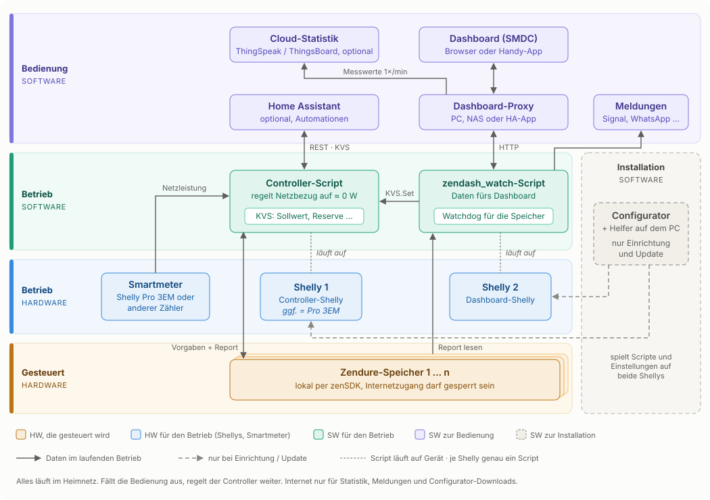

:de: **Deutsch** · [:gb: English](architektur_EN.md) · [:fr: Français](architektur_FR.md)

# So arbeiten die Teile zusammen

Die Suite besteht aus drei Schichten: unten deine Geräte, in der Mitte zwei Shellys mit je einer festen Aufgabe, oben alles zum Bedienen und Auswerten. Alles läuft in deinem Heimnetz – eine Cloud brauchst du nicht.

## Unten: die Geräte

**Speicher** – Deine Zendure-Speicher haben eine eingebaute lokale Schnittstelle, das **zenSDK**. Die Shellys sprechen sie direkt über die IP-Adresse an:

- `/properties/report` liefert Ladestand, Leistungen, Zellspannung, Temperatur und Grenzen wie `minSoc`.
- `/properties/write` nimmt Vorgaben an, z. B. Laden oder Entladen und mit wie viel Watt. Der Controller setzt dabei `smartMode: 1`, damit die häufigen Vorgaben nicht in den Flash-Speicher des Geräts geschrieben werden.

Für den laufenden Betrieb brauchen die Speicher kein Internet. Du kannst ihnen den Zugang im Router sperren.

**Stromzähler** – Der Controller muss wissen, wie viel gerade aus dem Netz kommt oder hineingeht. Am einfachsten läuft er direkt auf einem **Shelly Pro 3EM** – dann sind Zähler und Controller-Shelly dasselbe Gerät. Alternativ liest er ein anderes Smartmeter über das Netzwerk (`http_json`), siehe [Controller](Controller/readme.md).

Tipp: Gib Speichern und Shellys im Router feste IP-Adressen.

## Mitte: zwei Shellys

**Shelly 1 – Controller** regelt. Er misst alle paar Sekunden den Netzbezug und verteilt Laden und Entladen auf deine Speicher, sodass möglichst nichts eingespeist und nichts bezogen wird. Er arbeitet völlig selbstständig.

**Shelly 2 – zendash_watch** zeigt an und passt auf. Er liefert die Daten fürs Dashboard, gibt Änderungen aus dem Dashboard an den Controller weiter und überwacht als Watchdog deine Speicher. Meldungen (Akku voll, Übertemperatur, Unterspannung, Ausfall) kommen per Signal, WhatsApp oder Webhook. Fällt die Zellspannung unter die Schwelle, sperrt er zusätzlich das Entladen.

**KVS** – Die Einstellungen, die du im laufenden Betrieb änderst (Sollwert, Reserve, Entladen erlaubt …), liegen in der KVS des Controller-Shellys. Der Controller liest sie in jedem Regelzyklus – Änderungen wirken also nach wenigen Sekunden, ohne Neustart.

Auf jedem Shelly läuft **genau ein Script**. Shellys haben wenig Script-Speicher; zwei Scripte auf einem Gerät können sich gegenseitig zum Absturz bringen.

## Oben: bedienen und auswerten

**Dashboard-Proxy** – ein kleines Programm auf PC, Raspberry Pi, NAS oder als Home-Assistant-App. Es stellt das [Dashboard](zendash_watch_API_ZenSDK/dashboard.md) bereit und leitet dessen Anfragen an Shelly 2 weiter. Der Browser spricht also nie direkt mit den Shellys.

**Dashboard (SMDC)** – die Webseite im Browser oder als App auf dem Handy-Startbildschirm: Live-Werte, Sollwert, Reserve, manuelles Laden.

**Cloud-Statistik (optional)** – Der Proxy schickt auf Wunsch jede Minute die Messwerte an [ThingSpeak](zendash_watch_API_ZenSDK/thingspeak.md) und/oder [ThingsBoard](zendash_watch_API_ZenSDK/thingsboard.md) – auch selbst betrieben im Heimnetz. Übertragen werden nur Messwerte, keine Namen, Adressen oder Seriennummern. Ist kein Upload eingeschaltet, fragt der Proxy nichts ab. Für lückenlose Verläufe muss er dauerhaft laufen (NAS oder Home Assistant).

**Home Assistant (optional)** – liest und schreibt die KVS des Controllers direkt per REST (`KVS.GetMany`, `KVS.Set`). So kannst du Sollwert, Reserve & Co. auch aus Automationen steuern.

## Einrichten und aktualisieren

Der **[Configurator](Multiconfigurator/readme.md)** mit Helfer läuft auf deinem Rechner. Er prüft den freien Speicher der Shellys, erzeugt die Einstellungen, lädt die Scripte von GitHub und spielt sie auf. Für Updates vergleicht er die Versionen auf den Shellys mit den aktuellen auf GitHub. Im Alltag wird er nicht gebraucht.

## Was passiert, wenn etwas ausfällt?

| Fällt aus … | Folge |
|---|---|
| Proxy oder PC | Kein Dashboard, keine Statistik. **Die Regelung läuft weiter.** |
| Internet | Keine Statistik, keine Meldungen per Signal/WhatsApp. Regelung und Dashboard laufen weiter. |
| Shelly 2 (zendash_watch) | Kein Dashboard, keine Meldungen. **Die Regelung läuft weiter.** |
| Ein Speicher | Der Controller regelt mit den übrigen weiter, der Watchdog meldet den Ausfall. |
| Shelly 1 (Controller) | Keine Regelung mehr. Das Dashboard kann keine Einstellungen mehr ändern. |

## Weiterlesen

- [Was die Suite kann](szscs.md)
- [Controller](Controller/readme.md) · [Controller im Alltag](Controller/benutzerdoku.md)
- [zenDash-API + Watchdog](zendash_watch_API_ZenSDK/readme.md) · [API-Referenz](zendash_watch_API_ZenSDK/API.md)
- [Kompatible Geräte](kompatible_geraete.md) · [Speicherbedarf](zendash_speichermodell.md)
