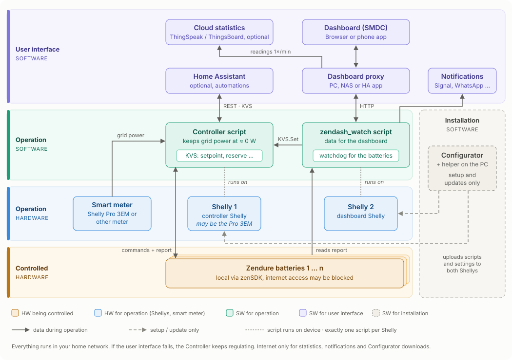

[:de: Deutsch](architektur.md) · :gb: **English** · [:fr: Français](architektur_FR.md)

# How the parts work together

The suite separates five areas – each has its own colour in the diagram:

| Colour | Area | What belongs to it |
|---|---|---|
| Amber | **Hardware being controlled** | your Zendure batteries |
| Blue | **Hardware for operation** | Shelly 1, Shelly 2, smart meter |
| Teal | **Software for operation** | Controller script, zendash_watch script |
| Purple | **Software for the user interface** | dashboard, dashboard proxy, Home Assistant, statistics, notifications |
| Grey | **Software for installation** | Configurator with helper |

Regulation needs only amber, blue and teal. Everything purple is convenience and may fail. Grey is only needed for setup and updates. Everything runs in your home network – no cloud needed.

## Hardware being controlled: the batteries

Your Zendure batteries have a built-in local interface, the **zenSDK**. The scripts talk to it directly via its IP address:

- `/properties/report` returns state of charge, power values, cell voltage, temperature and limits such as `minSoc`.
- `/properties/write` accepts commands, e.g. charge or discharge and with how many watts. The Controller sets `smartMode: 1` so the frequent commands are not written to the device's flash memory.

The batteries do not need internet access for normal operation. You can block it in your router.

## Hardware for operation: Shellys and smart meter

**Smart meter** – The Controller needs to know how much power is currently drawn from or fed into the grid. The simplest option is a **Shelly Pro 3EM** – smart meter and Shelly 1 are then the same device. Alternatively, another smart meter is read over the network (`http_json`), see [Controller](Controller/readme_EN.md).

**Shelly 1 (controller Shelly)** – hosts the Controller script and its settings (KVS).

**Shelly 2 (dashboard Shelly)** – hosts the zendash_watch script.

**Exactly one script** runs on each Shelly. Shellys have little script memory; two scripts on one device can crash each other. That is why there are always two Shellys.

Tip: give the batteries and Shellys fixed IP addresses in your router.

### Two variants

**With a Shelly Pro 3EM** – The Pro 3EM is smart meter and Shelly 1 at the same time. Shelly 2 is added.

**With another smart meter** – Shelly 1 is any Shelly and reads the smart meter over the network. Shelly 2 is added – so here too, two Shellys.

## Software for operation: two scripts

The **Controller script** (on Shelly 1) regulates. Every few seconds it reads the grid power from the smart meter and distributes charging and discharging across your batteries so that as little as possible is fed in or drawn. It works completely on its own.

**KVS** – The settings you change during operation (setpoint, reserve, discharge allowed …) are stored in the KVS of Shelly 1. The Controller script reads them in every control cycle, so changes take effect within a few seconds, without a restart. The KVS is the only place where the user interface affects regulation.

The **zendash_watch script** (on Shelly 2) displays and watches. It reads the battery reports, provides the data for the dashboard and writes changes from the dashboard to the Controller's KVS (`KVS.Set`). As a watchdog it monitors your batteries and reports battery full, overtemperature, undervoltage or failure. If the cell voltage drops below the threshold, it also blocks discharging.

## Software for the user interface

**Dashboard proxy** – a small program on a PC, Raspberry Pi, NAS or as a Home Assistant app. It serves the [dashboard](zendash_watch_API_ZenSDK/dashboard_EN.md) and forwards its requests to the zendash_watch script. The browser never talks to the Shellys directly.

**Dashboard (SMDC)** – the web page in the browser or as an app on your phone's home screen: live values, setpoint, reserve, manual charging.

**Notifications** – The zendash_watch script sends alerts via Signal, WhatsApp or webhook.

**Cloud statistics (optional)** – On request, the proxy sends the readings every minute to [ThingSpeak](zendash_watch_API_ZenSDK/thingspeak.md) and/or [ThingsBoard](zendash_watch_API_ZenSDK/thingsboard.md) (German) – also self-hosted in your home network. Only readings are transferred, no names, addresses or serial numbers. If no upload is enabled, the proxy does not poll anything. For gap-free history it must run permanently (NAS or Home Assistant).

**Home Assistant (optional)** – reads and writes the Controller's KVS directly via REST (`KVS.GetMany`, `KVS.Set`). This lets you control setpoint, reserve and more from automations.

## Software for installation

The **[Configurator](Multiconfigurator/readme_EN.md)** with the helper runs on your computer. It checks the free memory of the Shellys, creates the settings, downloads the scripts from GitHub and uploads them to both Shellys. For updates it compares the versions on the Shellys with the current ones on GitHub. It is not needed in everyday operation.

## What happens if something fails?

| If this fails … | Area | Result |
|---|---|---|
| Proxy or PC | user interface | No dashboard, no statistics. **Regulation continues.** |
| Internet | – | No statistics, no Signal/WhatsApp notifications. Regulation and dashboard continue. |
| Shelly 2 (zendash_watch) | operation | No dashboard, no notifications. **Regulation continues.** |
| One battery | controlled | The Controller keeps regulating with the others, the watchdog reports the failure. |
| Shelly 1 (Controller) | operation | No more regulation. The dashboard can no longer change settings. |

## Read more

- [What the suite can do](szscs_EN.md)
- [Controller](Controller/readme_EN.md)
- [zenDash API + Watchdog](zendash_watch_API_ZenSDK/readme_EN.md) · [API reference](zendash_watch_API_ZenSDK/API.md) (German)
- [Compatible devices](kompatible_geraete_EN.md) · [Memory requirements](zendash_speichermodell.md) (German)
