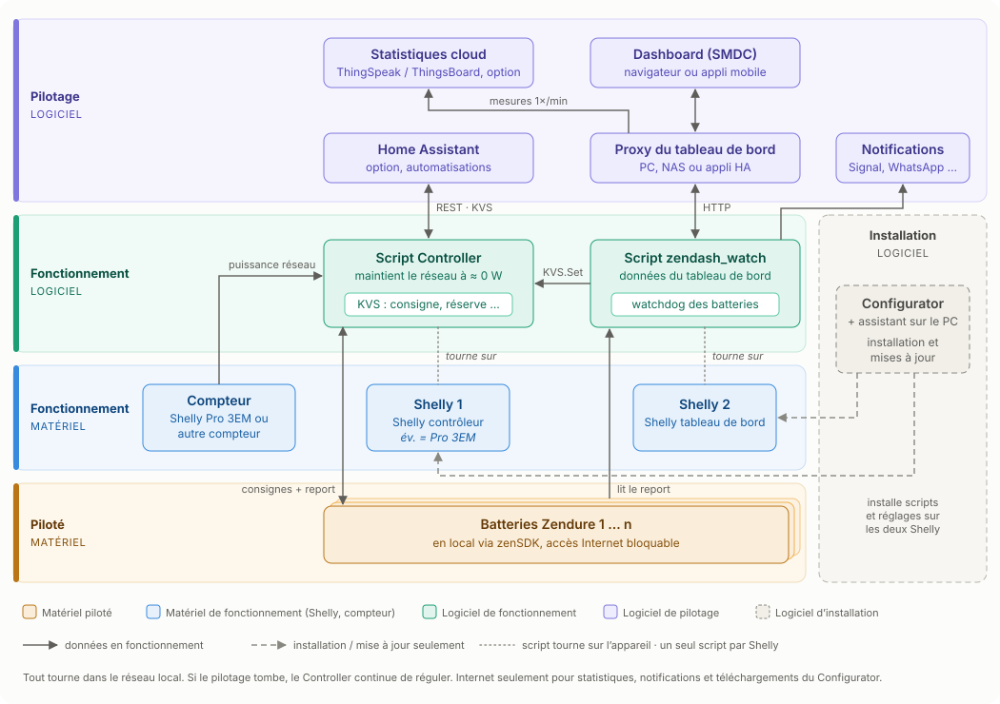

[:de: Deutsch](architektur.md) · [:gb: English](architektur_EN.md) · :fr: **Français**

# Comment les éléments fonctionnent ensemble

La suite comporte trois couches : en bas vos appareils, au milieu deux Shelly ayant chacun une tâche fixe, en haut tout ce qui sert à piloter et à analyser. Tout tourne dans votre réseau local – aucun cloud n'est nécessaire.

## En bas : les appareils

**Batteries** – Vos batteries Zendure disposent d'une interface locale intégrée, le **zenSDK**. Les Shelly s'adressent directement à elle via son adresse IP :

- `/properties/report` renvoie l'état de charge, les puissances, la tension des cellules, la température et des limites comme `minSoc`.
- `/properties/write` reçoit les consignes, par ex. charger ou décharger et avec combien de watts. Le Controller utilise `smartMode: 1` afin que les consignes fréquentes ne soient pas écrites dans la mémoire flash de l'appareil.

Les batteries n'ont pas besoin d'Internet pour fonctionner. Vous pouvez leur bloquer l'accès dans votre routeur.

**Compteur** – Le Controller doit savoir combien d'énergie est prélevée sur le réseau ou injectée. Le plus simple : il tourne directement sur un **Shelly Pro 3EM** – compteur et Shelly contrôleur sont alors le même appareil. Sinon, il lit un autre compteur intelligent via le réseau (`http_json`), voir [Controller](Controller/readme_FR.md).

Conseil : attribuez des adresses IP fixes aux batteries et aux Shelly dans votre routeur.

## Au milieu : deux Shelly

**Shelly 1 – Controller** régule. Toutes les quelques secondes, il mesure la puissance réseau et répartit charge et décharge entre vos batteries, de sorte que le moins possible soit injecté ou prélevé. Il fonctionne de manière totalement autonome.

**Shelly 2 – zendash_watch** affiche et surveille. Il fournit les données du tableau de bord, transmet au Controller les modifications faites dans le tableau de bord et surveille vos batteries en tant que watchdog. Les notifications (batterie pleine, surchauffe, sous-tension, panne) sont envoyées par Signal, WhatsApp ou webhook. Si la tension des cellules passe sous le seuil, il bloque en plus la décharge.

**KVS** – Les réglages que vous modifiez en fonctionnement (consigne, réserve, décharge autorisée …) sont stockés dans le KVS du Shelly contrôleur. Le Controller les lit à chaque cycle de régulation – les modifications prennent donc effet en quelques secondes, sans redémarrage.

**Un seul script** tourne sur chaque Shelly. Les Shelly disposent de peu de mémoire pour les scripts ; deux scripts sur un même appareil peuvent se faire planter mutuellement.

## En haut : piloter et analyser

**Proxy du tableau de bord** – un petit programme sur PC, Raspberry Pi, NAS ou en tant qu'application Home Assistant. Il fournit le [tableau de bord](zendash_watch_API_ZenSDK/dashboard_FR.md) et transmet ses requêtes au Shelly 2. Le navigateur ne communique donc jamais directement avec les Shelly.

**Tableau de bord (SMDC)** – la page web dans le navigateur ou en application sur l'écran d'accueil du téléphone : valeurs en direct, consigne, réserve, charge manuelle.

**Statistiques cloud (option)** – Sur demande, le proxy envoie chaque minute les mesures à [ThingSpeak](zendash_watch_API_ZenSDK/thingspeak.md) et/ou [ThingsBoard](zendash_watch_API_ZenSDK/thingsboard.md) (allemand) – y compris auto-hébergé dans votre réseau local. Seules des mesures sont transmises, aucun nom, adresse ou numéro de série. Si aucun envoi n'est activé, le proxy n'interroge rien. Pour un historique sans trous, il doit tourner en permanence (NAS ou Home Assistant).

**Home Assistant (option)** – lit et écrit directement le KVS du Controller via REST (`KVS.GetMany`, `KVS.Set`). Vous pouvez ainsi piloter consigne, réserve, etc. depuis des automatisations.

## Installation et mises à jour

Le **[Configurator](Multiconfigurator/readme_FR.md)** avec l'assistant local tourne sur votre ordinateur. Il vérifie la mémoire libre des Shelly, crée les réglages, télécharge les scripts depuis GitHub et les installe. Pour les mises à jour, il compare les versions présentes sur les Shelly avec les versions actuelles sur GitHub. Il n'est pas nécessaire au quotidien.

## Que se passe-t-il en cas de panne ?

| En panne … | Conséquence |
|---|---|
| Proxy ou PC | Pas de tableau de bord, pas de statistiques. **La régulation continue.** |
| Internet | Pas de statistiques, pas de notifications Signal/WhatsApp. Régulation et tableau de bord continuent. |
| Shelly 2 (zendash_watch) | Pas de tableau de bord, pas de notifications. **La régulation continue.** |
| Une batterie | Le Controller continue avec les autres, le watchdog signale la panne. |
| Shelly 1 (Controller) | Plus de régulation. Le tableau de bord ne peut plus modifier les réglages. |

## Pour aller plus loin

- [Ce que fait la suite](szscs_FR.md)
- [Controller](Controller/readme_FR.md)
- [zenDash API + Watchdog](zendash_watch_API_ZenSDK/readme_FR.md) · [Référence API](zendash_watch_API_ZenSDK/API.md) (allemand)
- [Appareils compatibles](kompatible_geraete_FR.md) · [Besoins en mémoire](zendash_speichermodell.md) (allemand)
