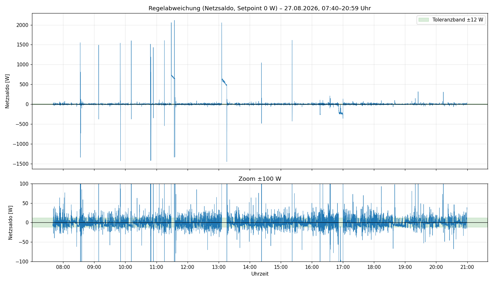

# Insight Shelly-Multi-Device Controller Prinzipien 

Der Shelly Multi Device Controller (**SMDC**) folgt folgenden Designprinzipien, die in Folge erläutert werden. Die Reihenfolge gibt dabei auch eine Priorisierung vor, ist also nicht zufällig gewählt

- ✅ Stabilität first ! 
- ✅ Nulleinspeisung second! 
- ✅ Effizienz third!
- ✅ systemweiter Bypass (new)
- ✅ Erhalt der Leistungsfähigkeit des Gesamtsystems (SoC-Balancing)
- ✅ Schnittstellenfähig (kann in externe Automatisierungen einbezogen werden)

## 1️⃣ Stabilität

Herausforderungen sind:

- asynchrone Requests, die Kommunikation mit den Solarflows erfolgt ausschließlich über asynchrone REST-Calls
    - Das Senden und Empfangen ist also entkoppelt, Antworten kommen irgendwann oder auch nie
    - begrenzte Aufnahmefähigkeit des Shelly Environments (der "Briefkasten" zum Versenden von Requests ist voll und das führt unweigerlich zum Absturz)

Der Anspruch ist:

- **24/7 (läuft immer)** ✅ 
    - Requests werden seriell versendet (schützt den "Briefkasten")  
    - der Watchdog (ein Buchhalter) überwacht das Regelintervall. Werden die Arbeiten in einem Intervall nicht abgeschlossen, wird kein neues Intervall gestartet (schützt den Shelly vor Überlastung)
    - alte Antworten werden einfach verworfen
        - asynchron heißt "der Brief ist raus" ..."schauen wir mal wann die Antwort kommt"
        - der Controller stellt sicher (über einen Zähler) dass nur passende Antworten im Intervall verarbeitet werden, Antworten aus alten Intervallen werden einfach verworfen
- **TakeOver und Fehlertoleranz** ✅ - ein nicht verfügbares Gerät wird sofort ersetzt, d.h. seine Lasten werden von anderen Geräten übernommen
    - WLAN-Aussetzer oder andere Probleme machen Solarflows ggf. nicht verfügbar. Das erkennt der Controller sofort und nimmt das Gerät sofort aus der Lastverteilung, merkt man nicht, steht aber im Log
- **Transparent** ✅  "Sag Bescheid wenn's schlimm ist, ansonsten halt die Klappe" - ein Kommunikationsmodul informiert sofort über Ausnahmesituationen
    - Fehler in der Kommunikation kommen häufiger vor als man denkt (httpGetError), sind aber meist unkritisch, eine serielle Häufung kann aber kritisch sein
    - je Fehlertyp gibt es einen Fehlerzähler (`errorThreshold`). Wenn dieser Wert überschritten ist, geht eine Meldung raus (an Whatsapp/Signal oder als Webhook), die Fehlerbehebung (meist magische Selbstheilung) wird auch berichtet
    - die beste Meldung ist **keine** Meldung

Das neueste Konzept (**Skipmode**) ✅  ist: "Frage die Solarflows nur dann, wenn sich der Gridwert (Smartmeter) zu weit weg bewegt von seinem Sollwert (meist NULL)". Dies entlastet massiv die jeweiligen Endpunkte im Shelly und den Solarflows. Im Tagesbetrieb werden bis zu 40% weniger Anfragen gestellt, im Nachtbetrieb bis zu 60% weniger Anfragen, ganz ohne Einfluss auf Regelgeschwindigkeit.

## 2️⃣ Nulleinspeisung und Nullbezug

**Begriffe**

- Nulleinspeisung - nichts ins Netz abgeben
- Nullbezug - nichts aus dem Netz beziehen

Defacto kann der Controller beides.

Die Verbraucher takten immer schneller als die Regelhardware (Solarflows) reagieren kann (3 Sek Reaktionszeit). Der Gridwert (Smartmeter) pendelt daher ständig auf und ab um den geplanten Sollwert. Auch ohne Regelung würde man ein ständiges Flattern beobachten können.

Die **Regelhardware** müsste doppelt so schnell reagieren können, um jede Änderung just in time auszugleichen. Das kann sie aber nicht.

Konzepte zur Regelung, die vom Controller umgesetzt sind: 

- Das **Regelintervall** (Standard 4000 ms) ✅ 
    - bestimmt die Taktrate des Reglers
    - Die Reaktionszeit der Solarflows ist größer 3 Sekunden, ein schnellerer Takt macht also gar keinen Sinn.
    - ein zu enger Takt bei vielen Solarflows sorgt im Zweifel für Überlastung. Der Watchdog sorgt für das Aussetzen des nächsten Taktes, unter diesen Aspekten sind stabile 4500ms besser, als ständige verschobene 4000ms Intervalle (siehe Gesamtdoku für mehr Hinweise)
- **Sollwert** ✅ (Standard 0W)
    - Sollwert ins Plus (z.B. 20W) verschiebt das Pendeln in den Plus-Bereich (Nulleinspeisung)
    - Sollwert ins Negative (z.B. -20W) verschiebt das Pendeln in den Negativ-Bereich (Nullbezug)
- **Hysterese** ✅ (oder Deadband, Standard 12W) 
    - ein Band, das um den Sollwert gelegt wird, in dem KEINE Regelaktionen stattfinden
    - Sollwert 0W und Hysterese 12W bedeutet: zwischen -12W und +12W findet keine Regelaktion statt.
    - entlastet massiv die Endpunkte der Solarflows
    - verhindert, dass die Solarflows das Flattern des Gridwertes nachvollziehen, was ihnen eh nie gelingt.
    - 12W ist ein sehr guter Kompromiss zwischen Genauigkeit, Regellast, Schreibhäufigkeit auf die Solarflows, (immer die 3 Sekunden Reaktionszeit der Solarflows im Kopf behalten)
- **Damping** ✅ (Standard 0,65)
    - die Sollwertabweichung wird nie 1:1 durchgereicht, weil das für massives Überschwingen der Regelwerte sorgt, ein Pendeln zwischen -1000W und +1000W ist möglich
    - Was bedeutet Damping = 0,65?
        - eine Sollwertabweichung von 100W wird nur mit Faktor 0,65 (65W) weitergegeben.
        - nach drei Takten (falls sich der Verbrauch nicht ändert) beträgt die Abweichung vom Sollwert exakt 4,2% (oder 4,2W im gegeb. Beispiel)
        - Damping trägt massiv zur Beruhigung der Regelaktivitäten bei
        - Damping hoch => Beschleunigung aber im Zweifel sehr unruhig mit heftigem Überschwingen; 
        - Damping runter => Verlangsamung aber viel ruhiger, die Regelung springt nicht jeder (kurzfristigen) Änderung hinterher.
        - der Controller begrenzt Damping auf 0,4 bis 0,8 (Werte außerhalb werden auf die jeweilige Grenze gesetzt)

## 3️⃣ Effizienz

Ein User hat uns hier die wunderbaren Effizienzkurven gebaut für SF2400AC/SF2400AC+. So ähnlich sieht das bei allen Solarflows aus.
Unterhalb 20 bis 30% Auslastung geht der Wirkungsgrad in den Keller.

Wichtig: 

- DC/AC Verluste (PV-Haus oder Akku-Akku) sind hoch im niedrigen Lastbereich 
- DC/DC Verluste (PV-Akku) sind im Vergleich dazu verschwindend gering

Der Controller setzt daher um:

- **Once Only Prinzip** ✅ 
    - wenn ein Solarflow die Last (Laden oder Entladen) tragen kann, dann soll er es tun, bis an seine eigene Lastgrenze
    - erst wenn EINER nicht mehr reicht, kommen ALLE ins Spiel (**Alle für Einen** Haushalt)
    - Vermieden wird dabei ein wildes Zu-/Abschalten, hier gibt es eine spezielle Deadzone, die das verhindert
    - Ein Cooldowntimer (mind. 3 Takte) verhindert ein zu schnelles Wechseln der Richtung (Laden/Entladen), das ist besonders wichtig, weil es immer die Überschwinger in einer Regelung gibt bei großen Lastwechseln. Ohne die Cooldowntakte würde der Controller sofort z.B. von Entladen auf Laden wechseln. Diese Überschwinger sind aber Fehlsignale, die mit den Cooldowntakten ausgesessen werden.
  
**Anbei eine beispielhafte Betrachtung zum Wirkungsgrad (etwas plakativ)**

**Beispiel:**

- drei Solarflows mit PV Eingang
- je 200W PV Eingang
- Hauslast aktuell 240W

**Wie aufteilen?**
Ganz häufige Erwartung ist

- auf jeden Fall erst PV von allen drei nutzen, Rest in den Speicher !

| Position         | Dev1 | Dev2 | Dev3 | Hauslast |
|------------------|------:|------:|------:|----------:|
| Summe PV         |   200 |   200 |   200 |       600 |
| in Speicher      |    90 |    90 |    90 |       270 |
| WR-Verlust       |    30 |    30 |    30 |        90 |
| Hauseinspeisung  |    80 |    80 |    80 |       240 |
| Modus            | Entladen|Entladen|Entladen||

von 600W PV/DC gehen 330W DC direkt zu den Wechselrichtern, von denen nur 240W AC im Haus ankommen  (DC/AC), der Rest (270W DC) geht in den Speicher.
Pro Gerät müssen also 110W für 80W Einspeisung aufgewendet werden => Wirkungsgrad: 72%

**Der Controller** verfolgt mit dem **OnceOnly Prinzip** einen anderen Ansatz

| Position         | Dev1 | Dev2 | Dev3 | Hauslast |
|------------------|-----:|-----:|-----:|---------:|
| Summe PV         |  200 |  200 |  200 |      600 |
| in/aus Speicher  |  200 |  200 |  -70 |      330 |
| WR-Verlust       |    0 |    0 |   30 |       30 |
| Hauseinspeisung  |    0 |    0 |   240|      240 |
| Modus            | Laden|Laden|Entladen||

Es werden in einem Gerät 270W für 240W Einspeisung (Effizienz: 88%) benötigt. Die anderen beiden laden verlustfrei(arm) ihre Akkus

Man braucht nur die beiden Fälle nebeneinander legen:

- Es landet mehr im Speicher!
- Weniger Verluste entstehen!
- Bedienung der Nulleinspeisung ohne Einschränkung!

Daher ist es völlig ok, wenn (im Beispiel)
**Zwei Geräte "LADEN"**, 
**während ein Gerät am "ENTLADEN" ist, und dabei die Akkus nutzt.** (Das sorgt bei vielen immer wieder für totale Verwirrung, ist aber aus Effizienzsicht total logisch.)

Ontop kommt das Konzept des **"SoC-Balancings"** dazu, das sicherstellt, dass die Akkustände nicht zu weit auseinanderlaufen, d.h. der Controller selbst sorgt für einen Wechsel, indem (beispielhaft Dev1 oder Dev2) übernimmt, wenn der SoC-Abstand einen definierten Schwellwert überschreitet. 
Das kann man an der folgenden Grafik schön sehen. Hier wechseln sich zwei Systeme im Single-Betrieb brav ab.

Die Analogie ist anwendbar für die reinen AC-Lader...Ladelast wird erst aufgeteilt, wenn ein Gerät die Last nicht bewältigen kann.

## 4️⃣ Erhalt der Leistungsfähigkeit des Gesamtsystems

- **dynamische Lastverteilung nach "Wasserstand"** ✅
    - der Controller sorgt dafür, dass die Gesamtleistung des Systems so lange wie möglich erhalten bleibt, dies bedeutet die Regelung beachtet die Kapazitäten der Akkustapel kontinuierlich.
    - Single Betrieb
        - Das Gerät mit dem größten SoC wird im "Single"-Betrieb zum Entladen herangezogen
        - Das Gerät mit dem niedrigsten SoC wird im "Single"-Betrieb zum Laden herangezogen
    - Split Betrieb (alle Solarflows arbeiten zusammen)
        - Geräte mit höherem Füllstand müssen mehr liefern (entladen)
        - Geräte mit niedrigerem Füllstand erhalten den größeren Ladeanteil (AC-Lader)
    - gehen Solarflows an die Leistungsgrenzen, wird der verbleibende Lastanteil auf die anderen Geräte (so möglich) verteilt (besonders bei Kombis SF800/SF2400 relevant).

Auch hier kommt das Konzept des **"SoC-Balancings"** sehr zum Tragen, das sicherstellt, dass die Akkustände nicht zu weit auseinanderlaufen, d.h. der Controller selbst sorgt für einen Wechsel, indem (beispielhaft Dev1 oder Dev2) übernimmt, wenn der SoC-Abstand einen definierten Schwellwert überschreitet. Wer den Controller nutzt wird am Morgen feststellen, dass die Akkustapel ziemlich gleiche Akkustände haben.

---

**Spezialfall Bypass** ✅ 

**Achtung:** "Export erlaubt" bedeutet die Solarflows befinden sich im Bypass und leiten ihre komplette PV-Leistung ins Netz.  

Das ist die erste Regelung, die **Bypass als systemweite Funktion** versteht und nicht nur als gerätespezifische Funktion.

Folgendes unterstützt der Controller im Modus "dynamic"

**Wenn**

- Geräte, die die Ladegrenze (`maxSoc`, meist 100%) erreicht haben, **und**
- Überschuss exportieren dürfen, **und** 
- AC Laden dürfen

**Dann**

- können sich die Solarflows **gegenseitig beim Laden** der Akkus unterstützen.

**Beispiel**:

- 3 Solarflows, zwei bei 100%, einer bei 60%: Der mögliche Überschuss der beiden 100%er kann als Ladebefehl an den 60%er abgegeben werden

So verpufft keine PV-Leistung. Sind alle Akkustapel bei 100%, wird der Export "Verboten" für ALLE Solarflows und erst bei Unterschreiten einer SoC-Grenze wieder aufgehoben.

Der Controller verwaltet die Einstellungen der Solarflows.

Konfiguriert werden kann:

- Export/Bypass immer verbieten (Solarflows liefern nur Hausbedarf, unterstützen sich aber nicht gegenseitig)
- Export/Bypass immer erlauben (Solarflows liefern alles, was die Panele hergeben)
- Export/Bypass dynamisch steuern (Mischung aus Erlauben und Verbieten, solange die Akkus und der Haushalt davon profitieren)

**Achtung** 
Einige Solarflows verhalten sich schon **vor der Bypass-Schaltung** zickig (SF2400Pro)....Diese fangen an die PV und oder AC-Ladeleistung zu drosseln. Das ist schon ein unregelbarer Zustand der Solarflows. Der Controller kann das nicht übersteuern. **Auswirkung: Hier wird für ganz kurze Zeit im Zweifel die Nulleinspeisung durchbrochen**

## 5️⃣ flexible Schnittstelle

Aktuell ist der Controller mit folgender Schnittstelle versehen 
Der Shelly-KVS kann von außen (per Curl, RPC-Calls) angesprochen werden. (siehe Gesamtdokumentation)

On-the-fly kann verändert werden:

systemweit

- Sollwert ✅

gerätespezifisch

- Reserve (`minSoc`) ✅
- Laden erlauben/verbieten ✅
- Entladen erlauben/verbieten ✅
- AC-Ladeleistung (für manuelles Laden der Solarflows) ✅

Nicht geplant sind:

- integrierte Preisfunktionen
- integrierte Timerfunktionen

## Fazit

- 1️⃣ Ohne Stabilität geht gar nichts!
- 2️⃣ Die Null soll stehen!
- 3️⃣ Höchste Effizienz sorgt für maximalen Nutzen im Haushalt !
- 4️⃣ Idealerweise steht die kombinierte Leistung bis zur Reserve (`minSoc`) gemeinsam zur Verfügung !
- 5️⃣ Der SMDC kann in externe Automatisierungen eingebunden werden.

## Weiterführende Links

- 📖 [Vollständige technische Dokumentation](https://surfer1264.github.io/Zendure-Stuff/Controller/gesamtdoku/)
- 🧭 [Getting-Started-Wiki](https://github.com/surfer1264/Zendure-Stuff/wiki/Shelly-Zendure-Muli-Device-Controller-‐-Getting-Started)
- 🛠️ [Konfigurationsassistent](https://raw.githack.com/surfer1264/Zendure-Stuff/main/shelly_script/Multiconfigurator/zendure-multi-configurator_multilang.html)
- 💬 Fragen & Austausch: [GitHub Discussions](https://github.com/surfer1264/Zendure-Stuff/discussions)
- 🐛 Probleme melden: [GitHub Issues](https://github.com/surfer1264/Zendure-Stuff/issues)
- [ab Version 4.x.x Script herunterladen](https://github.com/surfer1264/Zendure-Stuff/blob/main/shelly_script/Controller/zerooutput_multi_kvs_mini.js) Minifier eingesetzt