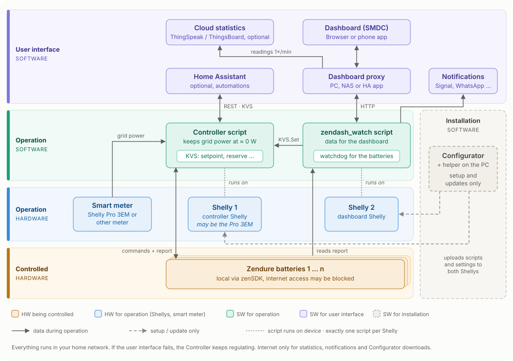

[:de: Deutsch](readme.md) · :gb: **English** · [:fr: Français](readme_FR.md)

# Control Zendure batteries locally – with two Shellys

Your Zendure batteries (zenSDK-capable devices from SolarFlow 800 onwards) are controlled without the cloud: one Shelly keeps your grid draw at zero, a second one provides the data for a dashboard and alerts you when something is wrong. What the suite can do in detail: **[What the suite can do](szscs_EN.md)**.

## 👉 Start here

1. **[Download the helper](https://github.com/surfer1264/Zendure-Stuff/releases/latest)** (Windows or Mac with Apple Silicon) and start it.
2. The Configurator opens in your browser. Choose **"Configure from scratch or update manually"** and answer the questions.
3. Finally click **"⚡ Upload directly"** – done.

Detailed instructions (including updates, replacing a Shelly and error messages) can be found with the **[Configurator](Multiconfigurator/readme_EN.md)** · [Deutsch](Multiconfigurator/readme.md) · [Français](Multiconfigurator/readme_FR.md)

## What you need

Two Shellys, a smart meter and zenSDK-capable batteries – which devices work is listed under **[Compatible devices](kompatible_geraete_EN.md)**. How many batteries the dashboard script can handle is shown in the [memory requirements](zendash_speichermodell.md) (German).

## How the system is structured

Explained in detail – area by area and what happens if something fails: **[How the parts work together](architektur_EN.md)**.

| Shelly | Script | Task |
|---|---|---|
| **Controller Shelly** | [Controller](Controller/readme_EN.md) | controls charging and discharging of your batteries |
| **Dashboard Shelly** | [zenDash API + Watchdog](zendash_watch_API_ZenSDK/readme_EN.md) | provides the data for the dashboard and reports battery full, overtemperature, undervoltage or failures |

On top of that there is the **[Configurator](Multiconfigurator/readme_EN.md)** with the helper on your computer: it handles initial configuration, updates and log recording for both Shellys.

**Exactly one script** runs on each Shelly. Shellys have little script memory – two scripts on one device can crash each other.

The **[Dashboard](zendash_watch_API_ZenSDK/dashboard.md)** (German) itself is a web page that you open via a small proxy on a PC, NAS or Home Assistant.

## Further tools

| Folder | Purpose |
|---|---|
| [Script_poller](Script_poller/readme.md) (German) | long-term measurement of memory and CPU of a Shelly script, log recording over hours (for troubleshooting and development) |
| [testController](testController/README.md) (German) | test environment for the Controller (for developers) |
| [thingsboard](thingsboard) | ready-made dashboards and rule chains for import into ThingsBoard, matching the [ThingsBoard upload](zendash_watch_API_ZenSDK/thingsboard.md) (German) |
| [Einordnung](Einordnung.md) (German) | comparison with other multi-device solutions (ioBroker, Z-HA, EMS SolarFlow …) |

## Terms

| Term | Meaning |
|---|---|
| **Battery** | your Zendure device (SolarFlow 800, SolarFlow 2400 Pro …) |
| **Controller** | the control script `zerooutput_multi_kvs` |
| **Helper** | small program for your computer that starts the Configurator and uploads the scripts to the Shellys |
| **KVS** | key-value store in the Shelly for settings you can change during operation (e.g. from the dashboard) |

More background can be found in the [system overview (S-Z-S-C-S)](szscs_EN.md).

## Notes on use

- The suite is a private community project, not a product of Zendure or Shelly. It is provided free of charge and without warranty ([MIT license](https://github.com/surfer1264/Zendure-Stuff/blob/main/LICENSE)).
- It controls real charging and discharging power. You use it on your own responsibility and check after setup that your system behaves as expected.
- Rules for grid connection and feed-in (e.g. registration, feed-in limits) still apply. The suite does not release you from them.
- Whether running third-party software affects the manufacturer's warranty is something to clarify with the manufacturer if in doubt.
- The authors are liable only to the extent that liability cannot be excluded by law (e.g. intent or gross negligence).
